# 🪐 OrbitoX Phase 7B.2 — Authoritative Responsive Navigation Matrix & Breakpoint Harmonization

**Specification ID:** `ARCH-7B2-05-RESPONSIVE`  
**Phase:** Phase 7B.2 — Theme Tokens & Persona Shell Architecture  
**Document Status:** Approved Architecture Contract & Owner Amendment Proposal  
**Governing Documents:** `PHASE7_UI_MASTER_BRIEF.md` (Section 3), `docs/ui-reset/03_SHELL_AND_NAVIGATION_ARCHITECTURE.md`  
**Accepted Baseline:** `f65698eab17b3a40842360eaeb387c74dca57ecc`  
**Author:** Principal Frontend & Platform Architect  
**Date:** November 17, 2026  

---

## 1. Executive Summary & Specification Conflict Analysis

Section 3 of `PHASE7_UI_MASTER_BRIEF.md` defines the responsive device matrix as follows:
- **Phone:** `< 640 px`
- **Tablet:** `640–1100 px` (with "bottom bar in portrait, rail in landscape")
- **Desktop:** `> 1100 px` (with "sidebar card")

### The Architectural Conflict:
1. **Approved Landscape Reference Viewport:** In Section 2 and Section 6.3 of the Master Brief, screens `S1` (Kitchen / KDS) and `S2` (POS Take Order & Checkout) are explicitly designated as **`tablet landscape`**.
2. **Physical Asset Resolution:** The verified concept images `Kitchen screen (KDS) · tablet landscape.png` and `POS take order & checkout · tablet landscape.png` have exact pixel dimensions of **`2388 × 1668`**. At standard Retina @2x scaling, this corresponds to an authoritative logical CSS viewport of **`1194 × 834 px`** (the native viewport of the 11-inch Apple iPad Pro in landscape orientation).
3. **The Flaw of a Naive Breakpoint:** If an engineer implements a simple CSS breakpoint `@media (min-width: 1101px)` to activate the desktop layout, the tablet landscape reference (`1194px`) will be erroneously evaluated as **Desktop**.
   - **Severe Consequence:** An expanded 260px `SidebarCard` will be forced onto the kitchen KDS and POS counter tablets, stealing vital horizontal screen real estate from order tickets and checkout grids, and directly violating the requirement that tablet landscape must render a 64px `IconRail` or zero-chrome mode.

---

## 2. Proposed Architectural Resolution: Four Authoritative Bands

Rather than relying on fragile User-Agent header sniffing or client-side JavaScript window listeners, OrbitoX establishes **four strictly non-overlapping viewport bands** aligned with industry-standard CSS container thresholds (Tailwind `sm`, `md`, `lg`, `xl`):

```mermaid
block-beta
    columns 4
    block:phone:1
        Phone["Phone Band<br/>&lt; 640px<br/>(Tailwind &lt; sm)"]
        Pill["Floating BottomTabBar<br/>max 5 items + More Sheet"]
    end
    block:tabport:1
        TabPort["Tablet Portrait<br/>640px – 1023px<br/>(Tailwind sm / md)"]
        BottomPill["Floating BottomNavPill<br/>centered bottom"]
    end
    block:tabland:1
        TabLand["Tablet Landscape<br/>1024px – 1279px<br/>(Tailwind lg)"]
        IconRail["Collapsible IconRail<br/>64px width"]
    end
    block:desktop:1
        Desktop["Desktop Band<br/>&ge; 1280px<br/>(Tailwind xl)"]
        Sidebar["SidebarCard<br/>260px expanded"]
    end
```



### 2.1 The Four Authoritative Device Test Scenarios

The four mandatory QA acceptance viewports map cleanly and deterministically:

| Test ID | Device Reference | Logical Viewport (W × H) | Pixel Ratio | Active Viewport Band | Primary Navigation Primitive | Secondary Navigation Primitive | Mandatory Layout Invariant |
| :--- | :--- | :---: | :---: | :--- | :--- | :--- | :--- |
| **VP-01** | iPhone 12/13/14 | **`390 × 844`** | 2.0 / 3.0 | **Phone** (`< 640px`) | `BottomTabBar` (floating) | `MoreNavSheet` (via drag handle) | TopBar collapsed, header actions in sheet, touch target $\ge 44\text{px}$. |
| **VP-02** | iPad Pro 11" Portrait | **`834 × 1194`** | 2.0 | **Tablet Portrait** (`640–1023px`) | `BottomNavPill` (floating) | `MoreNavSheet` (slide-over) | TopBar visible with breadcrumb, content frame padded $16\text{px}$. |
| **VP-03** | iPad Pro 11" Landscape | **`1194 × 834`** | 2.0 | **Tablet Landscape** (`1024–1279px`) | `IconRail` ($64\text{px}$ collapsed) | Tooltip / Flyout Popover | TopBar with search/profile, content frame padded $24\text{px}$. |
| **VP-04** | Desktop / MacBook | **`1440 × 900`** | 1.0 / 2.0 | **Desktop** ($\ge 1280\text{px}$) | `SidebarCard` ($260\text{px}$ expanded) | Collapsible section accordions | Full header, persistent tenant/persona context, content frame padded $32\text{px}$. |

---

## 3. Formal Owner Breakpoint Amendment Request

To reconcile the conceptual text in `PHASE7_UI_MASTER_BRIEF.md` with physical reality, the following formal amendment is submitted for owner approval:

> **Amendment UI-7B2-BP1 (Breakpoint Harmonization):**  
> *"The boundary between Tablet Landscape and Desktop is formally adjusted from `1100px` to `1280px` (`xl`). The Tablet Landscape range is defined as `1024px – 1279px` (`lg`). Viewports below `1280px` shall never render the expanded 260px desktop sidebar card, ensuring that tablet viewports (including iPad Pro 11" landscape at 1194px) consistently render the 64px icon rail or zero-chrome layout as designed."*

### Why this amendment is mathematically sound:
1. **Preserves 100% of Tablet Landscape Concepts:** Screens `S1` and `S2` at `1194px` fall unambiguously into the `1024px–1279px` band.
2. **Superior Desktop Resizing Behavior:** When a desktop user resizes their browser window or runs split-screen mode (e.g. side-by-side IDE and browser at 1100px), the layout **gracefully collapses** to the 64px `IconRail` instead of causing horizontal overflow or clipping cards.
3. **Zero JavaScript Overhead:** Implemented using pure, standard Tailwind CSS media queries (`max-sm:`, `sm:`, `md:`, `lg:`, `xl:`).

---

## 4. Behavior Across Intermediate Viewports

| Viewport Range | Physical Context | Layout Transformation & Behavior |
| :--- | :--- | :--- |
| **$0\text{px} – 639\text{px}$** | Modern smartphones (portrait & landscape) | `BottomTabBar` pinned to bottom with `env(safe-area-inset-bottom)`. Single-column card layout. Modals render as full-width `BottomSheet`. Horizontal scroll barred. |
| **$640\text{px} – 767\text{px}$** | Large foldables & small mini-tablets | Single/dual column card layout. Floating `BottomNavPill`. Modals render as centered dialogs. |
| **$768\text{px} – 1023\text{px}$** | Standard tablets portrait (iPad 10.2", iPad Pro 11") | Centered floating `BottomNavPill` ($52\text{px}$ height). Multi-column card grids (2 columns). Detail drawers render as right slide-over sheets. |
| **$1024\text{px} – 1279\text{px}$** | Tablet landscape & desktop split-screen | 64px `IconRail` docked on left. Full horizontal data tables and wide operational canvases (POS dual-pane, KDS multi-column). Detail panels render as side panels. |
| **$\ge 1280\text{px}$** | Laptops, external monitors, iMacs | Fixed 260px `SidebarCard` with active tenant context, cluster dock, and category accordions. 3–4 column grids, max-width $1280\text{px}$ or $1440\text{px}$ centered container. |

---

## 5. Touch vs. Pointer Ergonomics

To provide maximum responsiveness across hybrid touch/pointer devices (e.g. iPad Pro with Magic Keyboard, Microsoft Surface), CSS layout primitives leverage CSS Media Queries Level 4 interaction features:

```css
/* Touch-First Target Sizing for Tablets & Phones */
@media (hover: none) and (pointer: coarse) {
  .nav-touch-target {
    min-height: 48px;
    min-width: 48px;
  }
}

/* Precise Pointer Hover Effects for Desktops */
@media (hover: hover) and (pointer: fine) {
  .nav-touch-target:hover {
    background-color: var(--color-surface-raised);
    color: var(--color-text);
  }
}
```

This guarantees that physical touch targets on tablets and phones remain thumb-friendly ($\ge 44\text{px}$ / $\ge 48\text{px}$) while desktop mouse interactions enjoy subtle, high-performance hover states.
