# 🪐 OrbitoX Platform OS — Phase 7C Stage 0
# Document 01: Master Design Specification (Operations Console & System Screens)

**Milestone:** Phase 7C Operations Console & System Screens  
**Stage:** Stage 0 Architectural & Design Specification  
**Governing Baseline:** Phase 7B.2 Delivered HEAD `188680c27ce51ebb8ca6e998e504c51a24c34fa0`  
**Repository:** `Nikhil-ig/OrbitoX-Platform`  
**Author / Role:** Principal Software Architect, Senior Staff Designer & Security Engineer  
**Status:** **READY FOR OWNER REVIEW & APPROVAL GATE**

---

## 1. Executive Summary & Purpose

The **OrbitoX Operations Console** is the central nerve center for platform administrators, site reliability engineers, support operators, and compliance officers. It provides end-to-end visibility and administrative authority over the entire multi-tenant ecosystem: organizations, business projects, dynamic runtime clusters, package registries, security keys, subscription billing, audit trails, and DPDP/GDPR data rights.

Phase 7C transitions the Operations Console from disparate legacy prototypes (`/admin/*`, `/platform/*`) into a unified, hardened, production-grade operational command center hosted exclusively under the `/console/*` persona route.

```mermaid
graph TD
    subgraph OperationsConsole ["OrbitoX Operations Console (/console/*)"]
        OVERVIEW["System Overview & Fleet Health"]
        TENANTS["Organization & Tenant Management"]
        PROJECTS["Project Catalog & Runtime Factory"]
        PACKAGES["Plugin & Package Registry"]
        PROVISION["Provisioning & Job Execution Sagas"]
        SECURITY["Security Keys, Operators & RBAC"]
        BILLING["Commercial Plans, Subscriptions & Invoices"]
        AUDIT["Immutable Audit Trail & Search"]
        DATARIGHTS["Data Rights, Exports & Erasure Certs"]
        CONFIG["Global Platform Configuration & Appearance"]
    end

    subgraph CoreEngineServices ["Authoritative Backend Services"]
        SVC_OVERVIEW["OverviewService (/api/v1/platform/overview/*)"]
        SVC_TENANT["TenantsService & OrgService"]
        SVC_PROJECT["ProjectFactory & ReconcileEngine"]
        SVC_PLUGIN["PluginLifecycleService (Ed25519 Verified)"]
        SVC_PROVISION["ProvisioningSaga & OperationStore"]
        SVC_SEC["SecurityConsoleService & ApiKeyRotation"]
        SVC_BILLING["RazorpayBillingService & GraceSweepLease"]
        SVC_AUDIT["AuditConsoleService (Append-Only Role)"]
        SVC_DATA["DataRightsService (Phase 6G S3 & Certs)"]
    end

    OVERVIEW --> SVC_OVERVIEW
    TENANTS --> SVC_TENANT
    PROJECTS --> SVC_PROJECT
    PACKAGES --> SVC_PLUGIN
    PROVISION --> SVC_PROVISION
    SECURITY --> SVC_SEC
    BILLING --> SVC_BILLING
    AUDIT --> SVC_AUDIT
    DATARIGHTS --> SVC_DATA
```

---

## 2. Core Architectural Pillars

1. **Authoritative Real-Time Data (Zero Mocked Screens):**  
   Every counter, graph, status indicator, and list must be directly backed by real server actions and validated Prisma queries under restricted connection roles (`orbitox_runtime`, `orbitox_platform_admin_audit`). No hardcoded statistics or decorative cards.
2. **Phase 7B.2 Responsive Shell Primitives & Approved Breakpoints:**  
   The Console strictly inherits and consumes the accepted `ResponsiveShell` primitive with `ConsoleNavItems` and preserves the approved Phase 7B.2 4-band breakpoint boundaries:
   - **Phone:** `< 640px` (`< sm`) with sticky compact navigation, bottom bar, and `MoreNavSheet`.
   - **Tablet Portrait:** `640px` to `1023px` (`sm` to `< lg`) with off-canvas drawer navigation.
   - **Tablet Landscape:** `1024px` to `1279px` (`lg` to `< xl`) with compact 64px icon sidebar.
   - **Desktop:** `1280px` and above (`>= 1280px`, `>= xl`) with full 260px expanded navigation sidebar.
   - Minimum $44 \times 44$px touch targets enforced across all interactive controls.
3. **High-Information-Density Design with Dark Operator Theme:**  
   In alignment with concept reference `1 · Operator console — dark.png`, the console defaults to an operator-optimized dark palette (`data-theme="dark"` with persistent accent selection), high-contrast tabular data, monospaced ID tokens, and clear operational badge hierarchies.
4. **Step-Up MFA Re-Authentication for High-Risk Actions:**  
   Destructive actions—including tenant suspension, immediate tenant resumption, API key revocation, emergency operator break-glass, and organization data erasure—require re-entering TOTP MFA tokens before execution.
5. **Idempotent Operational Sagas:**  
   All multi-step provisioning, runtime scaling, and key rotation actions execute through the `PlatformOperation` saga engine with atomic lease locking and rollback capabilities.

---

## 3. High-Level Screen Map & Workstream Scope

Phase 7C covers 10 primary operational domains:
- **Screen Group A: System Overview & Telemetry:** Global node status, active database connections, message queue lag, error rates, and quick incident alerts.
- **Screen Group B: Organization & Tenant Management:** Organization lifecycle (`ACTIVE`, `SUSPENDED`, `CLOSED`), custom domains, brand preview, and branch hierarchies.
- **Screen Group C: Project Management & Runtime Factory:** Project environments (`dev`, `staging`, `prod`), template selection, runtime status, and resource drift reconciliation.
- **Screen Group D: Plugin & Package Registry:** Installed plugins, version dependencies, Ed25519 digital signature validation, and licensing state.
- **Screen Group E: Provisioning & Asynchronous Sagas:** Provisioning job queues, retry workflows, execution logs, and rollback controls.
- **Screen Group F: API Key & Integration Security:** Scoped API credentials, automated key rotation with overlap grace periods, and webhook delivery health.
- **Screen Group G: Security Center & RBAC:** Platform operators, TOTP MFA enforcement, session invalidation, and custom role permissions.
- **Screen Group H: Commercial Billing & Quotas:** Tiered plan definitions, Razorpay subscription state machine, invoice history, and preflight downgrade validation.
- **Screen Group I: Audit Trail & Compliance:** Searchable append-only audit stream with actor, IP, tenant, intent, and previous-value diffs.
- **Screen Group J: Data Rights & Privacy:** Phase 6G GDPR/DPDP export job monitoring, download token management, and cryptographic deletion certificates.
