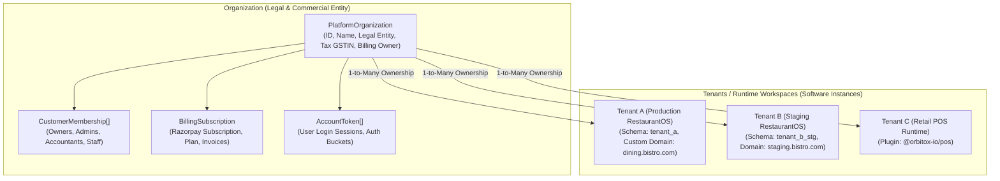

# 🪐 OrbitoX Platform OS — Phase 7C Stage 0
# Document 02: Existing Screen & Reference Inventory

**Milestone:** Phase 7C Operations Console & System Screens  
**Governing Baseline:** Phase 7B.2 Delivered HEAD `188680c27ce51ebb8ca6e998e504c51a24c34fa0`  
**Date:** November 18, 2026 (Revised)  
**Auditor / Role:** Principal Software Architect & Senior Staff Designer

---

## 1. Visual Reference Artwork Census

The Phase 7C design directly translates the approved visual benchmarks located in `OrbitoX — new look concept-png/`:

| Concept Asset Name | Core Visual Elements & UI Patterns | Implementation Target in Phase 7C |
| :--- | :--- | :--- |
| `1 · Operator console — dark.png` | Dark background (`#0A0F1D`), crisp high-contrast cards, top stats row (Organizations, Active Tenants, Provisioning Sagas, System Load), search bar, and primary navigation sidebar. | **Master Console Layout (`/console`)** |
| `Operator console · phone.png` | Compact mobile portrait view with sticky header, collapsible KPI summary cards, quick action pills, bottom navigation bar, and minimum $44 \times 44$px touch targets. | **Mobile Phone Breakpoint (`< 640px`)** |
| `Shared console sidebar.png` | Grouped navigation items: Core Command (Overview), Fleet (Organizations, Tenants, Projects), Extensibility (Packages, Plugins), Ops (Provisioning, Observability, Approvals), Security (Keys, Operators, Audit, Data Rights), Commercial (Billing, Plans). | **`ConsoleNavItems` Hierarchy** |
| `Organization detail.png` | Header with organization status badge, quick actions (Suspend, Edit, Export), multi-tab inspection (Overview, Projects, Branches, Domains, Audit, Billing). | **`/console/organizations/[id]` & `/console/tenants/[id]` Inspector** |
| `Tenant detail · suspend with re-auth.png` | Red-accented destructive confirmation modal with reason selector, impacted project list, and TOTP MFA verification code input. | **Tenant Suspension Step-Up Modal** |
| `Provisioning job · retry.png` | Step-by-step saga execution pipeline with timestamps, error log drawer, and safe idempotent retry button. | **`/console/provisioning` Saga Inspector** |
| `API keys · rotate.png` | Active API credential table with permissions scope tags, expiry timer, and one-click key rotation modal showing 24h grace overlap. | **`/console/security` Key Rotation Drawer** |
| `Billing & payments.png` | Current plan summary, MRR graph, active subscriptions table, failed payment alerts, and manual invoice adjustment drawer. | **`/console/billing` Operational View** |
| `Data rights requests.png` | Data Rights job queue, export ZIP readiness indicator, and signed cryptographic deletion certificate viewer. | **`/console/data-rights` Compliance View** |
| `Pop-ups, warnings & utilities@2x.png` | Standardized dialog styles: Alert dialogs, destructive confirmations, toast notifications, and drawer slide-overs. | **Global Operational Dialogs** |

---

## 2. Complete Monorepo Route Census & Consolidation Matrix

A forensic scan of the entire `apps/platform/src/app/(console)` directory at commit `188680c` identified 36 distinct route endpoints across `admin`, `console`, and `platform`. Every single route is cataloged below with its current maturity and explicit consolidation disposition:

### 2.1 Complete Route-by-Route Disposition Ledger

| Existing Route Path | Current Purpose & Implementation Status | Maturity Status | Explicit Consolidation Action in Phase 7C |
| :--- | :--- | :--- | :--- |
| **`/(console)/console/overview`** | Modern system overview dashboard | **Pilot-ready** | **RETAIN** as canonical `/console/overview`. Back with real `OverviewService` telemetry. |
| **`/(console)/console/organizations`** | Customer parent organizations table | **Pilot-ready** | **RETAIN** as canonical `/console/organizations` (Legal entities, billing owners, user memberships). |
| **`/(console)/console/tenants`** | Provisioned runtime application instances | **Pilot-ready** | **RETAIN** as canonical `/console/tenants` (Software runtime workspaces, branch bindings, runtime health). |
| **`/(console)/console/tenants/[id]`** | Individual tenant inspector drawer/page | **Pilot-ready** | **RETAIN** as canonical `/console/tenants/[id]`. Enhance with full runtime tabs & suspension modal. |
| **`/(console)/console/billing`** | Subscriptions, plans, and invoices | **Pilot-ready** | **RETAIN** as canonical `/console/billing`. Connect to live Razorpay & plan models. |
| **`/(console)/console/provisioning`** | Asynchronous provisioning jobs & sagas | **Pilot-ready** | **RETAIN** as canonical `/console/provisioning`. Integrate retry/rollback actions from `/platform/operations`. |
| **`/(console)/console/security`** | API credentials, key rotation & operators | **Pilot-ready** | **RETAIN** as canonical `/console/security`. Incorporate credential vault from `/platform/credentials`. |
| **`/(console)/console/audit`** | Append-only audit search & inspection | **Pilot-ready** | **RETAIN** as canonical `/console/audit`. Wire to append-only `PlatformAuditEvent` repository. |
| **`/(console)/console/data-rights`** | GDPR/DPDP Phase 6G data rights | **Production-ready**| **RETAIN** as canonical `/console/data-rights` with ZIP streaming and signed certificates. |
| **`/(console)/console/design-system`** | Internal operator design system showcase | **Production-ready**| **RETAIN** as developer preview `/console/design-system` under `SUPPORT_READONLY`. |
| **`/(console)/console/settings/appearance`** | Operator dark theme & accent persistence | **Production-ready**| **RETAIN** as canonical `/console/settings/appearance`. |
| **`/(console)/console/page.tsx`** | Root console redirect | **Production-ready**| **RETAIN** as canonical redirect to `/console/overview`. |
| **`/(console)/platform/observability`**| Fleet telemetry & service metrics | **Technical preview**| **REMEDIATE & MERGE** into `/console/overview` and dedicated `/console/observability` tab. Connect to real `/api/v1/platform/overview/telemetry`. |
| **`/(console)/platform/operations`** | Distributed operations saga tracker | **Technical preview**| **MERGE** into `/console/provisioning` with full `PlatformOperation` lease and retry drawer. Deprecate path via 308. |
| **`/(console)/platform/configuration`**| Global runtime configuration & flags | **Technical preview**| **MOVE** to canonical `/console/settings/configuration`. Preserve system config editing. |
| **`/(console)/platform/credentials`** | Vault secrets & third-party keys | **Technical preview**| **MERGE** into `/console/security` under the "Vault Credentials" tab. Deprecate path via 308. |
| **`/(console)/platform/approvals`** | Operator multi-person approvals queue | **Technical preview**| **RETAIN** under canonical `/console/approvals` as dedicated approval inbox. |
| **`/(console)/platform/ai`** | AI Gateway & MCP tool execution | **Technical preview**| **RETAIN** under canonical `/console/ai` with explicit human approval gates. |
| **`/(console)/platform/explorer`** | Interactive OpenAPI Explorer | **Pilot-ready** | **MOVE** to `/console/developer/explorer`. Retain as authenticated operator tool. |
| **`/(console)/platform/fleet`** | Multi-server node & cluster view | **Technical preview**| **MERGE** into `/console/overview` under the "Cluster Topology" tab. |
| **`/(console)/platform/packages`** | Package & plugin catalogue | **Pilot-ready** | **MOVE** to canonical `/console/packages`. |
| **`/(console)/platform/plans`** | Pricing tier & quota definitions | **Pilot-ready** | **MERGE** into `/console/billing` under the "Plans & Quotas" tab. |
| **`/(console)/platform/projects`** | Business software projects list | **Pilot-ready** | **MOVE** to canonical `/console/projects`. |
| **`/(console)/platform/projects/[projectId]`**| Individual project inspector | **Pilot-ready** | **MOVE** to canonical `/console/projects/[id]`. |
| **`/(console)/platform/restaurants`** | Vertical RestaurantOS fleet view | **Pilot-ready** | **MERGE** into `/console/tenants` with vertical filter `vertical=restaurant`. |
| **`/(console)/platform/restaurants/[id]`**| RestaurantOS runtime inspector | **Pilot-ready** | **MERGE** into `/console/tenants/[id]` under the RestaurantOS vertical tab. |
| **`/(console)/platform/tenants`** | Platform tenant list | **Pilot-ready** | **CONSOLIDATE** with `/console/tenants`. Deprecate `/platform/tenants` via 308. |
| **`/(console)/platform/tenants/new`** | Provision new tenant wizard | **Pilot-ready** | **MOVE** to `/console/tenants/new`. |
| **`/(console)/platform/tests`** | Automated in-browser test runner | **Technical preview**| **MOVE** to `/console/developer/tests`. Restricted to `PLATFORM_OWNER`. |
| **`/(console)/admin/page.tsx`** | Legacy dashboard overview | **Prototype** | **DEPRECATE** via 308 redirect to `/console/overview` once replacement is verified. |
| **`/(console)/admin/api-keys/page.tsx`**| Legacy API key screen | **Prototype** | **DEPRECATE** via 308 redirect to `/console/security`. |
| **`/(console)/admin/audit/page.tsx`** | Legacy audit table | **Prototype** | **DEPRECATE** via 308 redirect to `/console/audit`. |
| **`/(console)/admin/business/page.tsx`**| Legacy category/provider catalog | **Prototype** | **DEPRECATE** via 308 redirect to `/console/packages`. |
| **`/(console)/admin/business/[category]`**| Legacy category drilldown | **Prototype** | **DEPRECATE** via 308 redirect to `/console/packages`. |
| **`/(console)/admin/developer-apis`** | Legacy developer API list | **Prototype** | **DEPRECATE** via 308 redirect to `/console/developer/explorer`. |
| **`/(console)/admin/projects/page.tsx`**| Legacy projects table | **Prototype** | **DEPRECATE** via 308 redirect to `/console/projects`. |
| **`/(console)/admin/projects/create`** | Legacy project creation | **Prototype** | **DEPRECATE** via 308 redirect to `/console/projects/create`. |
| **`/(console)/admin/projects/[projectId]`**| Legacy project detail | **Prototype** | **DEPRECATE** via 308 redirect to `/console/projects/[id]`. |
| **`/(console)/admin/quotas/page.tsx`** | Legacy quotas view | **Prototype** | **DEPRECATE** via 308 redirect to `/console/billing`. |
| **`/(console)/admin/restaurant/page.tsx`**| Legacy restaurant screen | **Prototype** | **DEPRECATE** via 308 redirect to `/console/tenants?vertical=restaurant`. |
| **`/(console)/admin/services/page.tsx`**| Legacy services table | **Prototype** | **DEPRECATE** via 308 redirect to `/console/packages`. |
| **`/(console)/admin/system/page.tsx`** | Legacy system status | **Prototype** | **DEPRECATE** via 308 redirect to `/console/overview`. |

---

## 3. Organizations vs Tenants: Core Domain Boundary Clarification

A critical architectural distinction in OrbitoX is the separation between an **Organization** and a **Tenant**:

1. **`/console/organizations` (Organization Management):**
   - Represents the commercial and legal customer account (`PlatformOrganization`).
   - Manages billing contracts, payment methods, GST/tax configurations, user memberships, and organization-level data rights erasure.
2. **`/console/tenants` (Tenant / Runtime Fleet Management):**
   - Represents an active provisioned application runtime instance or workspace (`RestaurantLocation`, external project deployment).
   - Manages runtime health, database RLS schema binding, custom domain routing, branch layouts, and operational suspension/resumption.
   - An organization may own multiple tenants (e.g., a main restaurant branch, a secondary delivery kitchen, and a staging environment).

---

## 4. Disconnected & Mocked Data Real-Data Remediation Plan

To eliminate all mocked responses in accordance with Governance Rule 3.4:

1. **Observability & Telemetry (`/platform/observability` $\to$ `/console/overview`):**
   - Replace static mock cards with live data from `GET /api/v1/platform/overview/telemetry`.
   - Queries `node:process` for memory usage (`rss`, `heapUsed`), `eventLoopDelay` histogram, and `platform-database-readiness.ts` for active/idle PostgreSQL connection pool metrics.
2. **Cluster Reconciliation (`/api/v1/platform/reconcile`):**
   - Replace simulated state cards with `POST /api/v1/platform/reconcile`, invoking `reconciliation.reconcileAll()` to compare desired resource graphs against live observed runtime state.
3. **Plan Entitlements & Preflight Downgrades:**
   - Connect `POST /api/v1/platform/plan/preflight-downgrade` to inspect active tenant seat counts, branch counts, and dish items before rendering plan change options.
