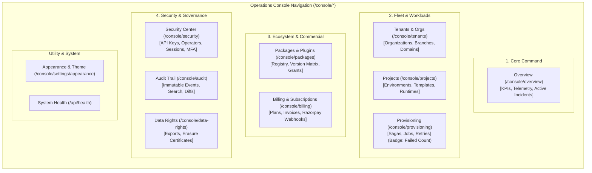

# 🪐 OrbitoX Platform OS — Phase 7C Stage 0
# Document 03: Navigation & Information Architecture

**Milestone:** Phase 7C Operations Console & System Screens  
**Governing Baseline:** Phase 7B.2 Delivered HEAD `188680c27ce51ebb8ca6e998e504c51a24c34fa0`  
**Date:** November 18, 2026  
**Auditor / Role:** Senior Staff Information Architect & UX Designer

---

## 1. Information Hierarchy & Navigation Structure

The Operations Console navigation is structured into four logical operational categories designed for fast operator triage and task completion:

---

## 2. Nav Item Specification & Badge Triggers

| Nav Item Label | Target Route | Icon Symbol | Category Group | Dynamic Badge Condition |
| :--- | :--- | :--- | :--- | :--- |
| **Overview** | `/console/overview` | `Activity` | Core Command | Critical operational alert active (`count > 0`, Red). |
| **Tenants** | `/console/tenants` | `Building2` | Fleet & Workloads | Pending organization onboarding requests (`Amber`). |
| **Projects** | `/console/projects` | `Boxes` | Fleet & Workloads | Detected resource configuration drift (`count > 0`, Purple). |
| **Provisioning** | `/console/provisioning` | `Cpu` | Fleet & Workloads | Failed or retrying provisioning jobs (`count > 0`, Red). |
| **Packages & Plugins** | `/console/packages` | `Package` | Ecosystem & Commercial | Available plugin security updates (`count > 0`, Blue). |
| **Billing & Plans** | `/console/billing` | `CreditCard` | Ecosystem & Commercial | Past-due subscriptions in grace period (`count > 0`, Amber). |
| **Security** | `/console/security` | `ShieldAlert` | Security & Governance | API keys expiring within 7 days (`count > 0`, Amber). |
| **Audit Trail** | `/console/audit` | `FileText` | Security & Governance | None (Real-time stream indicator). |
| **Data Rights** | `/console/data-rights` | `Lock` | Security & Governance | Active export jobs ready for download (`count > 0`, Green). |
| **Appearance** | `/console/settings/appearance` | `Palette` | Utility & System | None. |

---

## 3. Global Header & Quick Action Layout

The console header remains sticky across all viewpoints, providing situational awareness:
1. **Global Search Trigger (`Cmd+K` / `Ctrl+K`):**  
   Opens a modal search palette searching organizations, tenants, project IDs, order numbers, and operator accounts across the entire platform.
2. **Environment Pill Indicator:**  
   Displays the current deployment environment (`PRODUCTION`, `STAGING`, `DEVELOPMENT`) with distinctive color coding (Red for Production, Amber for Staging, Gray for Local) preventing accidental operational changes.
3. **Operator Profile & Quick Actions:**  
   Displays operator avatar, name, role badge (`SUPER_OPERATOR`), active session expiry countdown, and one-click "Lock Session" action.
