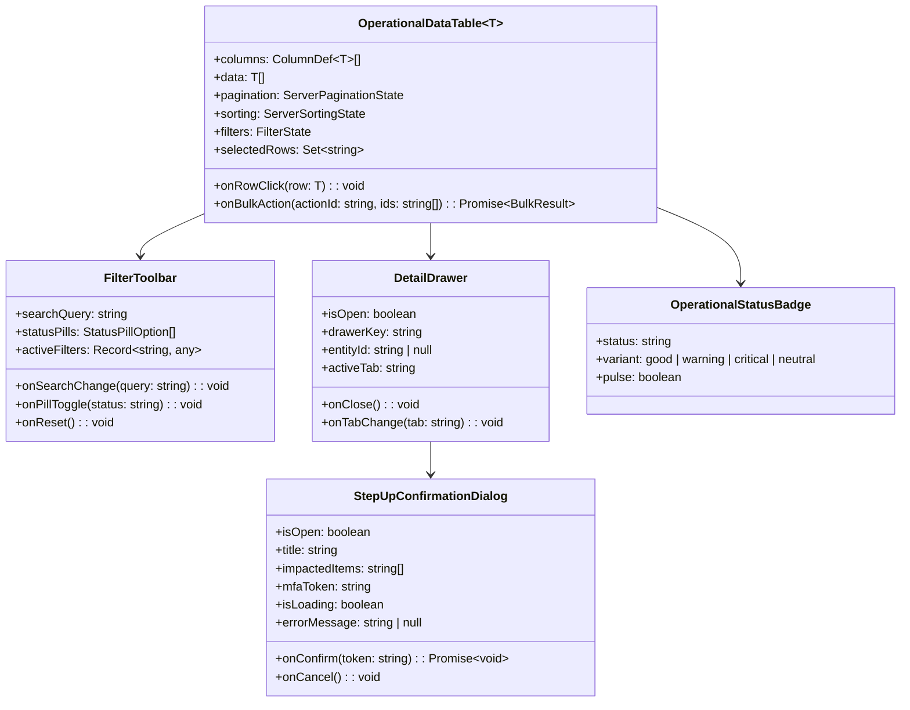

# 🪐 OrbitoX Platform OS — Phase 7C Stage 0
# Document 05: Component & Data Contract Architecture

**Milestone:** Phase 7C Operations Console & System Screens  
**Governing Baseline:** Phase 7B.2 Delivered HEAD `188680c27ce51ebb8ca6e998e504c51a24c34fa0`  
**Date:** November 18, 2026 (Revised)  
**Auditor / Role:** Senior Staff Frontend Architect & Component Designer

---

## 1. Reusable Operational Component Primitives

The Operations Console introduces five foundational UI patterns to handle complex multi-tenant operational workflows while maintaining strict adherence to `@orbitox-io/ui` design tokens, WCAG 2.2 AA accessibility, and real server-side state machines.



---

## 2. Exhaustive Component Contract Specifications

### 2.1 `OperationalDataTable<T>` Specification
- **TypeScript Interface:**
  ```typescript
  export interface ServerPaginationState {
    page: number;         // 1-indexed
    pageSize: number;     // 10, 25, 50, 100
    totalCount: number;
    pageCount: number;
  }

  export interface ServerSortingState {
    column: string;
    direction: 'asc' | 'desc';
  }

  export interface OperationalDataTableProps<T> {
    columns: ColumnDef<T>[];
    data: T[];
    pagination: ServerPaginationState;
    sorting: ServerSortingState;
    onPaginationChange: (page: number, pageSize: number) => void;
    onSortingChange: (column: string, direction: 'asc' | 'desc') => void;
    onRowClick?: (row: T) => void;
    selectedRowIds?: Set<string>;
    onSelectionChange?: (selectedIds: Set<string>) => void;
    bulkActions?: BulkActionDef[];
    onBulkAction?: (actionId: string, selectedIds: string[]) => Promise<BulkActionResult>;
    virtualizedThreshold?: number; // Defaults to 100 rows
    isLoading?: boolean;
    emptyState?: React.ReactNode;
  }
  ```
- **Server-Side Integration & URL-State Synchronization:**
  - Table state automatically synchronizes with browser URL query parameters (`?page=2&pageSize=25&sort=createdAt:desc&status=ACTIVE`).
  - Next.js `useSearchParams()` and `useRouter().replace()` are used with `shallow: true` so table navigation generates shareable, bookmarkable deep links.
- **Large Dataset Virtualization Strategy:**
  - When row count exceeds 100 rows in viewport, table rows activate virtualized rendering using `@tanstack/react-virtual` or CSS `content-visibility: auto; contain-intrinsic-size: 52px;` to preserve 60 FPS scrolling and prevent DOM bloat.
- **Bulk Action Authorization & Partial Failures:**
  - Bulk actions (e.g. bulk reconcile, bulk tenant export) require server-side batch authorization.
  - Returns `BulkActionResult`:
    ```typescript
    export interface BulkActionResult {
      total: number;
      succeeded: string[];
      failed: Array<{ id: string; error: string }>;
    }
    ```
  - Displays a summary toast notification detailing partial successes and failed items with individual error messages.

---

### 2.2 `DetailDrawer` (Deep-Linked Slide-Over Inspector)
- **TypeScript Interface:**
  ```typescript
  export interface DetailDrawerProps {
    isOpen: boolean;
    title: string;
    subtitle?: string;
    badge?: React.ReactNode;
    tabs: Array<{ id: string; label: string; count?: number; content: React.ReactNode }>;
    activeTabId: string;
    onTabChange: (tabId: string) => void;
    onClose: () => void;
    actions?: React.ReactNode;
  }
  ```
- **Deep-Linking & Browser History Integration:**
  - Opening a drawer updates the URL query string: `?drawer=tenant&id=uuid-1234&tab=projects`.
  - Pressing the browser **Back button** (`popstate` event) closes the drawer and restores the clean table URL without navigating away from the current page.
  - Refreshing the browser with the drawer URL open automatically re-fetches the inspector data and renders the drawer pre-opened.
- **Accessibility & Focus Trapping:**
  - Emits `aria-modal="true"` and `role="dialog"`.
  - Focus is automatically trapped within the drawer container (`focus-trap`).
  - Pressing `Escape` invokes `onClose()`.

---

### 2.3 `StepUpConfirmationDialog`
- **TypeScript Interface:**
  ```typescript
  export interface StepUpConfirmationDialogProps {
    isOpen: boolean;
    title: string;
    description: string;
    impactSummary: Array<{ label: string; value: string }>;
    destructive?: boolean; // Renders red status-critical accents
    requiresMfa: boolean;  // Enforces 6-digit TOTP code input
    isSubmitting: boolean;
    errorText?: string | null;
    onConfirm: (mfaCode: string) => Promise<void>;
    onCancel: () => void;
  }
  ```
- **Safety Safeguards:**
  - Confirm button is strictly disabled until the 6-digit TOTP code is entered and regex validated (`^\d{6}$`).
  - Input auto-focuses on open with `autocomplete="one-time-code"`.
  - Error messages (e.g. "Invalid or expired MFA code") render inline with live screen-reader alert (`role="alert"`).

---

## 3. Explicit UI State Contracts (Loading, Empty, Error, Forbidden)

Every console screen implements four mandatory companion states to ensure zero layout shift, clear user feedback, and robust error recovery:

| UI State | Rendering Component & Architecture | User Interaction & Behavior |
| :--- | :--- | :--- |
| **Loading** | Companion `loading.tsx` with pulse skeleton matching exact table columns (`var(--color-bg-muted)`). | Non-interactive. Preserves header and layout structure (`CLS = 0`). |
| **Empty State** | `OperationalEmptyState`: Large iconography, clear explanatory title, helpful descriptive text, and a primary CTA button. | Direct actionable step (e.g., "No organizations found. Clear active filters or create your first organization"). |
| **Error State** | Companion `error.tsx` error boundary rendering an error card with error code digest and correlation ID (`Digest: err_7c_db_pool`). | "Retry Action" button invoking `reset()`. Logs correlation ID to console. |
| **Permission Denied** | `PermissionDeniedCard` (HTTP 403 fallback) rendered when operator lacks required canonical role. | Displays missing required permission token (e.g., "Requires PLATFORM_OWNER authority") and link back to Overview. |

---

## 4. Optimistic UI Mutations & Safe Rollback Pattern

For quick operator actions (e.g., acknowledging alerts, toggling feature flags, updating item tags), screens employ React 19 `useOptimistic`:

```typescript
// Pattern for optimistic state update with rollback on server failure
const [optimisticAlerts, setOptimisticAlerts] = useOptimistic(
  serverAlerts,
  (state, acknowledgedAlertId: string) =>
    state.map((alert) =>
      alert.id === acknowledgedAlertId ? { ...alert, status: 'ACKNOWLEDGED' } : alert
    )
);

async function handleAcknowledge(alertId: string) {
  setOptimisticAlerts(alertId); // Instant visual update
  try {
    await acknowledgeAlertAction(alertId);
  } catch (error) {
    // React automatically rolls back optimistic state on action re-render
    toast.error('Failed to acknowledge alert. Please check your network connection.');
  }
}
```

---

## 5. Authoritative Server Action Validation Schemas (Zod Contracts)

Mutations are enforced through strictly typed Zod schemas validating inputs before passing to server services:

```typescript
// apps/platform/src/server/actions/console-schemas.ts
import { z } from 'zod';

export const SuspendTenantSchema = z.object({
  tenantId: z.string().uuid('Invalid tenant identifier format'),
  reason: z.enum([
    'BILLING_DELINQUENCY',
    'TERMS_OF_SERVICE_VIOLATION',
    'SECURITY_INCIDENT_SUSPECTED',
    'OPERATOR_MAINTENANCE'
  ]),
  notes: z.string().min(10, 'Audit explanation must be at least 10 characters').max(500),
  mfaToken: z.string().regex(/^\d{6}$/, 'MFA code must be exactly 6 digits'),
});

export const RotateApiKeySchema = z.object({
  keyId: z.string().uuid('Invalid key identifier format'),
  graceHours: z.number().int().min(1).max(72).default(24),
  mfaToken: z.string().regex(/^\d{6}$/, 'MFA code must be exactly 6 digits'),
});

export const RetryProvisioningSagaSchema = z.object({
  jobId: z.string().uuid('Invalid job identifier format'),
  idempotentKey: z.string().uuid(),
  forceStepRollback: z.boolean().default(false),
});

export const PreflightDowngradeSchema = z.object({
  tenantId: z.string().uuid(),
  targetPlanId: z.string().min(1),
});
```
