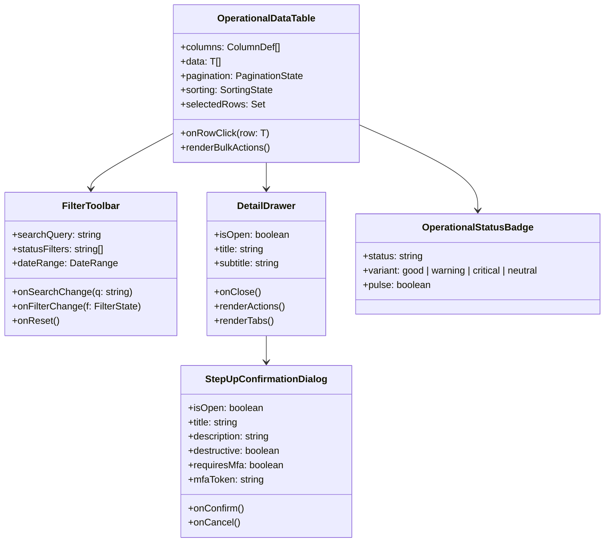

# 🪐 OrbitoX Platform OS — Phase 7C Stage 0
# Document 05: Component & Data Contract Architecture

**Milestone:** Phase 7C Operations Console & System Screens  
**Governing Baseline:** Phase 7B.2 Delivered HEAD `188680c27ce51ebb8ca6e998e504c51a24c34fa0`  
**Date:** November 18, 2026  
**Auditor / Role:** Senior Staff Frontend Architect & Component Designer

---

## 1. Reusable Operational Component Primitives

The Operations Console introduces five foundational UI patterns to handle complex multi-tenant workflows while maintaining strict adherence to `@orbitox-io/ui` design tokens and WCAG 2.2 AA accessibility.



---

## 2. Core Operational Component Specifications

### 2.1 `OperationalDataTable`
- **Purpose:** High-density, sortable, paginated tabular presentation of tenants, projects, saga jobs, and audit logs.
- **Key Capabilities:**
  - Virtualized rendering for datasets exceeding 1,000 rows.
  - Column visibility toggles stored in browser local storage.
  - Sticky header row during vertical scrolling.
  - Checkbox multi-row selection for bulk actions (e.g. bulk reconcile, bulk export).
  - Empty state with clear context-specific call to action.

### 2.2 `FilterToolbar`
- **Purpose:** Unified search and filter controls placed directly above tables.
- **Key Capabilities:**
  - Instant debounced search input (300ms) updating URL search parameters (`?q=...`) for shareable links.
  - Single-click status filter pills (`All`, `Active`, `Suspended`, `Failed`, `Pending`).
  - Clear-all filters reset button visible only when active filters exist.

### 2.3 `DetailDrawer` (Slide-Over Inspector)
- **Purpose:** Right-hand side panel opening upon selecting any row (e.g. Tenant Details, Saga Execution Log, API Key Scopes).
- **Key Capabilities:**
  - Preserves underlying table scroll position and active row highlight.
  - Tabbed sub-sections (Overview, Configuration, History, Raw JSON).
  - Escape key dismisses; focus trapped within drawer when open (`aria-modal="true"`).

### 2.4 `StepUpConfirmationDialog`
- **Purpose:** Strict safety modal for destructive actions (e.g. tenant suspension, API key revocation, data deletion).
- **Key Capabilities:**
  - Red accent borders and alert warning banner (`var(--status-critical-*)`).
  - Clear impact summary listing exact resources affected.
  - Numeric 6-digit TOTP input box for step-up multi-factor authentication.
  - Disabled confirm button until required verification inputs are completed.

---

## 3. Server Action Validation Schemas (Zod Contracts)

All operations mutate state exclusively through validated Server Actions with strict Zod parsing:

```typescript
// apps/platform/src/server/actions/console-tenants.ts
import { z } from 'zod';

export const SuspendTenantSchema = z.object({
  tenantId: z.string().uuid('Invalid tenant identifier'),
  reason: z.enum([
    'BILLING_DELINQUENCY',
    'TERMS_OF_SERVICE_VIOLATION',
    'SECURITY_INCIDENT_SUSPECTED',
    'OPERATOR_MAINTENANCE'
  ]),
  notes: z.string().min(10, 'Audit explanation must be at least 10 characters').max(500),
  mfaToken: z.string().regex(/^\d{6}$/, 'MFA code must be exactly 6 digits'),
});

export const RotateApiKeySchema = z.object({
  keyId: z.string().uuid('Invalid key identifier'),
  graceHours: z.number().int().min(1).max(72).default(24),
  mfaToken: z.string().regex(/^\d{6}$/, 'MFA code must be exactly 6 digits'),
});

export const RetryProvisioningSagaSchema = z.object({
  jobId: z.string().uuid('Invalid job identifier'),
  idempotentKey: z.string().uuid(),
  forceStepRollback: z.boolean().default(false),
});
```

---

## 4. State Management, Skeletons & Optimistic UI

1. **Skeleton Loaders:**  
   Every console screen implements a companion `loading.tsx` rendering pulse-animated table skeletons matching exact column structures to eliminate layout shifts (`CLS = 0`).
2. **Error Boundaries:**  
   Every console segment includes `error.tsx` catching server exceptions, displaying the correlation error ID (`error.digest`), and providing a "Retry Request" button.
3. **Optimistic Updates:**  
   Status toggles (e.g. acknowledging alerts, toggling feature flags) use React 19 `useOptimistic` to provide instant visual feedback while awaiting server confirmation.
