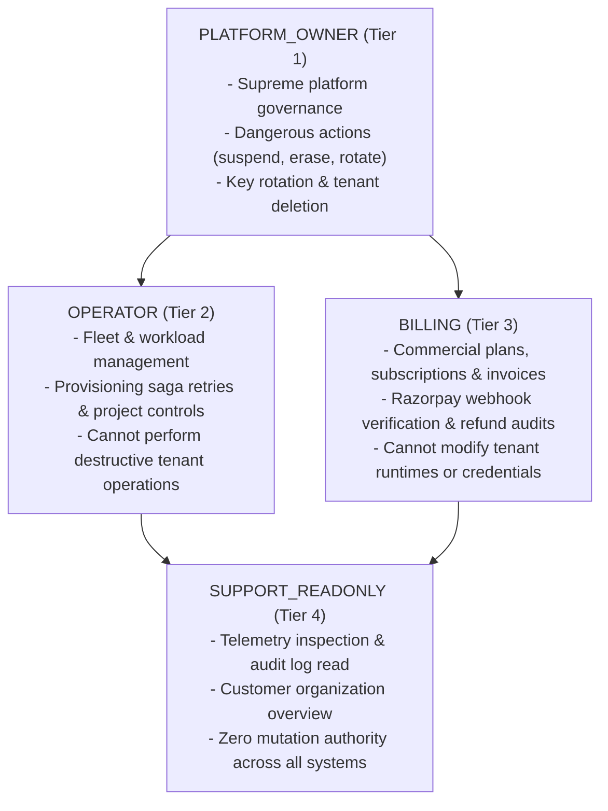
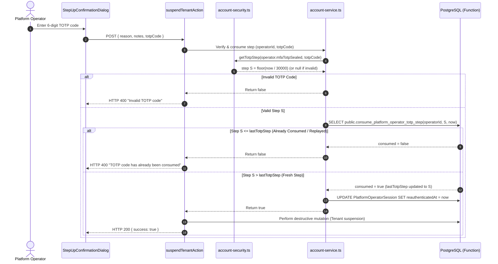
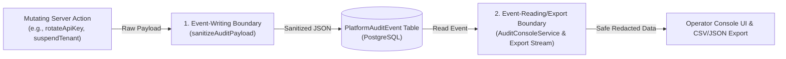

# 🪐 OrbitoX Platform OS — Phase 7C Stage 0
# Document 06: Permission & Security Matrix

**Milestone:** Phase 7C Operations Console & System Screens  
**Governing Baseline:** Phase 7B.2 Delivered HEAD `188680c27ce51ebb8ca6e998e504c51a24c34fa0`  
**Specification Branch:** `docs/phase-7c-stage0-specification`  
**Date:** November 18, 2026 (Authoritative Security & Grounding Revision)  
**Auditor / Role:** Principal Security Architect & Staff Backend Engineer

---

## 1. Canonical Operator RBAC Role Hierarchy

Access control for all console routes, server actions, and mutation APIs is strictly governed by the canonical production enum `PlatformOperatorRole` defined in `apps/platform/prisma/schema.prisma` and evaluated through `operatorRoleAllows()` in `apps/platform/src/server/organizations/operator-route-policy.ts`:



### 1.1 Action-by-Action Permission & Step-Up MFA Entitlement Table

| Console Operation / Action | Target Endpoint / Server Action | Minimum Required Role | Requires Step-Up TOTP? | Freshness Window |
| :--- | :--- | :--- | :--- | :--- |
| **View System Overview & Telemetry** | `GET /api/v1/platform/overview/*` | `SUPPORT_READONLY` | No | N/A |
| **Inspect Audit Log Stream** | `GET /api/v1/platform/audit-logs` | `SUPPORT_READONLY` | No | N/A |
| **View Tenant Runtime Fleet** | `GET /api/v1/platform/tenants` | `SUPPORT_READONLY` | No | N/A |
| **View Customer Organizations** | `GET /api/v1/platform/organizations` | `SUPPORT_READONLY` | No | N/A |
| **Reconcile Cluster State** | `POST /api/v1/platform/reconcile` | `OPERATOR` | No | N/A |
| **Create Customer Organization** | `POST /api/v1/platform/organizations` | `OPERATOR` | No | N/A |
| **Provision New Tenant Runtime** | `POST /api/v1/platform/tenants` | `OPERATOR` | No | N/A |
| **Retry Failed Provisioning Saga** | `POST /api/v1/platform/operations/:id/retry` | `OPERATOR` | No | N/A |
| **Manage Billing Plans & Quotas** | `POST /api/v1/platform/plans` | `BILLING` | No | N/A |
| **Suspend Tenant Runtime** | `POST /api/v1/platform/tenants/:id/suspend` | `PLATFORM_OWNER` | **YES (TOTP)** | 5 Minutes |
| **Resume Suspended Tenant** | `POST /api/v1/platform/tenants/:id/resume` | `PLATFORM_OWNER` | **YES (TOTP)** | 5 Minutes |
| **Rotate Master API Key** | `POST /api/v1/platform/security-keys/:id/rotate` | `PLATFORM_OWNER` | **YES (TOTP)** | 5 Minutes |
| **Revoke Master API Key** | `POST /api/v1/platform/security-keys/:id/revoke` | `PLATFORM_OWNER` | **YES (TOTP)** | 5 Minutes |
| **Execute Tenant Data Erasure** | `POST /api/v1/data-rights/delete` | `PLATFORM_OWNER` | **YES (TOTP)** | 5 Minutes |

> [!IMPORTANT]
> **Server-Side Enforcement Non-Negotiable:**  
> UI visibility toggles serve purely as presentation conveniences. Server-side middleware (`withOperatorAuth`) strictly enforces role checks and rejects unauthorized requests with HTTP 403 `FORBIDDEN`.

---

## 2. Server-Side Session Inactivity Enforcement Architecture

### 2.1 Existing Baseline Implementation vs. Proposed Stage 1 Hardening

To maintain strict fidelity to the verified codebase, the session inactivity architecture is documented across two explicit boundaries:

#### 1. Accepted Baseline Architecture (`188680c`):
- **Database Schema (`PlatformOperatorSession`):**  
  The session table in PostgreSQL contains: `id`, `operatorId`, `tokenHash`, `csrfTokenHash`, `createdAt`, `lastSeenAt`, `idleExpiresAt`, `absoluteExpiresAt`, `reauthenticatedAt`, `revokedAt`, `ipAddress`, and `userAgent`.  
  *(Note: `PlatformOperatorSession` does **not** have a `status` column; session lifecycle validity is determined by `revokedAt IS NULL` and `idleExpiresAt > now`).*
- **Baseline Inactivity Constant:**  
  `apps/platform/src/server/auth/account-security.ts` defines:  
  `export const ACCOUNT_SESSION_IDLE_MS = 30 * 60 * 1000;` (30 minutes sliding window).
- **Baseline Inactivity Evaluation:**  
  In `apps/platform/src/server/accounts/account-service.ts`, `getOperatorSession()` checks:
  ```ts
  if (
    !session ||
    session.revokedAt ||
    session.operator.status !== 'ACTIVE' ||
    session.idleExpiresAt <= now ||
    session.absoluteExpiresAt <= now
  ) {
    return null;
  }
  ```
  If expired, `getOperatorSession()` returns `null`. `withOperatorAuth()` in `operator-auth.ts` catches `!session` and returns HTTP 401 `{ success: false, error: { code: 'UNAUTHORIZED', message: 'Operator session required.' } }`.

#### 2. Proposed Stage 1 Implementation Hardening:
- **Tightened Inactivity Window (15 Minutes):**  
  Define a dedicated `OPERATOR_SESSION_IDLE_MS = 15 * 60 * 1000` (15 minutes) for privileged operator sessions in `account-security.ts`, retaining 30 minutes for standard customer sessions.
- **Active Revocation on Expired Session Detection:**  
  When `getOperatorSession()` queries an active token whose `idleExpiresAt <= now` and `revokedAt === null`, Stage 1 will update `revokedAt = now` in PostgreSQL via `tx.platformOperatorSession.updateMany`, recording permanent revocation in the database audit record without requiring any schema migration.
- **Automatic Cookie Invalidation on 401:**  
  In `withOperatorAuth()`, when `session === null`, append `Set-Cookie` headers clearing `orbitox_op_session` and `orbitox_op_csrf` (with `Max-Age=0` and past expiration dates) to eliminate stale cookie retention in operator browsers.

---

## 3. Grounded TOTP Replay Prevention & Step-Up Architecture

The TOTP re-authentication contract is grounded directly in the production cryptographic functions and PostgreSQL stored procedures present in the baseline:



### 3.1 Grounded Cryptographic Mechanics:
1. **TOTP Candidate Step Evaluation (`account-security.ts`):**  
   `getTotpStep(secret: string, code: string, now = Date.now()): number | null` calculates the baseline step index $S = \lfloor \text{now} / 30000 \rfloor$ and tests candidates $[S, S-1, S+1]$ against the HMAC-SHA1 RFC 6238 token using `crypto.timingSafeEqual`.
2. **Atomic Step Consumption (`apps/platform/src/server/accounts/account-service.ts`):**  
   `consumeOperatorTotpStep(tx, operatorId, step, now)` executes the PostgreSQL stored procedure:
   ```sql
   SELECT public.consume_platform_operator_totp_step(
     $1::text,    -- operatorId
     $2::integer, -- step
     $3::timestamptz -- now
   ) AS consumed;
   ```
   This function atomically checks `WHERE id = operatorId AND (lastTotpStep IS NULL OR lastTotpStep < step)`. If matching, it sets `lastTotpStep = step` and returns `true`. If `lastTotpStep >= step`, it returns `false`, preventing replay attacks within the same 30-second window.
3. **5-Minute Freshness Gate (`operator-auth.ts`):**  
   Following step consumption, `session.reauthenticatedAt` is set to `now`. High-risk operations verify:
   $$\text{Date.now()} - \text{session.reauthenticatedAt.getTime()} \le 5 \times 60 \times 1000 \text{ (5 minutes)}$$
   Requests older than 5 minutes fail closed with HTTP 403 `{ code: 'REAUTH_REQUIRED' }`.

---

## 4. Strict Audit Log Redaction Policy (`PlatformAuditEvent`)

### 4.1 Grounded Reality & Stage 1 Dual-Boundary Redaction

- **Baseline Reality:**  
  `AuditConsoleService` reads `event.metadata` directly from PostgreSQL `PlatformAuditEvent` and returns it without redaction.
- **Stage 1 Architectural Redaction Boundaries:**  
  Redaction will be enforced at **both** the event-writing boundary and the event-reading/export boundary:



#### Boundary 1: Event-Writing Sanitization (`sanitizeAuditPayload`)
Before inserting into `PlatformAuditEvent.metadata` or change-diff fields, the payload is recursively scrubbed:
```ts
const SENSITIVE_KEY_PATTERN = /(?:password|passwordHash|token|secret|mfaTotpSealed|mfaToken|backupCode|credential|apiKey|pepper|privateKey|authorization|cookie|bearer|cvv|aadhaar|ssn)/i;

export function sanitizeAuditPayload<T>(input: T): T {
  if (input === null || typeof input !== 'object') return input;
  if (Array.isArray(input)) {
    return input.map((item) => sanitizeAuditPayload(item)) as unknown as T;
  }
  const result: Record<string, any> = {};
  for (const [key, value] of Object.entries(input)) {
    if (SENSITIVE_KEY_PATTERN.test(key)) {
      result[key] = '[REDACTED]';
    } else if (typeof value === 'object' && value !== null) {
      result[key] = sanitizeAuditPayload(value);
    } else {
      result[key] = value;
    }
  }
  return result as T;
}
```

#### Boundary 2: Event-Reading & Export Sanitization
In `AuditConsoleService.queryAuditLogs()`, `getAuditEventById()`, and the streaming export route `GET /api/v1/platform/audit-logs/export`, all returned `metadata` objects pass through `sanitizeAuditPayload()` to guarantee defense-in-depth even against legacy or pre-existing unredacted rows.

### 4.2 Comprehensive Redaction Test Cases
- **Nested Secrets:** `{ config: { auth: { clientSecret: "secret123" } } }` $\to$ `{ config: { auth: { clientSecret: "[REDACTED]" } } }`.
- **Credential Fields:** Direct masking of `apiKey`, `pepper`, `privateKey`, `password`, `token`, `mfaTotpSealed`, `backupCode`, `authorization`, `cookie`.
- **Sensitive Personal Information (SPI/PII):** Masking of `aadhaar`, `ssn`, `cardCvv`, and bank account numbers (`****-****-1234`).
- **Immutable Database Grants:** The `PlatformAuditEvent` table is written via `orbitox_platform_admin_audit` with `INSERT` and `SELECT` only; `UPDATE`, `DELETE`, and `TRUNCATE` are revoked at the engine level.
