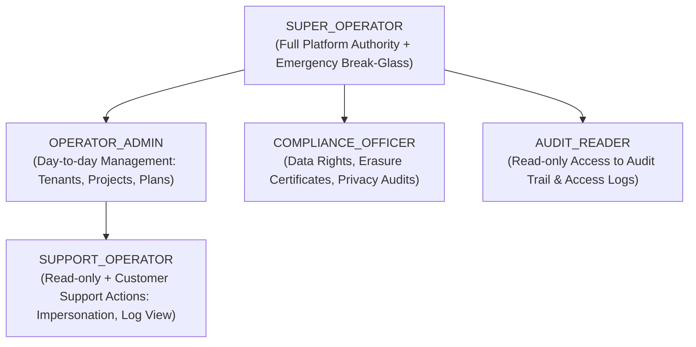

# 🪐 OrbitoX Platform OS — Phase 7C Stage 0
# Document 06: Permission & Security Matrix

**Milestone:** Phase 7C Operations Console & System Screens  
**Governing Baseline:** Phase 7B.2 Delivered HEAD `188680c27ce51ebb8ca6e998e504c51a24c34fa0`  
**Date:** November 18, 2026  
**Auditor / Role:** Principal Security Engineer & IAM Architect

---

## 1. Operator RBAC Roles & Entitlement Hierarchy

The Operations Console defines five distinct operator roles with strictly partitioned operational authorities:

### 1.1 Detailed Role-Permission Entitlement Matrix

| Fine-Grained Permission Token | Description | `SUPER_OPERATOR` | `OPERATOR_ADMIN` | `SUPPORT_OPERATOR` | `COMPLIANCE_OFFICER` | `AUDIT_READER` | Step-Up MFA Required? |
| :--- | :--- | :---: | :---: | :---: | :---: | :---: | :---: |
| `OPERATOR_CONSOLE_VIEW` | Access `/console/*` routes | Yes | Yes | Yes | Yes | Yes | No |
| `TENANT_VIEW` | Inspect tenant metadata & config | Yes | Yes | Yes | Yes | No | No |
| `TENANT_EDIT` | Update branding, domains, branches | Yes | Yes | No | No | No | No |
| `TENANT_SUSPEND` | Suspend active tenant runtime | Yes | Yes | No | No | No | **YES (TOTP)** |
| `TENANT_RESUME` | Re-activate suspended tenant | Yes | Yes | No | No | No | **YES (TOTP)** |
| `PROJECT_MANAGE` | Create projects, trigger reconciles | Yes | Yes | No | No | No | No |
| `PROVISION_RETRY` | Retry failed provisioning saga | Yes | Yes | No | No | No | No |
| `SECURITY_KEY_VIEW` | List active API keys & scopes | Yes | Yes | No | No | No | No |
| `SECURITY_KEY_ROTATE` | Rotate API credential pairs | Yes | Yes | No | No | No | **YES (TOTP)** |
| `SECURITY_KEY_REVOKE` | Immediate credential invalidation | Yes | No | No | No | No | **YES (TOTP)** |
| `OPERATOR_MANAGE` | Create/edit operator accounts | Yes | No | No | No | No | **YES (TOTP)** |
| `BILLING_PLAN_EDIT` | Modify pricing, quotas, features | Yes | Yes | No | No | No | No |
| `BILLING_ADJUST` | Issue credits or billing adjustments| Yes | Yes | No | No | No | No |
| `AUDIT_TRAIL_VIEW` | Query immutable audit logs | Yes | Yes | Yes | Yes | Yes | No |
| `DATA_RIGHTS_EXPORT` | Trigger full tenant data export | Yes | No | No | Yes | No | No |
| `DATA_RIGHTS_DELETE` | Execute tenant data erasure | Yes | No | No | Yes | No | **YES (TOTP)** |

---

## 2. Step-Up Authentication & Session Safeguards

1. **Mandatory TOTP MFA for Destructive Actions:**  
   Actions flagged with `Step-Up MFA Required?` cannot be submitted with a standard session token alone. The client must supply a valid 6-digit TOTP code generated within the last 60 seconds (`AccountSecurity.verifyMfaToken`). The server validates and immediately consumes the token to prevent replay attacks.
2. **15-Minute Inactive Session Timeout:**  
   Operator console sessions automatically lock after 15 minutes of user inactivity (measured via pointer/keyboard event listeners). The UI transitions to a PIN/password re-entry overlay without destroying unsaved form work in memory.
3. **Immutable Operational Audit Logging:**  
   Every operator action—read, write, or destructive—is automatically logged to `PlatformAuditEvent` with:
   - `operatorId` & `operatorEmail`
   - Client IP address and User-Agent
   - Action name and target entity (`tenantId`, `projectId`, `keyId`)
   - Complete serialized JSON payload and previous-value diff
   - All written using the PostgreSQL append-only role `orbitox_platform_admin_audit` where `UPDATE` and `DELETE` queries fail closed.
