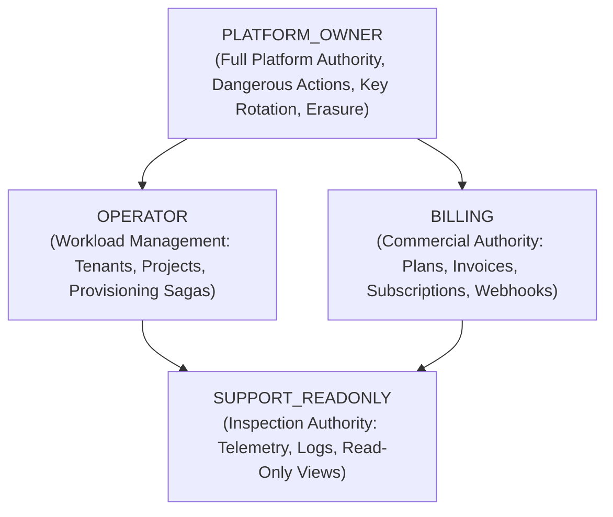

# 🪐 OrbitoX Platform OS — Phase 7C Stage 0
# Document 06: Permission & Security Matrix

**Milestone:** Phase 7C Operations Console & System Screens  
**Governing Baseline:** Phase 7B.2 Delivered HEAD `188680c27ce51ebb8ca6e998e504c51a24c34fa0`  
**Date:** November 18, 2026 (Revised)  
**Auditor / Role:** Principal Security Engineer & IAM Architect

---

## 1. Canonical RBAC Registry (`PlatformOperatorRole`)

The Operations Console derives its authorization model directly from the authoritative production database enum `PlatformOperatorRole` (`apps/platform/prisma/schema.prisma`) and the route policy engine (`apps/platform/src/server/organizations/operator-route-policy.ts`):



### 1.1 Role Hierarchy & Evaluation Rules (`operatorRoleAllows`)
In `apps/platform/src/server/organizations/operator-route-policy.ts`:
```typescript
export function operatorRoleAllows(actual: PlatformOperatorRole, required: RequiredOperatorRole): boolean {
  if (actual === 'PLATFORM_OWNER' || actual === required) return true;
  if (actual === 'OPERATOR' && required === 'SUPPORT_READONLY') return true;
  if (actual === 'BILLING' && required === 'SUPPORT_READONLY') return true;
  return false;
}
```

### 1.2 Canonical Screen & Action Permission Registry

| Canonical Operation / Action | Target Endpoint / Handler | Required Role (`PlatformOperatorRole`) | Step-Up MFA Required? | Reauth Window |
| :--- | :--- | :---: | :---: | :---: |
| **View System Overview & Telemetry** | `GET /api/v1/platform/overview/*` | `SUPPORT_READONLY` | No | None |
| **Trigger Cluster Reconciliation** | `POST /api/v1/platform/reconcile` | `OPERATOR` | No | None |
| **List & Inspect Organizations** | `GET /api/v1/platform/organizations/*` | `OPERATOR` | No | None |
| **Create Customer Organization** | `POST /api/v1/platform/organizations` | `OPERATOR` | No | None |
| **List & Inspect Tenants** | `GET /api/v1/platform/tenants/*` | `OPERATOR` | No | None |
| **Update Tenant Brand & Domains** | `PUT /api/v1/platform/tenants/:id` | `OPERATOR` | No | None |
| **Suspend Tenant Runtime** | `POST /api/v1/platform/tenants/:id/suspend` | `PLATFORM_OWNER` | **YES (TOTP)** | 5 Minutes |
| **Resume Tenant Runtime** | `POST /api/v1/platform/tenants/:id/resume` | `PLATFORM_OWNER` | **YES (TOTP)** | 5 Minutes |
| **Create & Manage Projects** | `POST /api/v1/projects/*` | `OPERATOR` | No | None |
| **Retry Provisioning Saga** | `POST /api/v1/platform/operations/:id/retry` | `OPERATOR` | No | None |
| **View API Key Registry** | `GET /api/v1/platform/security-keys` | `PLATFORM_OWNER` | No | None |
| **Rotate API Credential Pair** | `POST /api/v1/platform/security-keys/:id/rotate` | `PLATFORM_OWNER` | **YES (TOTP)** | 5 Minutes |
| **Revoke API Credential** | `POST /api/v1/platform/security-keys/:id/revoke` | `PLATFORM_OWNER` | **YES (TOTP)** | 5 Minutes |
| **Manage Pricing Plans & Quotas**| `POST, PUT /api/v1/platform/plans/*` | `BILLING` | No | None |
| **Preflight Downgrade Check** | `POST /api/v1/platform/plan/preflight-downgrade`| `BILLING` | No | None |
| **Query Immutable Audit Logs** | `GET /api/v1/platform/audit-logs/*` | `SUPPORT_READONLY` | No | None |
| **Initiate Tenant Data Export** | `POST /api/v1/data-rights/export` | `PLATFORM_OWNER` | No | None |
| **Execute Tenant Data Erasure** | `POST /api/v1/data-rights/delete` | `PLATFORM_OWNER` | **YES (TOTP)** | 5 Minutes |

> [!IMPORTANT]
> **Server-Side Enforcement Non-Negotiable:**  
> UI visibility toggles serve purely as presentation conveniences. Server-side middleware (`withOperatorAuth`) strictly enforces role checks and rejects unauthorized requests with HTTP 403 `FORBIDDEN`.

---

## 2. Server-Side Session Inactivity Enforcement (15-Minute Timeout)

A purely client-side inactivity overlay is fundamentally insufficient because an attacker can bypass DOM elements or invoke APIs directly. OrbitoX enforces a strict server-side sliding inactivity timeout:

1. **Database Schema Anchor (`PlatformOperatorSession`):**
   - `lastSeenAt`: Timestamp of the last verified HTTP request.
   - `idleExpiresAt`: Hard expiration timestamp initialized to `now + 15 minutes`.
   - `absoluteExpiresAt`: Maximum absolute session lifetime (12 hours).
2. **Server-Side Middleware Check (`apps/platform/src/server/auth/operator-auth.ts`):**
   - On every request, `withOperatorAuth` retrieves the active session from PostgreSQL.
   - If `Date.now() > session.idleExpiresAt.getTime()`:
     - The session is immediately flagged as revoked in DB (`revokedAt = now`).
     - Clears session cookies (`clearOperatorSessionCookies`).
     - Returns HTTP 401 `{ success: false, error: { code: 'SESSION_IDLE_TIMEOUT', message: 'Operator session expired due to inactivity. Re-authentication required.' } }`.
   - If valid, the request proceeds, and `idleExpiresAt` is extended by 15 minutes (`idleExpiresAt = new Date(Date.now() + 15 * 60 * 1000)`).
3. **Cross-Tab & Refresh Protection:**
   Because expiration is tracked in the database, refreshing the browser, opening a new tab, or issuing direct cURL requests from an idle session is completely prevented.

---

## 3. TOTP Replay Prevention & Step-Up Lifecycle

1. **Time-Step Tracking Anchor (`PlatformOperator.lastTotpStep`):**
   - In accordance with RFC 6238, the current 30-second time-step is calculated as:
     $$S = \left\lfloor \frac{\text{Date.now()}}{1000 \times 30} \right\rfloor$$
   - When an operator submits a TOTP code during step-up re-authentication:
     1. Verify the cryptographic code against the operator's sealed secret (`AccountSecurity.verifyMfaToken`).
     2. Verify that the matching time step $S > \text{operator.lastTotpStep}$.
     3. If $S \le \text{operator.lastTotpStep}$, reject the code immediately with HTTP 400 `{ code: 'TOTP_ALREADY_USED', message: 'This TOTP code has already been consumed. Please wait for the next time-step.' }`.
     4. On successful verification, atomically update `PlatformOperator.lastTotpStep = S` in the database transaction.
2. **Single-Use Step-Up Re-Authentication Window:**
   - A successful TOTP verification updates `PlatformOperatorSession.reauthenticatedAt = new Date()`.
   - For all high-risk endpoints matching `DANGEROUS_ACTION` (suspension, revocation, key rotation, data erasure), `withOperatorAuth` checks:
     $$\text{Date.now()} - \text{session.reauthenticatedAt} \le 5 \times 60 \times 1000 \text{ (5 minutes)}$$
   - Once the 5-minute sliding window lapses, the server fails closed with HTTP 403 `{ code: 'REAUTH_REQUIRED' }`, requiring a fresh TOTP code.

---

## 4. Strict Audit Log Redaction Policy (`PlatformAuditEvent`)

To prevent the immutable audit trail from becoming a sensitive-data exposure surface, a strict field-redaction policy is enforced across all audit logging (`AuditConsoleService`):

1. **Blacklisted Keys:**
   Any key matching the following regular expression or name set is strictly redacted before writing to `PlatformAuditEvent.payload` or `previousValue`:
   ```text
   /(?:password|passwordHash|token|secret|mfaTotpSealed|mfaToken|backupCode|credential|apiKey|pepper|privateKey|authorization|cookie|bearer)/i
   ```
2. **Recursive Masking Implementation:**
   - Any primitive value associated with a blacklisted key is replaced with the string:
     `"[REDACTED_BY_POLICY]"`
   - Credit card numbers, PANs, and bank account numbers are masked to the last 4 digits (`****-****-****-1234`).
   - Personal Identifiable Information (PII) such as phone numbers or home addresses are salted and hashed or excluded unless explicitly mandated by regulatory tax audit requirements.
3. **Append-Only Database Immutability:**
   - The audit log is written exclusively using the dedicated PostgreSQL connection role `orbitox_platform_admin_audit`.
   - PostgreSQL grants for `orbitox_platform_admin_audit` permit `INSERT` and `SELECT` only. All `UPDATE`, `DELETE`, and `TRUNCATE` operations are strictly revoked at the database engine level.
