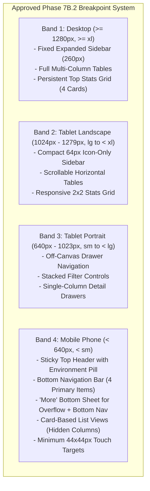

# 🪐 OrbitoX Platform OS — Phase 7C Stage 0
# Document 07: Responsive & Accessibility Specification

**Milestone:** Phase 7C Operations Console & System Screens  
**Governing Baseline:** Phase 7B.2 Delivered HEAD `188680c27ce51ebb8ca6e998e504c51a24c34fa0`  
**Date:** November 18, 2026 (Revised)  
**Auditor / Role:** Senior Staff Accessibility Specialist & Responsive UI Architect

---

## 1. Approved 4-Band Responsive Viewport Behavior (UI-7B2-BP1)

The Operations Console strictly inherits and consumes the approved 4-band responsive viewport specification established in Phase 7B.2 (`ResponsiveShell.tsx` and `UI-7B2-BP1`). It does not define custom or competing breakpoint boundaries:

### 1.1 Responsive Layout Adaptations by Screen

| Screen View | Desktop ($\ge 1280$px, $\ge$ xl) | Tablet Landscape ($1024\text{--}1279$px, lg) | Tablet Portrait ($640\text{--}1023$px, sm/md) | Mobile Phone ($< 640$px, $<$ sm) |
| :--- | :--- | :--- | :--- | :--- |
| **Console Overview** | 4-column KPI grid, 2-column graph + table layout. | 2-column KPI grid, stacked graphs. | 2-column KPI grid, stacked tables. | Single-column swipeable KPI cards, list view. |
| **Tenant Fleet List**| 7-column table (Name, Domain, Plan, Status, Seats, Created, Actions). | 5-column table (Name, Plan, Status, Seats, Actions). | 4-column table (Name, Plan, Status, Actions). | Stacked cards showing Name, Status badge, and Chevron to detail view. |
| **Tenant Inspector** | Side-by-side split view: Table left (60%), Detail Drawer right (40%). | Slide-over drawer (50% screen width) over table. | Slide-over drawer (75% screen width) over table. | Full-screen modal sheet with sticky action footer. |
| **Provisioning Saga**| Horizontal multi-step pipeline timeline with real-time log terminal. | Horizontal pipeline timeline, collapsible log drawer. | Vertical accordion steps with expandable logs. | Vertical step list with full-screen error log modal. |
| **Security Key Table**| Full table with Scopes, Expiry, Created, and Rotate/Revoke buttons. | Compact table with Scopes hidden in detail popover. | Card view with Status pill and Action trigger. | Stacked key cards with bottom sheet rotation modal. |

---

## 2. WCAG 2.2 AA Accessibility Enforcement

Every screen in Phase 7C strictly satisfies all WCAG 2.2 AA Success Criteria without exception, inheriting the zero-violation standard verified in CI Run #447:

### 2.1 Contrast Requirements (Success Criterion 1.4.3 & 1.4.11)
- **Normal Text ($\le 18$pt / $\le 14$pt bold):** Contrast ratio against background must be $\ge 4.5:1$.
  - Foreground token: `var(--color-fg-default)` (`#F9FAFB` on dark `#0A0F1D`, ratio $16.8:1$).
  - Muted text token: `var(--color-fg-muted)` (`#9CA3AF` on dark `#0A0F1D`, ratio $6.2:1$).
- **Large Text ($\ge 18$pt / $\ge 14$pt bold) & UI Controls:** Contrast ratio against background must be $\ge 3.0:1$.
  - Borders and active toggles: `var(--color-border-default)` (`#374151` on dark, ratio $3.5:1$).
  - Status Badges: Use semantic badge tokens:
    - Good/Active: `var(--status-good-bg)`, `var(--status-good-fg)` (contrast $5.1:1$).
    - Warning/Pending: `var(--status-warning-bg)`, `var(--status-warning-fg)` (contrast $4.8:1$).
    - Critical/Error: `var(--status-critical-bg)`, `var(--status-critical-fg)` (contrast $5.4:1$).

### 2.2 Target Size (Minimum) (Success Criterion 2.5.8)
- Every interactive button, navigation link, filter pill, and table row action must provide a minimum pointer target size of **$44 \times 44$px** on touch devices.
- Implemented using Tailwind utility `min-h-[44px] min-w-[44px]` or padding expansion techniques (`after:absolute after:inset-[-6px]`).

### 2.3 Keyboard Navigation & Operator Hotkeys
- **Global Search:** `Cmd+K` (macOS) / `Ctrl+K` (Linux/Windows) opens the universal command palette.
- **Filter Focus:** Pressing `/` instantly focuses the search filter in any active table.
- **Table Navigation:** `j` / `Down Arrow` moves selection to the next row; `k` / `Up Arrow` moves to the previous row.
- **Row Detail:** Pressing `Enter` opens the `DetailDrawer` for the currently selected table row.
- **Drawer / Modal Dismiss:** Pressing `Escape` closes any open drawer, modal, or sheet.

### 2.4 Reduced Motion & Screen Reader Support
- **Reduced Motion:** All animations (drawer slide-in, skeleton pulse, modal fade) honor `@media (prefers-reduced-motion: reduce)` by immediately rendering the final state (`transition-none`, `animate-none`).
- **Screen Reader Announcements:** Dynamic background updates (e.g. provisioning saga step completion, alert arrival) emit live region announcements using `role="status"` and `aria-live="polite"`.
