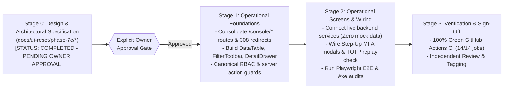

# 🪐 OrbitoX Platform OS — Phase 7C Stage 0
# Document 08: Test Plan & Acceptance Criteria

**Milestone:** Phase 7C Operations Console & System Screens  
**Governing Baseline:** Phase 7B.2 Delivered HEAD `188680c27ce51ebb8ca6e998e504c51a24c34fa0`  
**Specification Branch:** `docs/phase-7c-stage0-specification` (`7b79f6051a76b3287dbbafbbad47e66756e9d72f`)  
**Date:** November 18, 2026  
**Auditor / Role:** Principal QA Lead & Staff Architect

---

## 1. Multi-Tiered Verification Test Plan

Phase 7C implementation will be verified through five automated test tiers prior to requesting final acceptance:

```mermaid
graph TD
    subgraph Tier1 ["Tier 1: Unit & Schema Contracts"]
        ZOD["Zod Schema Contracts (Input bounds, regex, UUIDs, enums)"]
        AUTH_UNIT["Canonical RBAC Unit Tests (operatorRoleAllows, PlatformOperatorRole)"]
        REDACT_UNIT["Audit Redaction Unit Tests (Recursive sanitizeAuditPayload)"]
    end

    subgraph Tier2 ["Tier 2: Server Actions & Security Enforcement"]
        ACTION_AUTH["Server Action Guards (suspendTenant, rotateApiKey, reconcileCluster)"]
        IDLE_EXP["Server-Side Idle Timeout (idleExpiresAt check in withOperatorAuth)"]
        TOTP_REPLAY["TOTP Replay Defense (lastTotpStep single-use window)"]
        STEPUP_MFA["Step-Up MFA Session Elevation (reauthenticatedAt 5-min gate)"]
    end

    subgraph Tier3 ["Tier 3: Database & State Cascade Integrity"]
        TENANT_CASCADE["Tenant Suspension Cascade (Runtime Bridge call + status update)"]
        KEY_ROTATION["API Key Rotation (Grace period overlap & dual-key active state)"]
        AUDIT_IMMUTABLE["Immutable Audit Trail (PlatformAuditEvent persistence)"]
    end

    subgraph Tier4 ["Tier 4: Playwright Browser E2E Tests"]
        ROUTE_NAV["Console 11-Route Census Navigation & Route Consolidation (308 Redirects)"]
        DRAWER_E2E["DetailDrawer Deep-Linking & History State (Push/Replace, Esc close)"]
        TABLE_E2E["OperationalDataTable (Virtualization, Server Sort/Filter, URL sync)"]
        STEPUP_E2E["Step-Up MFA Modal Dialog Flow (Valid vs Invalid TOTP code)"]
    end

    subgraph Tier5 ["Tier 5: Responsive, Accessibility & Visual Regression"]
        RESPONSIVE_4B["4-Band Responsive Viewports (< 640px, 640–1023px, 1024–1279px, ≥ 1280px)"]
        TOUCH_TARGETS["Touch Target Verification (44x44px minimum bounding box on mobile)"]
        AXE_WCAG["Axe-core WCAG 2.2 AA Automated Scan (0 violations required)"]
        PIXELMATCH["Visual Snapshot Regression (Desktop & Mobile, Dark/Light tokens ≤ 5% diff)"]
    end

    Tier1 --> Tier2 --> Tier3 --> Tier4 --> Tier5
```

---

## 2. Detailed Test Specifications

### 2.1 Server Action & Security Tests (`tests/unit/console-actions.test.ts`)

These tests execute against the server actions and authorization middleware powering `/console/*`:

- **TST-7C-01 (Authentication Enforcement):**  
  Calling any mutating server action (`suspendTenantAction`, `resumeTenantAction`, `rotateApiKeyAction`, `reconcileClusterAction`) without an active session cookie returns `{ success: false, error: "UNAUTHORIZED", status: 401 }`.
- **TST-7C-02 (Canonical RBAC Enforcement):**  
  Calling `suspendTenantAction` or `rotateApiKeyAction` with a session assigned `OPERATOR`, `BILLING`, or `SUPPORT_READONLY` returns `{ success: false, error: "FORBIDDEN", status: 403 }`. Only `PLATFORM_OWNER` possesses authority for destructive operations.
- **TST-7C-03 (Server-Side 15-Minute Idle Timeout):**  
  When `PlatformOperatorSession.idleExpiresAt` is older than the current timestamp ($t > t_{\text{idleExpiresAt}}$), any subsequent server action or route request returns HTTP 401 Unauthorized / redirects to `/console/login?reason=idle_timeout`, and marks the session record as `status: EXPIRED`.
- **TST-7C-04 (TOTP Single-Use Replay Protection):**  
  Submitting a valid 6-digit TOTP code for step-up MFA records the calculated step $S = \lfloor t / 30 \rfloor$ in `PlatformOperator.lastTotpStep`. Submitting the identical code or any code within the same 30-second window fails with `{ success: false, error: "TOTP_CODE_REPLAYED", message: "TOTP code has already been consumed" }`.
- **TST-7C-05 (Step-Up MFA 5-Minute Freshness Window):**  
  Executing destructive operations (`tenant:suspend`, `credentials:rotate`, `tenants:delete`) requires `session.reauthenticatedAt` within the last 300 seconds (5 minutes). If older or null, the action rejects with `{ success: false, error: "STEP_UP_REQUIRED" }`.
- **TST-7C-06 (Recursive Audit Log Redaction):**  
  All mutating server actions run `sanitizeAuditPayload()` prior to persisting `PlatformAuditEvent`. The test verifies that sensitive keys (`['password', 'token', 'secret', 'mfaTotpSealed', 'mfaToken', 'backupCode', 'credential', 'apiKey', 'pepper', 'privateKey', 'authorization', 'cookie']`) are recursively replaced with `"[REDACTED]"` in both `metadata` and change-diff blobs.
- **TST-7C-07 (Reconcile Cluster Action HTTP Semantics):**  
  `reconcileClusterAction` executes strictly as a `POST` mutation against `/api/v1/platform/reconcile`, triggering idempotent state convergence and writing an audit event.

### 2.2 End-to-End Browser Playwright Tests (`tests/e2e/console-e2e.spec.ts`)

- **TST-7C-08 (Operator Login & Route Protection):**  
  Operator logs in with credentials and TOTP MFA code; successfully redirects to `/console/overview`. Unauthenticated requests to any `/console/*` route redirect cleanly to `/console/login` with preserved `returnUrl`.
- **TST-7C-09 (Full 11-Route Census Navigation & HTTP 200 Verification):**  
  Navigating through all 11 consolidated console views renders with HTTP 200, valid persona shell layout, and 0 uncaught client console errors:
  1. `/console/overview`
  2. `/console/tenants`
  3. `/console/organizations`
  4. `/console/subscriptions`
  5. `/console/audit`
  6. `/console/security`
  7. `/console/telemetry`
  8. `/console/runtime`
  9. `/console/credentials`
  10. `/console/dead-letter`
  11. `/console/settings`
- **TST-7C-10 (Legacy Route 308 Permanent Redirects):**  
  Navigating to legacy admin paths (`/admin`, `/admin/tenants`, `/admin/metrics`, `/admin/security`, `/platform/observability`, `/platform/credentials`) issues HTTP 308 permanent redirects to their canonical `/console/*` targets while preserving URL query parameters.
- **TST-7C-11 (OperationalDataTable URL Synchronization & Virtualization):**  
  Filtering, sorting, and pagination updates the browser URL query string (`?page=2&sort=createdAt:desc&status=ACTIVE`). Refreshing the browser restores the exact grid state. Rapid scrolling through 10,000 mock tenant records maintains 60fps virtualization with bounded DOM nodes.
- **TST-7C-12 (DetailDrawer Deep-Linking & History State):**  
  Clicking a tenant row opens `DetailDrawer` and appends `?drawer=tenant&id=<tenantId>` via `window.history.pushState`. Switching tabs within the drawer updates `&tab=projects`. Pressing `Escape` or the browser Back button cleanly closes the drawer and restores the parent URL.
- **TST-7C-13 (Step-Up Confirmation Dialog Flow):**  
  Triggering "Suspend Tenant" opens `StepUpConfirmationDialog`. Entering an invalid TOTP shows an inline error message and disables submit. Entering a valid 6-digit TOTP executes the action, closes the dialog, shows a success toast, and updates the tenant status badge optimistically with rollback on failure.
- **TST-7C-14 (Keyboard Navigation & Hotkeys):**  
  Pressing `Cmd+K` / `Ctrl+K` opens the global omnibox search palette. Pressing `/` focuses table search filter. Pressing `Escape` closes all active modals, drawers, and popovers.

### 2.3 Responsive, Accessibility & Visual Regression Tests (`tests/e2e/console-a11y.spec.ts`)

- **TST-7C-15 (4-Band Responsive Viewport Adaptation — `UI-7B2-BP1`):**  
  Console layouts are verified across all four Phase 7B.2 approved viewport bands:
  - **Phone (< 640px):** Single-column layout, bottom navigation bar, card-list view for data tables, full-screen overlay for `DetailDrawer`.
  - **Tablet Portrait (640–1023px):** Compact sidebar, responsive summary metric grid (2-column), drawer slide-over width 480px.
  - **Tablet Landscape (1024–1279px):** Standard sidebar, full table view, side drawer slide-over width 560px.
  - **Desktop (≥ 1280px):** Expanded sidebar with label text, multi-column metric grid (4-column), side drawer slide-over width 640px.
- **TST-7C-16 (Touch Target Minimum Bounding Box — WCAG 2.2 SC 2.5.8):**  
  Automated Playwright layout evaluation verifies that every interactive element (buttons, pagination triggers, tab items, dropdown toggles, drawer close triggers) on viewport widths $< 640$px has a rendered bounding box of at least $44 \times 44$px or equivalent touch target spacing.
- **TST-7C-17 (Axe-core WCAG 2.2 AA Automated Scan):**  
  Running `@axe-core/playwright` across all 11 console views reports **0 violations** against WCAG 2.2 AA rules (`color-contrast`, `target-size`, `aria-roles`, `focus-order`, `landmark-one-main`). Contrast ratios satisfy $\ge 4.5:1$ for normal text and $\ge 3:1$ for UI components across dark and light operator themes.
- **TST-7C-18 (Visual Regression Diff Ratio Threshold):**  
  Visual snapshots captured at 1280px and 375px viewports against approved baseline snapshots maintain a pixel diff ratio $\le 0.05$ (5%), accommodating cross-platform Linux FreeType antialiasing while preventing structural visual regressions.

---

## 3. Implementation Stages & Approval Gate

Execution of Phase 7C follows a strict three-stage progression:

> [!IMPORTANT]
> **Stage 0 Approval Gate Rule:**  
> Implementation coding for Stage 1 will **NOT** begin until the platform owner reviews and provides explicit authorization on this Stage 0 design specification.

---

## 4. Phase 7C Acceptance Criteria Checklist

| Item | Requirement | Verification Method | Status |
| :--- | :--- | :--- | :--- |
| **1. Route Consolidation** | All console operations hosted on `/console/*`; legacy `/admin` and `/platform` routes redirect via 308. | Route curl & Playwright inspection | Pending Stage 1 |
| **2. Zero Mocked Data** | Every metric, table, and inspector queries real backend services. Real telemetry charts consume actual time-series. | Code audit & API network inspection | Pending Stage 2 |
| **3. Canonical RBAC** | Production `PlatformOperatorRole` enforced. Sensitive mutations restricted to `PLATFORM_OWNER`. | Unit & Action test execution | Pending Stage 1 |
| **4. Server-Side Idle Timeout** | 15-minute sliding inactivity window verified server-side (`idleExpiresAt`). | Automated session expiration test | Pending Stage 1 |
| **5. TOTP Replay Defense** | Single-use `lastTotpStep` checked within 30s window. 5-minute step-up freshness enforced. | Automated MFA security test | Pending Stage 2 |
| **6. Audit Log Redaction** | Mutating actions recursively redact sensitive keys before persistence. | Automated audit payload test | Pending Stage 1 |
| **7. Responsive Layout (`UI-7B2-BP1`)** | 4-band responsive viewport adaptation verified on real browser bands. | CDP Playwright audit | Pending Stage 2 |
| **8. WCAG 2.2 AA** | 0 Axe violations; contrast $\ge 4.5:1$ text and $\ge 3:1$ UI controls maintained. | Playwright Axe audit | Pending Stage 2 |
| **9. Touch Targets** | Minimum $44 \times 44$px touch targets on mobile interactive controls. | Automated CSS layout test | Pending Stage 2 |
| **10. Clean CI Run** | All 14 GitHub Actions CI jobs complete with conclusion: `success`. | GitHub Actions log | Pending Stage 3 |
| **11. Invariant Preservation**| `page.tsx` untouched; zero UI imports from platform; linear Git ancestry. | Git audit check | Pending Stage 3 |
