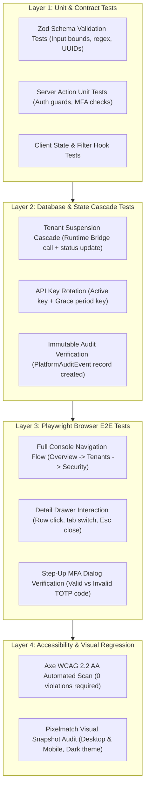
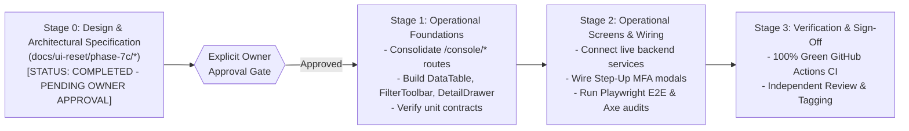

# 🪐 OrbitoX Platform OS — Phase 7C Stage 0
# Document 08: Test Plan & Acceptance Criteria

**Milestone:** Phase 7C Operations Console & System Screens  
**Governing Baseline:** Phase 7B.2 Delivered HEAD `188680c27ce51ebb8ca6e998e504c51a24c34fa0`  
**Date:** November 18, 2026  
**Auditor / Role:** Principal QA Lead & Staff Architect

---

## 1. Multi-Tiered Verification Test Plan

Phase 7C implementation will be verified through four rigorous automated test layers prior to requesting final acceptance:

---

## 2. Detailed Test Specifications

### 2.1 Server Action & Security Tests (`tests/unit/console-actions.test.ts`)
- **TST-7C-01:** `suspendTenantAction` rejects unauthenticated callers with HTTP 401.
- **TST-7C-02:** `suspendTenantAction` rejects callers lacking `TENANT_SUSPEND` permission with HTTP 403.
- **TST-7C-03:** `suspendTenantAction` rejects invalid or expired TOTP MFA codes with HTTP 400.
- **TST-7C-04:** Successful tenant suspension writes a `PlatformAuditEvent` record with full before/after diff.
- **TST-7C-05:** `rotateApiKeyAction` generates a valid credential pair and schedules previous key expiration after 24 hours.

### 2.2 End-to-End Browser Playwright Tests (`tests/e2e/console-e2e.spec.ts`)
- **TST-7C-06:** Operator logs in with credentials and TOTP MFA code; successfully redirects to `/console/overview`.
- **TST-7C-07:** Navigation through all 10 sidebar links renders with HTTP 200 and zero uncaught client console errors.
- **TST-7C-08:** Clicking a tenant row opens the `DetailDrawer` displaying valid live project and branch tabs.
- **TST-7C-09:** Keyboard shortcut `Cmd+K` opens search palette; typing query returns matching tenant record.
- **TST-7C-10:** Pressing `/` focuses table search filter; typing filters rows instantly.

### 2.3 Accessibility & Visual Regression Tests
- **TST-7C-11:** Playwright Axe-core audit across all 10 console views reports **0 violations** against WCAG 2.2 AA rules (`color-contrast`, `target-size`, `aria-roles`).
- **TST-7C-12:** Visual regression diff ratio remains $\le 0.05$ across both Desktop (1280px) and Mobile (375px) viewports in dark operator theme.

---

## 3. Implementation Stages & Approval Gate

Execution of Phase 7C follows a strict three-stage progression:

> [!IMPORTANT]
> **Stage 0 Approval Gate Rule:**  
> Implementation coding for Stage 1 will **NOT** begin until the platform owner reviews and provides explicit authorization on this Stage 0 design specification.

---

## 4. Phase 7C Acceptance Criteria Checklist

| Item | Requirement | Verification Method | Status |
| :--- | :--- | :--- | :--- |
| **1. Route Consolidation** | All console operations hosted on `/console/*`; legacy `/admin` routes redirect via 308. | Route curl inspection | Pending Stage 1 |
| **2. Zero Mocked Data** | Every metric, table, and inspector queries real backend services. | Code audit & API logs | Pending Stage 2 |
| **3. Step-Up MFA** | Destructive actions enforce 6-digit TOTP verification before execution. | Automated action tests | Pending Stage 2 |
| **4. Responsive Layout** | 4-band responsive viewport adaptation verified on real browser bands. | CDP Playwright audit | Pending Stage 2 |
| **5. WCAG 2.2 AA** | 0 Axe violations; contrast $\ge 4.5:1$ text and $\ge 3:1$ UI controls maintained. | Playwright Axe audit | Pending Stage 2 |
| **6. Touch Targets** | Minimum $44 \times 44$px touch targets on mobile interactive controls. | Automated CSS test | Pending Stage 2 |
| **7. Clean CI Run** | All 14 GitHub Actions CI jobs complete with conclusion: `success`. | GitHub Actions log | Pending Stage 3 |
| **8. Invariant Preservation**| `page.tsx` untouched; zero UI imports from platform; linear Git ancestry. | Git audit check | Pending Stage 3 |
