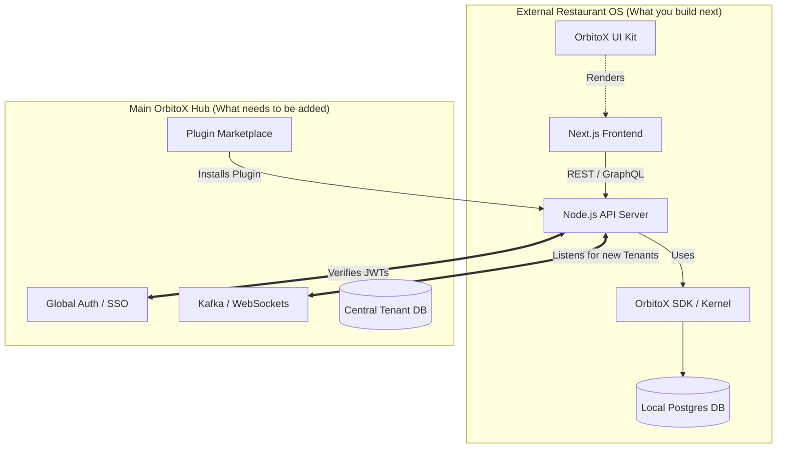

# 🚀 Roadmap: Building a Full Restaurant SaaS with OrbitoX

Yes, it is **100% possible** to build a full, production-ready Restaurant SaaS using what we've built. The `external-restaurant-os` folder currently proves the "Kernel" works. 

To take this from a "Command Line PoC" to a **Fully Monetizable SaaS Product**, here is the exact architectural blueprint of what needs to be built on both sides.

---

## 🏗️ Architecture Blueprint

---

## 🛠️ Phase 1: What to add to `external-restaurant-os`

Right now, this folder just has `main.ts`. To make it a real application, you need to add:

### 1. The API Server (Backend)
You need a web server (Express, Fastify, or NestJS) to accept HTTP requests from users.
* **What it does**: Instead of running a script and exiting, it listens on port `3000`.
* **Integration**: Every API route (e.g., `POST /api/menu_items`) will call `await rbacService.authorize(...)` before saving to the database.

### 2. A Database & ORM (Persistence)
Right now, the Context Graph is stored in-memory and disappears when the script ends.
* **What you need**: Add Prisma or Drizzle ORM, connected to a local PostgreSQL or SQLite database.
* **Integration**: The OrbitoX `ContextService` needs a "Database Adapter" written for it so it can save `brand-hq` and `franchisee-1` permanently to Postgres.

### 3. The Frontend (UI)
Users need buttons to click, not a terminal.
* **What you need**: A Next.js or React application.
* **Integration**: You will import the `DynamicForm` and `DynamicTable` we built in the OrbitoX UI package. Because you already have a `manifest.json`, the UI will automatically render the correct forms for "Menu Items" without you writing frontend code!

---

## 🌐 Phase 2: What to add to the `OrbitoX Hub`

For the "Hub and Spoke" model to work, the main OrbitoX Monorepo needs some global infrastructure:

### 1. Global Authentication (Identity Provider)
The Restaurant OS should not manage passwords. 
* **Action**: Implement an OAuth2 server (or use Supabase/Clerk/Keycloak) in the Main OrbitoX Hub. When a user logs into the Restaurant OS, they are redirected to the Hub, authenticate, and return with a JWT token containing their roles.

### 2. The Event Bus (Real-time Sync)
When a new Franchisee signs up on the Main Hub, the Restaurant OS needs to know immediately so it can create a local Context Graph node.
* **Action**: Add Redis Pub/Sub, Kafka, or WebSockets to the Hub. The Restaurant OS will listen to an event like `TENANT_CREATED` and automatically update its local database.

### 3. Policy & Role Editor UI
Right now, we hardcoded `manager` and `status == active` in the TypeScript files.
* **Action**: Build an admin dashboard on the Main Hub where Global Admins can drag-and-drop to create JSON-Logic ABAC rules, and assign roles to users. These rules are then served to the Restaurant OS via an API.

---

## 📋 Step-by-Step Execution Plan

If you wanted to start building this today, here is the order of operations:

| Step | Task | Location | Effort |
| :--- | :--- | :--- | :--- |
| **1** | Initialize a Next.js Fullstack App inside `external-restaurant-os`. | External App | 1 Hour |
| **2** | Add Prisma ORM and create a PostgreSQL database for the Restaurant OS. | External App | 2 Hours |
| **3** | Create REST endpoints (`GET /menu`, `POST /menu`) wrapped in the `RbacService` logic. | External App | 1 Day |
| **4** | Connect the OrbitoX `DynamicTable` to the Next.js frontend to list menu items. | External App | 1 Day |
| **5** | Set up a central JWT Auth server on the Main Hub. | OrbitoX Hub | 2 Days |
| **6** | Build a WebSocket listener to sync `Context` from the Hub to the Restaurant OS. | Both | 3 Days |

### Summary
You have successfully built the **hardest part** of a B2B SaaS—the dynamic engine, context graph, and zero-trust security. The rest is standard web development (setting up databases, APIs, and React interfaces).
