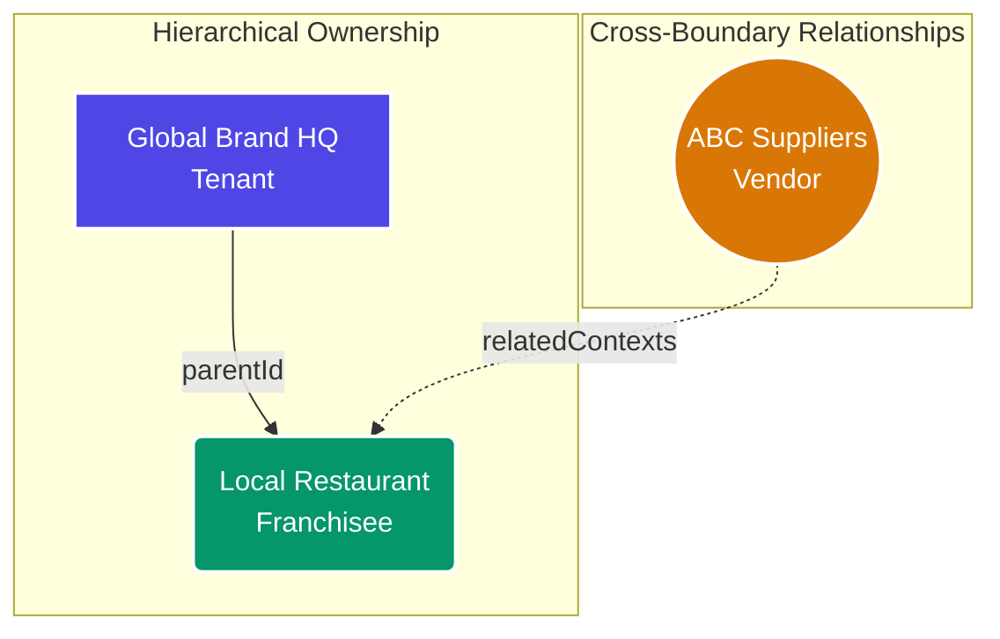
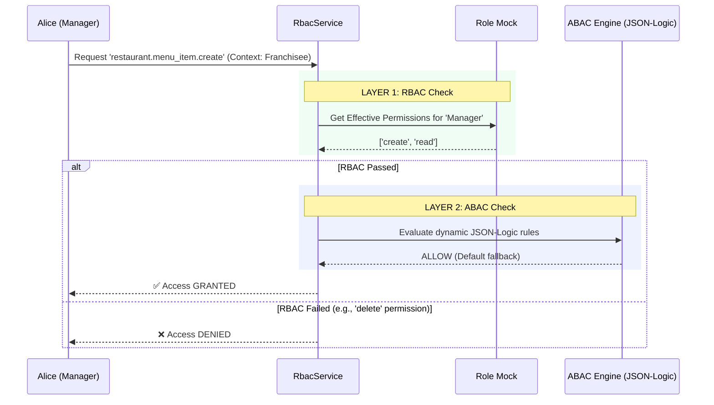
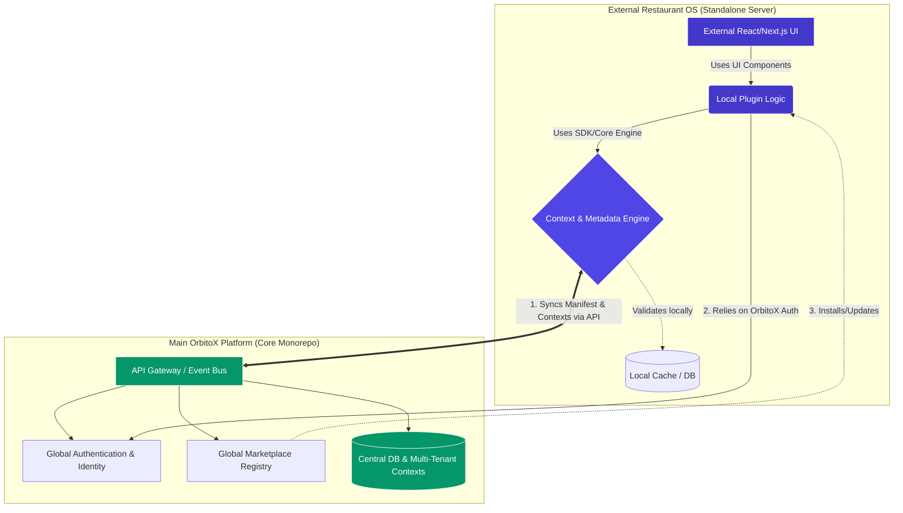
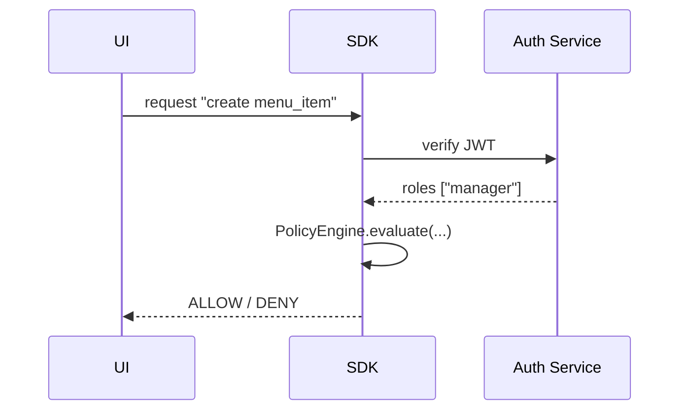
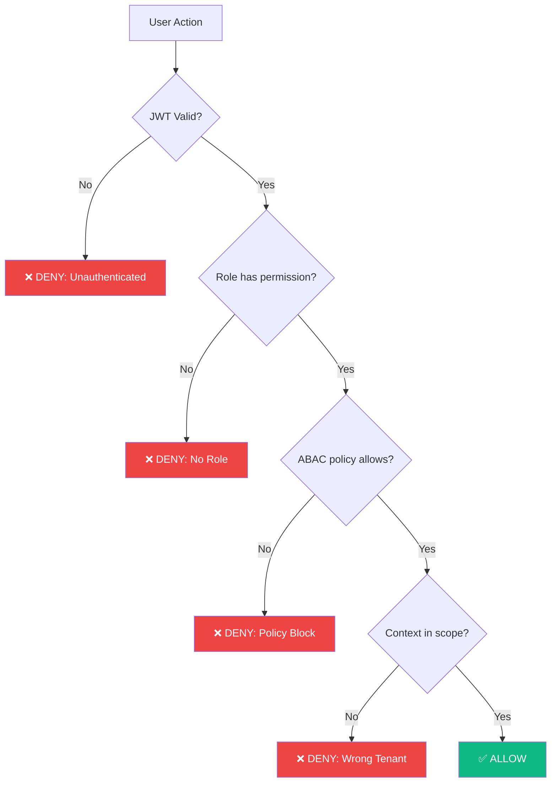
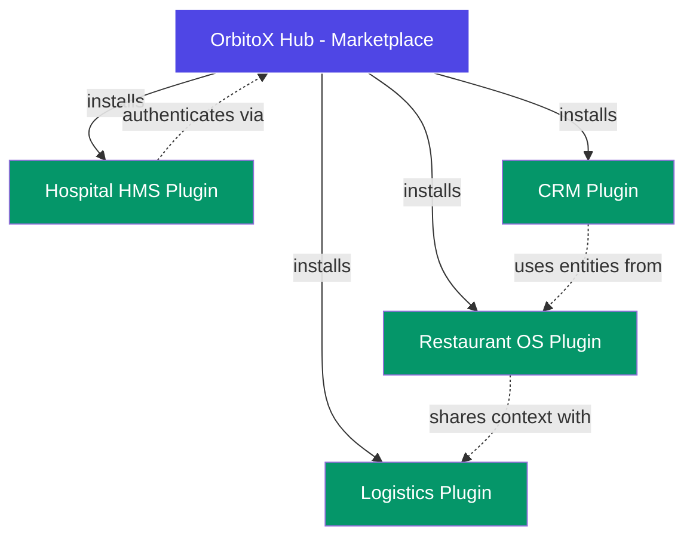

# OrbitoX Standalone Integration Test

This project serves as a **Proof of Concept (PoC)** to verify the extreme portability and headless nature of the **OrbitoX Platform Kernel**. By packaging the OrbitoX SDKs and consuming them as standard npm dependencies, we simulate how external developers can rapidly scaffold enterprise-grade applications.

## 🏗️ Architecture Overview

The standalone test (`src/main.ts`) bypasses the NestJS Dependency Injection container to instantiate the core OrbitoX engines directly. It proves that the logic inside OrbitoX is not tightly coupled to any specific web framework or database.

### Components Initialized

| Component | Package | Purpose in Standalone Test |
| :--- | :--- | :--- |
| **Plugin Manifest** | `manifest.json` | Declarative definition of the "Restaurant" domain (Entities, Fields, UI metadata). |
| **ContextService** | `@orbitox/core` | Manages hierarchical (Tree) and mesh (Graph) relationships between tenants/vendors. |
| **PolicyEngine** | `@orbitox/core` | Evaluates dynamic JSON-Logic Attribute-Based Access Control (ABAC) rules. |
| **RbacService** | `@orbitox/core` | Intercepts authorization requests and enforces both RBAC (Roles) and ABAC (Attributes). |
| **MetadataEngine** | `@orbitox/plugin-engine` | Parses the `manifest.json` and dynamically registers entities into the system memory. |

---

## 🌐 The O2O2B2B Context Graph

One of the most complex requirements for an Enterprise SaaS is managing universal relationship models (O2O, B2B, B2C, B2B2C, O2O2B2B). 

In `main.ts`, we construct the following multi-dimensional context graph:



### Why this matters:
1. **Inheritance**: The `Local Restaurant` automatically inherits configurations and policies from `Global Brand HQ` via traditional tree traversal (`parentId`).
2. **Cross-Pollination**: `ABC Suppliers` is an external vendor entity, but through `relatedContexts`, they are securely bridged to the `Local Restaurant`. The Context Engine's BFS traversal algorithm seamlessly navigates this mesh.

---

## 🛡️ Security Evaluation Flow (RBAC + ABAC)

When the script attempts to create a "Menu Item", the authorization request travels through the dual-layer security engine:



### The Test Results
When running `npm start`:
1. **Create Action (`restaurant.menu_item.create`)**: Succeeds because the mock user (`Alice`) has the `manager` role, which contains the `create` permission, and the ABAC engine defaults to ALLOW for valid RBAC requests without explicit blocking policies.
2. **Delete Action (`restaurant.menu_item.delete`)**: Fails instantly because the `manager` role in our mock lacks the `delete` permission. The system correctly throws an `Access denied` exception, proving zero-trust enforcement outside the main API.

---

## 🤝 How External Projects Work WITH the Main "OrbitoX" Platform

While this test proves the SDK works entirely in isolation, in a real-world production environment, **External Projects (like this one)** and the **Main OrbitoX Platform** work together in a Hub-and-Spoke (or Satellite) architecture.

### The Relationship

- **The Main OrbitoX Platform (Hub)**: Acts as the central nervous system. It hosts the core databases, user registries, global authentication (SSO), and the Marketplace. It exposes GraphQL/REST APIs and WebSocket event streams.
- **The External Project (Spoke/Satellite)**: Built by a third-party agency (or a massive franchisee). It uses the `@orbitox/sdk` to rapidly build its own UI and custom business logic, but it synchronizes its data and context with the Hub.

### Visualizing the Integration



### The Synergy Workflow:

1. **Manifest Registration**: When this external `Restaurant OS` boots up, the `@orbitox/sdk` takes the `manifest.json` and pushes it to the **Main OrbitoX Platform**. The main platform registers the `menu_item` entity globally.
2. **Context Synchronization**: When a new franchisee signs up on the Main Platform, the event bus pushes that Context (ID, parentID, owner) down to this external system. Our local SDK instantly updates its local Context Graph so it knows how to handle local ABAC.
3. **Delegated Security**: When a user logs into the `External Restaurant OS`, they actually authenticate via the Main Platform's OAuth/SSO. The external system receives a JWT containing the user's Roles. The local `PolicyEngine` (which we just proved works standalone!) evaluates permissions instantly without making a network round-trip for every click.
4. **Marketplace Discovery**: Because the external system uses the official SDK, it can be published to the Main Platform's Marketplace, allowing other businesses on OrbitoX to discover and install the "Restaurant OS" extension seamlessly.

### Deep Dive: How the External Project Communicates with the Hub

#### 1. Manifest registration flow (HTTP POST)
```http
POST /api/plugins/manifest
Content-Type: application/json
Authorization: Bearer <JWT>

{
  "pluginId": "restaurant",
  "entities": [{ ... }],
  "version": "1.0.0"
}
```
*The Hub validates the schema, stores it in `plugin_manifest` table, and emits `PluginRegistered` event.*

#### 2. Context sync via Event Bus (WebSocket)
```json
{
  "type": "ContextCreated",
  "payload": {
    "id": "ctx_1785926240123_998",
    "parentId": "ctx_1785926240123_48",
    "type": "tenant",
    "slug": "franchisee-1",
    "ownerId": "franchise_owner"
  }
}
```
*The external SDK receives this message, calls `ContextService.createContext` locally, and updates its graph.*

#### 3. Authorization request lifecycle


#### 4. Marketplace publishing
*When the external team runs `orbitox publish restaurant`, the CLI bundles the plugin and calls:*
```bash
POST /api/marketplace/plugins
{
  "name": "restaurant",
  "tarball": "<base64 blob>"
}
```
*The Hub stores the artifact and makes it selectable for other tenants.*

### Benefits Recap

| Benefit | Explanation |
|--------|-------------|
| **Zero‑Trust** | All decisions are enforced locally after a single JWT verification. |
| **Low latency** | ABAC evaluation runs in‑process, no extra network hop per request. |
| **Scalable** | Hundreds of satellites can attach to a single Hub without coupling. |
| **Reusable** | Plugins can be published once and consumed by any tenant. |

---

## 🔍 Differences: Standalone vs Hub-Integrated Mode

This project can operate in **two distinct modes**. Understanding the difference is fundamental before making an architectural decision.

### Mode Comparison Table

| Dimension | 🏝️ Standalone Mode (this PoC) | 🌐 Hub-Integrated Mode (Production) |
|-----------|-------------------------------|--------------------------------------|
| **Authentication** | Mock users (hardcoded roles) | Real users via Hub OAuth2 / SSO (JWT) |
| **Context Source** | Created locally in `main.ts` | Synced in real-time from Hub via WebSocket or REST |
| **Policy Source** | Rules embedded in code | Rules fetched from Hub's `PolicyService` and cached |
| **Database** | In-memory (no persistence) | Local DB (SQLite/Postgres) synced with Hub Central DB |
| **Manifest** | Loaded from local `manifest.json` | Pushed to Hub and registered globally |
| **Plugin Lifecycle** | Manual bootstrap | Managed by Hub lifecycle events (`PluginInstalled`, `PluginUpdated`) |
| **Marketplace** | Not visible to others | Published and discoverable by any Hub tenant |
| **Multi-tenancy** | Simulated | Real multi-tenant isolation enforced by Hub |
| **Event Bus** | None | Kafka / WebSocket for real-time sync |
| **Scalability** | Single process, single developer test | Hundreds of satellites, auto-scaling |
| **Use Case** | Local development, SDK verification, CI tests | Real SaaS product running for thousands of users |

---

## 🎯 Benefits in Depth

### Benefit 1: Speed of Product Creation

> **"Time-to-new-SaaS should be days, not months."**
> — OrbitoX Platform Bible

Without OrbitoX, building a multi-tenant SaaS like this Restaurant OS from scratch would require weeks of boilerplate work. With OrbitoX SDK you:

1. Create a `manifest.json` — 10 minutes
2. Run `npm start` — seconds
3. Get a fully working Context Graph, RBAC, ABAC, and Metadata engine instantly

| Task | Traditional (from scratch) | OrbitoX SDK |
|------|---------------------------|-------------|
| Auth & Identity | ~2 weeks | ✅ Built-in via Hub OAuth |
| Multi-Tenant DB schema | ~1 week | ✅ `ContextService` handles it |
| RBAC Engine | ~2 weeks | ✅ `RbacService` ready to use |
| ABAC Policies | ~1 week | ✅ `PolicyEngine` (JSON-Logic) |
| Admin Panel | ~2 weeks | ✅ `DynamicForm` + `DynamicTable` |
| Testing & Hardening | ~2 weeks | ✅ PoC proves it works in < 1 day |
| **TOTAL** | **~10 weeks** | **~3 days** |

---

### Benefit 2: True Multi-Model Business Support

OrbitoX handles the most complex real-world business topologies without any custom code:

| Business Model | Description | OrbitoX Mechanism |
|---|---|---|
| **B2C** | Single brand → end consumers | 1 Context Tree: `Brand → Customer` |
| **B2B** | Businesses transact with each other | 2 Context Trees: `Vendor ↔ Buyer` |
| **B2B2C** | Business sells via another business to consumers | 3-level tree: `Brand → Reseller → Customer` |
| **O2O** | Online orders fulfilled offline | Context mesh: `Online Platform — Offline Store` |
| **O2O2B2B** | Online-to-Offline bridging two businesses | Deep mesh graph: 4+ node types, cross-boundary edges |
| **C2C** | Consumer sells to another consumer | Peer mesh: Any 2 consumer contexts can relate |
| **C2B** | Consumer provides service to business | Reverse edge: `Consumer → Business` |
| **Universal** | All models simultaneously | DAG graph with typed edges: `owns`, `partnerOf`, `supplierOf` |

All of these are handled by the **same `ContextService`** — no new code, just different graph configurations.

---

### Benefit 3: Zero-Trust Security Without Complexity

Traditional approach forces developers to manually guard every DB call. OrbitoX collapses that into one line:

```typescript
// Traditional (fragile, error-prone)
if (user.role === 'manager' && context.tenantId === user.tenantId && !user.isSuspended && feature.isEnabled) {
  // ... maybe 5 more checks
}

// OrbitoX (one line, covers all 4 gates)
await rbacService.authorize({ userId, contextId, permission });
```

#### The 4-Gate Zero-Trust Pipeline



Every request passes through **4 independent gates**. Any single failure immediately denies the action.

---

### Benefit 4: Headless & Framework-Agnostic

The OrbitoX kernel has zero dependency on any UI or database framework:

| Frontend | Compatible? | Notes |
|---|---|---|
| React / Next.js | ✅ | Built-in `DynamicForm`, `DynamicTable` UI components |
| Vue / Nuxt | ✅ | Consume REST APIs directly |
| Angular | ✅ | SDK is pure TypeScript |
| Plain HTML + JS | ✅ | Use REST API only |
| React Native | ✅ | No DOM dependency in SDK |
| CLI / Script | ✅ | **This PoC proves it** — no browser needed |

| Backend / Database | Compatible? | Notes |
|---|---|---|
| PostgreSQL | ✅ | Default ORM target |
| MongoDB | ✅ | Switch the data adapter |
| SQLite | ✅ | Perfect for edge / standalone mode |
| Redis (cache) | ✅ | Context graph can be cached |
| No database | ✅ | In-memory mode (this PoC) |

---

### Benefit 5: Plugin Marketplace & Ecosystem

Because every project registers its manifest with the Hub, the entire system becomes a **living marketplace** of composable capabilities:



- A **single tenant** can install both `Restaurant OS` + `CRM` and they automatically share the same user pool and context graph.
- **Zero re-implementation** of auth, roles, or tenancy between plugins.
- Plugins can **communicate with each other** via shared context IDs and the event bus.

---

### Benefit 6: Local-First, Offline-Capable Architecture

Because the `PolicyEngine` evaluates rules **locally** after receiving a JWT, external projects can operate even with a degraded Hub connection:

| Scenario | Behaviour |
|---|---|
| Hub is fully online | Real-time context sync + policy updates |
| Hub is briefly unavailable | External app serves requests using **local cached** contexts & policies |
| Hub is permanently down | External app continues with last-known state; writes queue for sync on recovery |
| No Hub at all (full standalone) | Works in pure offline mode using local `manifest.json` and in-memory graph — exactly what this PoC demonstrates |

---

## ✅ When to Use Which Mode

| Scenario | Recommended Mode |
|---|---|
| Testing the SDK locally | 🏝️ Standalone |
| CI/CD pipeline unit tests | 🏝️ Standalone |
| Building a new vertical SaaS (CRM, HMS, etc.) | 🌐 Hub-Integrated |
| Third-party agency building an extension | 🌐 Hub-Integrated |
| Offline-capable mobile or edge apps | 🏝️ Standalone + periodic Hub sync |
| Large enterprise with many subsidiaries | 🌐 Hub-Integrated (O2O2B2B graph) |
| Agency starting with a client's custom product | Start 🏝️ Standalone → migrate to 🌐 Hub |

---

## 🚀 Next Steps to Go Production

1. **Replace mock `RoleService`** → HTTP call to Hub's `/api/roles/:userId` endpoint.
2. **Add a local DB** (SQLite or Postgres) to persist contexts across restarts.
3. **Configure Hub URL** via environment variable (`ORBITOX_HUB_URL=https://...`).
4. **Run `orbitox publish`** to register the plugin in the Hub Marketplace.
5. **Add a React/Next.js UI** using the OrbitoX `DynamicForm` and `DynamicTable` components.
6. **Containerize** with `docker-compose up` for production deployment.


