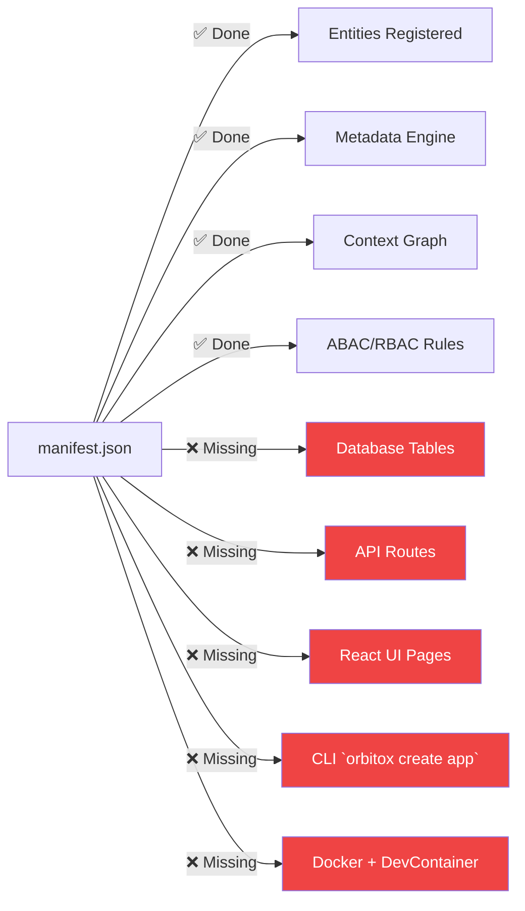

# ⚡ How to Make OrbitoX 10x Faster, Smarter & Fully Automatic

This document answers the question:
> **"How do I reduce time, make it easier, faster, more automatic, and smart enough to implement in ANY project?"**

The answer is a single paradigm shift:
> **Move from "Manual Assembly" → "One-Command Magic"**

---

## 🎯 The Core Idea: Configuration as Code

The entire OrbitoX philosophy is that a developer should only do **one thing**:
> Write a `manifest.json` → OrbitoX does **everything else automatically**.

| What you write | What OrbitoX auto-generates |
|---|---|
| Entity name + fields | Database schema (Prisma migration) |
| Field types (text, date, enum) | TypeScript types and Zod validators |
| Entity relationships | REST / GraphQL API endpoints |
| Business model (B2B2C, etc.) | Context graph structure |
| Permissions list | RBAC roles and ABAC policy rules |
| UI hints (label, placeholder) | Fully rendered React forms and tables |

**This is already partially implemented. The following roadmap shows exactly what to add to complete the loop.**

---

## 🔴 The Current Gap (What's Missing)



---

## ⚡ Feature 1: `orbitox create <app-name>` — The Universal Scaffold Command

Currently the CLI has `orbitox new <plugin-name>` which generates an internal plugin.
We need a **separate `create` command** for external standalone projects (like this one).

### How it would work:
```bash
# One command to scaffold an ENTIRE restaurant SaaS
orbitox create restaurant-os --template=saas
```

### What it auto-generates in < 30 seconds:
```
restaurant-os/
├── manifest.json               ← You fill this in
├── package.json                ← Auto-configured
├── docker-compose.yml          ← Database + App containers ready
├── .env.example                ← All env variables pre-listed
├── prisma/
│   └── schema.prisma           ← Auto-generated from manifest.json
├── src/
│   ├── api/                    ← Express/NestJS API server auto-generated
│   │   ├── routes/             ← CRUD routes for every entity in manifest
│   │   └── middleware/         ← Auth + RBAC middleware pre-wired
│   ├── services/               ← OrbitoX kernel services bootstrapped
│   └── main.ts                 ← Production-ready entrypoint
└── frontend/
    ├── app/                    ← Next.js app
    │   ├── (auth)/             ← Login / Register pages auto-generated
    │   ├── dashboard/          ← Auto-rendered from DynamicTable
    │   └── [entity]/           ← CRUD pages auto-rendered from DynamicForm
    └── next.config.js
```

**Developer time to first running app: ~5 minutes**

---

## ⚡ Feature 2: Manifest-to-Database (Auto Prisma Generator)

When you define this in `manifest.json`:
```json
{
  "entities": [{
    "id": "menu_item",
    "fields": [
      { "name": "name", "type": "text", "required": true },
      { "name": "price", "type": "number" },
      { "name": "category", "type": "enum", "options": ["appetizer", "main", "dessert"] },
      { "name": "available", "type": "boolean", "default": true }
    ]
  }]
}
```

The `orbitox generate:db` command **auto-writes** this Prisma schema:
```prisma
model MenuItem {
  id        String   @id @default(cuid())
  name      String
  price     Float?
  category  MenuItemCategory?
  available Boolean  @default(true)
  contextId String   // Multi-tenancy built-in
  createdAt DateTime @default(now())
  updatedAt DateTime @updatedAt
}

enum MenuItemCategory {
  APPETIZER
  MAIN
  DESSERT
}
```

Then **runs the migration automatically**:
```bash
orbitox generate:db
# → Reads manifest.json
# → Writes prisma/schema.prisma
# → Runs `prisma migrate dev`
# ✅ Done. Database is ready.
```

---

## ⚡ Feature 3: Manifest-to-API (Auto Route Generator)

After generating the database, `orbitox generate:api` writes:

```typescript
// Auto-generated: src/api/routes/menu-item.routes.ts
router.get('/menu-items', auth(), async (req, res) => {
  await rbacService.authorize({ userId: req.user.id, contextId: req.context.id, permission: 'menu_item.read' });
  const items = await prisma.menuItem.findMany({ where: { contextId: req.context.id } });
  res.json(items);
});

router.post('/menu-items', auth(), async (req, res) => {
  await rbacService.authorize({ userId: req.user.id, contextId: req.context.id, permission: 'menu_item.create' });
  const item = await prisma.menuItem.create({ data: { ...req.body, contextId: req.context.id } });
  res.json(item);
});
// ... update, delete auto-generated too
```

Notice: **every route automatically calls `rbacService.authorize`**. Security is never optional.

---

## ⚡ Feature 4: Manifest-to-UI (Auto React Page Generator)

`orbitox generate:ui` reads the manifest and writes a complete Next.js page:

```typescript
// Auto-generated: frontend/app/menu-items/page.tsx
import { DynamicTable, DynamicForm } from '@orbitox/ui';
import { menuItemManifest } from '@/manifest';

export default function MenuItemsPage() {
  // DynamicTable reads the manifest entity definition
  // and auto-renders the correct columns, filters, and actions
  return <DynamicTable entity={menuItemManifest} apiPath="/api/menu-items" />;
}
```

The `DynamicForm` and `DynamicTable` already exist in the OrbitoX UI package!
We just need the **generator** to wire them up automatically.

---

## ⚡ Feature 5: Smart Templates Library

Instead of starting from scratch, provide pre-built industry templates:

| Command | Template | What it includes |
|---|---|---|
| `orbitox create my-crm --template=crm` | **CRM** | Leads, Contacts, Deals, Pipeline, Email |
| `orbitox create my-hms --template=hms` | **HMS** | Patients, Appointments, Doctors, Billing |
| `orbitox create my-restaurant --template=restaurant` | **Restaurant OS** | Menu, Orders, Tables, Kitchen, Delivery |
| `orbitox create my-store --template=ecommerce` | **E-Commerce** | Products, Cart, Orders, Payments |
| `orbitox create my-lms --template=lms` | **LMS** | Courses, Students, Assignments, Grades |

Templates are **fully functional apps** on day 1. You just modify the `manifest.json` to add or remove fields.

---

## ⚡ Feature 6: `orbitox generate` — The Master Command

Bundle all generators into one master command that runs the full pipeline:

```bash
# After you write or modify manifest.json:
orbitox generate

# This runs:
# 1. orbitox generate:types     → TypeScript interfaces
# 2. orbitox generate:db        → Prisma schema + migration
# 3. orbitox generate:api       → REST / GraphQL routes
# 4. orbitox generate:ui        → React pages and forms
# 5. orbitox generate:rbac      → Default roles and permissions
# 6. orbitox generate:tests     → Unit + E2E test stubs
#
# ✅ Done in ~10 seconds. Full app updated.
```

---

## 📊 Time Comparison: Before vs. After

| Phase | Building Manually | With OrbitoX (today) | With OrbitoX (future) |
|---|---|---|---|
| Project setup | 2 days | 30 min | **< 5 min** (one command) |
| DB Schema design | 3 days | 2 hours | **< 1 min** (auto-generated) |
| API endpoints | 5 days | 1 day | **< 1 min** (auto-generated) |
| Auth & Security | 5 days | 2 hours | **Zero** (built into every route) |
| Admin UI | 5 days | 1 day | **< 1 min** (DynamicTable wired up) |
| Multi-tenancy | 3 weeks | 2 hours | **Zero** (contextId on every query) |
| **TOTAL** | **~6 weeks** | **~1 week** | **⚡ < 1 day** |

---

## 🏗️ Implementation Priority (What to Build First)

| Priority | Feature | Effort | Impact |
|---|---|---|---|
| 🔴 P0 | `orbitox create <app> --template=<name>` CLI command | 2 days | Creates a working app in 5 minutes |
| 🔴 P0 | `orbitox generate:db` — Manifest to Prisma schema | 1 day | Eliminates all manual DB work |
| 🔴 P0 | `orbitox generate:api` — Manifest to typed CRUD routes | 2 days | Eliminates all manual API work |
| 🟡 P1 | `orbitox generate:ui` — Wire manifest to DynamicTable pages | 1 day | Eliminates all manual UI work |
| 🟡 P1 | `restaurant` starter template | 1 day | This specific project, done in minutes |
| 🟢 P2 | `orbitox generate` — Master orchestrator command | 1 day | One command to rule them all |
| 🟢 P2 | DevContainer + Docker template auto-generation | 1 day | Zero local setup required |

**Total to build: ~9 days of engineering. Return: every future SaaS takes < 1 day.**
