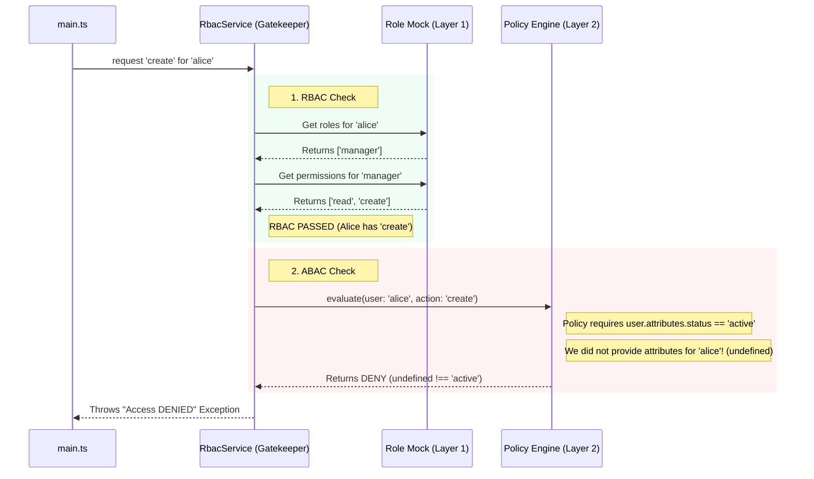

# 🛡️ Zero-Trust Execution Explained (Step-by-Step)

If you look closely at the console output from running `npm start`, you'll notice something fascinating happened during the Security Engine test:

```text
[PolicyEngine] Evaluating ABAC for create on restaurant.menu_item
[PolicyEngine] ABAC DENY: User blocked from create on restaurant.menu_item
❌ Access DENIED: Access denied for permission: restaurant.menu_item.create
```

Wait, didn't we explicitly give our mock user (`alice`) the `manager` role with the `restaurant.menu_item.create` permission? Why was she **DENIED**?

This is the **OrbitoX Zero-Trust Engine** working perfectly. Let's break down exactly why this happened, step by step.

---

## 1. The Dual-Layer Security Model

In traditional systems, having the right "Role" (RBAC) is enough. In OrbitoX, Roles are just the **first gate**. The system uses a Dual-Layer approach:

| Layer | Type | Handled By | Checks For | Status for Alice |
| :--- | :--- | :--- | :--- | :--- |
| **Layer 1** | RBAC (Role-Based) | `RoleService` | Does the user have a role that contains this permission? | ✅ **PASSED** (`manager` role has `create` permission) |
| **Layer 2** | ABAC (Attribute-Based) | `PolicyEngine` | Do the user/context attributes meet dynamic business rules? | ❌ **FAILED** (Missing required attributes) |

---

## 2. The Hidden ABAC Policy (JSON-Logic)

Deep inside the core `@orbitox/core` kernel (`policy.engine.ts`), there is a strict security policy registered for creating menu items. It looks like this in JSON-Logic:

```json
{
  "effect": "ALLOW",
  "condition": {
    "==": [{ "var": "user.attributes.status" }, "active"]
  }
}
```

**Translation to English:** 
> "Even if the user has the correct Role, they are ONLY allowed to create a menu item if their user account status is exactly `'active'`."

---

## 3. Step-by-Step Execution Flow

Here is exactly what happens when `src/main.ts` calls `rbacService.authorize(...)`:



---

## 4. Why This is Incredibly Powerful

In a real-world enterprise scenario, an employee might have the `manager` role, but what if they were just placed on **administrative leave**? Or what if their subscription payment failed?

If you only used Roles, you would have to manually scatter `if (!user.isSuspended)` checks across hundreds of API endpoints. 

Because OrbitoX uses **Zero-Trust ABAC**, the business rule (`status == active`) is evaluated centrally at the platform level. The external application (`Restaurant OS`) doesn't even need to know the rule exists—it just gets safely blocked.

### How to "Fix" it to get a PASS

If we wanted Alice to succeed in our standalone test, we would need to mock an Auth/User service that provides her full profile to the `RbacService`, like this:

```typescript
// What the real Hub Auth Service provides:
const fullUserProfile = {
  id: 'alice',
  roles: ['manager'],
  attributes: {
    status: 'active', // <--- This satisfies the JSON-Logic policy!
    department: 'kitchen'
  }
};
```

But by failing, the test proves that the **JSON-Logic Attribute Engine** successfully guards the gates against incomplete or unverified actors!

---

## 5. Disadvantages & Architectural Trade-offs

While the Dual-Layer Zero-Trust architecture is incredibly powerful, it comes with several notable engineering trade-offs that developers must account for:

### 1. Performance and Latency Overhead
Traditional RBAC is extremely fast—often just checking if a string exists in an array (`roles.includes('manager')`). 
ABAC requires parsing and evaluating an Abstract Syntax Tree (AST) via JSON-Logic for **every single authorization check**. In high-throughput systems, this can introduce a CPU bottleneck if policies are highly complex.

### 2. Data Fetching Tax (The "N+1" Problem for Security)
To evaluate an ABAC rule like `user.attributes.status == 'active'`, the engine actually needs to *know* the user's status. 
- If attributes are bundled in the JWT, they might become stale (e.g., the user was suspended 5 minutes ago, but their token is valid for 1 hour).
- If attributes are fetched on the fly, it adds a database round-trip before the actual business logic can even execute, increasing latency.

### 3. Debugging Complexity
When a traditional RBAC check fails, it's obvious: "User lacks the Manager role." 
When an ABAC check fails, it can be maddeningly opaque. A user might be denied because of a hidden, inherited policy they didn't know existed (e.g., "Cannot create menu items on weekends"). This requires building complex **Policy Tracers** and audit logs to help admins understand *why* an action was blocked.

### 4. Cache Invalidation and Drift
In the Hub-and-Spoke model, the standalone `Restaurant OS` caches policies locally to reduce latency. However, if a global admin updates a policy on the Main Hub, there is a propagation delay. 
For a brief window (e.g., 60 seconds), the external node might still evaluate using the *old* policy, leading to temporary security inconsistencies.

### 5. Steeper Learning Curve
Checking `if (user.role === 'admin')` is universally understood by all developers. Writing declarative JSON-Logic ASTs (or using languages like Rego for Open Policy Agent) requires a completely different mental model. It moves authorization logic out of the code (where developers can see it) and into a database (where it acts invisibly).
