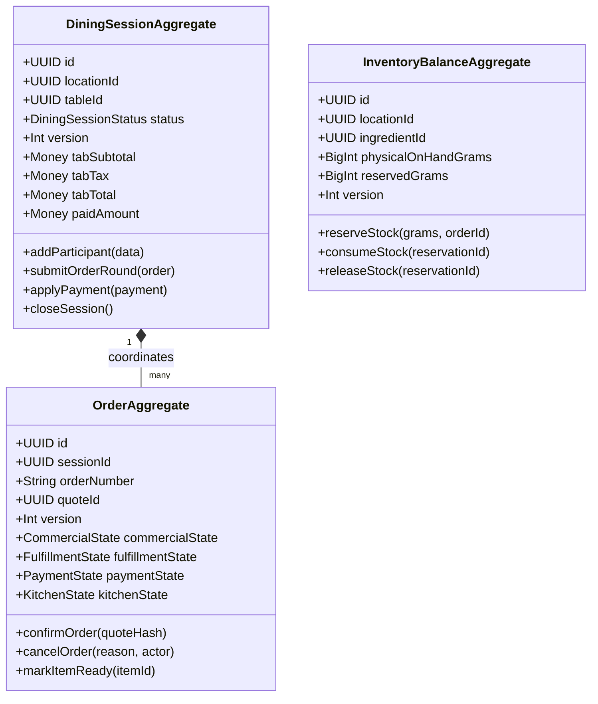

# 📦 RestaurantOS Domain Model Specification (03)

> **Contract Reference:** `03_RestaurantOS_Domain_Model.md`  
> **Status:** Production Architecture Baseline (v2.1 Hardened)  
> **Package Target:** `@orbitox-io/restaurant-core`, `@orbitox-io/restaurant-pricing`, `@orbitox-io/restaurant-catalog`

---

## 1. Domain Aggregate Roots & Invariants

In Domain-Driven Design (DDD), an aggregate root is the single point of entry for all state changes within its boundary. In RestaurantOS v2.1, entities cannot be mutated across aggregate boundaries without going through the aggregate root methods.



---

## 2. Universal Value Objects

### 2.1 The `Money` Value Object (Minor-Unit Integer Discipline)

Floating-point representations (`0.1 + 0.2 = 0.30000000000000004`) and strings are strictly prohibited in financial logic. All monetary values are represented as 64-bit integers in the currency's minor unit:

```typescript
export type CurrencyCode = 'INR' | 'USD' | 'EUR' | 'GBP' | 'AED';

export interface Money {
  readonly amountMinor: bigint; // e.g., ₹125.50 = 12550n
  readonly currency: CurrencyCode;
}

export class MoneyUtil {
  static add(a: Money, b: Money): Money {
    if (a.currency !== b.currency) throw new Error('CurrencyMismatchException');
    return { amountMinor: a.amountMinor + b.amountMinor, currency: a.currency };
  }

  static subtract(a: Money, b: Money): Money {
    if (a.currency !== b.currency) throw new Error('CurrencyMismatchException');
    return { amountMinor: a.amountMinor - b.amountMinor, currency: a.currency };
  }

  static multiply(m: Money, factor: number, rounding: 'HALF_EVEN' | 'FLOOR' | 'CEIL' = 'HALF_EVEN'): Money {
    const raw = Number(m.amountMinor) * factor;
    const rounded = rounding === 'HALF_EVEN' ? Math.round(raw) : Math.floor(raw);
    return { amountMinor: BigInt(rounded), currency: m.currency };
  }
}
```

---

### 2.2 The `PricingQuote` Value Object (Cryptographic Hash Lock)

Checkout operations **never** calculate totals on the client. Quotes are issued by the Pricing Engine and validated during order submission via input and result SHA-256 hashes:

```typescript
export interface PricingQuote {
  readonly quoteId: string;
  readonly sessionId: string;
  readonly locationId: string;
  
  // Referenced Entity Versions
  readonly catalogVersion: string;
  readonly menuVersion: string;
  readonly priceVersion: string;
  readonly taxProfileVersion: string;
  readonly promotionVersion: string;
  readonly availabilityVersion: string;

  // Cryptographic Verifiers
  readonly inputHash: string;   // SHA256(SessionId + LineItems)
  readonly resultHash: string;  // SHA256(Versions + Taxes + TotalMinor)

  // Calculated Financial Breakdown
  readonly lineItems: Array<{
    productId: string;
    quantity: number;
    unitPriceMinor: bigint;
    selectedModifierIds: string[];
    subtotalMinor: bigint;
  }>;
  readonly discountAmountMinor: bigint;
  readonly taxes: Array<{
    name: string;        // e.g., "CGST 2.5%"
    ratePercent: number; // 2.5
    amountMinor: bigint;
  }>;
  readonly totalMinor: bigint;

  readonly expiresAt: Date;     // 120-second validity window
  readonly createdAt: Date;
}
```

---

### 2.3 The `BusinessSnapshot` Value Object (Immutable Order Audit Record)

At the instant an order is confirmed, a `BusinessSnapshot` is captured and persisted inside `Order.businessSnapshotJson`. This snapshot guarantees complete historical reproducibility for tax authorities and audits:

```typescript
export interface BusinessSnapshot {
  readonly confirmedAt: string;
  readonly locationSnapshot: {
    name: string;
    gstinOrTaxId: string;
    address: string;
    timezone: string;
  };
  readonly pricingSnapshot: {
    catalogVersion: string;
    menuVersion: string;
    recipeVersions: Record<string, string>; // productId -> recipeVersionId
    taxVersion: string;
    promotionVersion: string;
  };
  readonly appliedRules: string[];
}
```

---

## 3. Entity Definitions

### 3.1 DiningSession, QRIdentity & Participants (v2.2 Contract)

```typescript
export interface QRIdentity {
  readonly id: string;
  readonly locationId: string;
  readonly tableId: string;
  readonly publicLocatorVersion: number;
  readonly tokenHash: string; // Opaque high-entropy locator hash
  readonly status: 'ACTIVE' | 'REVOKED' | 'SUSPENDED';
  readonly issuedAt: Date;
  readonly revokedAt?: Date;
}

export interface TableDiscoveryContext {
  readonly restaurantName: string;
  readonly branchName: string;
  readonly serviceAreaName: string;
  readonly tableLabel: string;
  readonly brandLogoUrl: string;
  readonly isSessionActive: boolean;
  readonly joinPolicy: 'OPEN_JOIN' | 'APPROVAL_REQUIRED' | 'HOST_APPROVAL' | 'STAFF_APPROVAL' | 'HIGH_SECURITY';
  readonly publicMenuUrl: string;
}

export interface JoinRequest {
  readonly id: string;
  readonly diningSessionId: string;
  readonly requestedDisplayName: string;
  readonly requesterContext: {
    ipAddress?: string;
    userAgent?: string;
    deviceFingerprint?: string;
  };
  readonly riskScore: number;
  readonly requestedAt: Date;
  readonly expiresAt: Date;
  status: 'REQUESTED' | 'APPROVED' | 'REJECTED' | 'EXPIRED';
  approvedBy?: string; // Host participant ID or Staff ID
}

export type ParticipantType = 'ANONYMOUS_GUEST' | 'IDENTIFIED_GUEST' | 'STAFF_ASSISTED';
export type ParticipantRole = 'HOST' | 'PARTICIPANT';

export interface Participant {
  readonly id: string;
  readonly sessionId: string;
  readonly type: ParticipantType;
  readonly role: ParticipantRole;
  readonly displayName: string;
  readonly avatarRef?: string;
  readonly phone?: string;
  readonly customerId?: string;
  readonly deviceFingerprint?: string;
  readonly joinedAt: Date;
  readonly leftAt?: Date;
}

export interface DiningSessionPrivacyPolicy {
  allowGuestJoin: boolean;
  requireApproval: boolean;
  showParticipantNames: boolean;
  showParticipantItems: boolean;
  showSharedTotal: boolean;
  allowGuestInvites: boolean;
  allowGuestOrderForTable: boolean;
  allowGuestRequestBill: boolean;
  allowGuestSplitBill: boolean;
  participantVisibilityMode: 'PRIVATE' | 'SHARED' | 'SHARED_WITH_CONSENT' | 'BILL_ONLY';
}

export interface DiningSession {
  readonly id: string;
  readonly locationId: string;
  readonly tableId: string;
  status: 'OPEN' | 'ORDERING' | 'ORDERED' | 'PREPARING' | 'BILL_REQUESTED' | 'PAID' | 'CLOSED';
  guestCount: number;
  accessEpoch: number; // Incremented on session close/transfer to bulk-revoke all capabilities
  privacyPolicy: DiningSessionPrivacyPolicy;
  participants: Participant[];
  orderIds: string[];
  tabSubtotalMinor: bigint;
  tabTaxMinor: bigint;
  tabTotalMinor: bigint;
  paidAmountMinor: bigint;
  version: number;
  openedAt: Date;
  closedAt?: Date;
}
```

### 3.2 CatalogItem, Variants & Recipes

```typescript
export interface RecipeIngredient {
  ingredientId: string;
  quantityGramsOrUnits: number;
  isWastageExpectedPercent: number;
}

export interface RecipeVersion {
  recipeVersionId: string;
  catalogItemId: string;
  versionNumber: number;
  ingredients: RecipeIngredient[];
  preparationMinutes: number;
  targetStationId: string;
  equipmentRequiredIds: string[];
  effectiveFrom: Date;
}

export interface CatalogItem {
  id: string;
  companyId: string;
  name: string;
  category: string;
  baseCostMinor: bigint;
  allergens: string[];
  dietaryTags: Array<'VEG' | 'NON_VEG' | 'VEGAN' | 'GLUTEN_FREE'>;
  activeRecipeVersionId: string;
  modifierGroupIds: string[];
}
```

---

## 4. Invariants & Business Constraints

1. **Monetary Non-Negativity:** No aggregate method may compute an `amountMinor < 0n` unless explicitly processing an authorized `Refund` entity.
2. **Optimistic Locking:** Every database update on `DiningSession`, `Order`, `InventoryBalance`, or `Table` must increment `version = version + 1` and verify the expected version in the SQL `WHERE` clause.
3. **Confirmed Immutability:** Once `Order.commercialState === 'CONFIRMED'`, no property of `OrderItem` may be overwritten. Modifications must be modeled as discrete `OrderAdjustment` entities.
4. **Recipe Version Binding:** Every confirmed `OrderItem` must reference a valid, non-null `recipeVersionId`.
