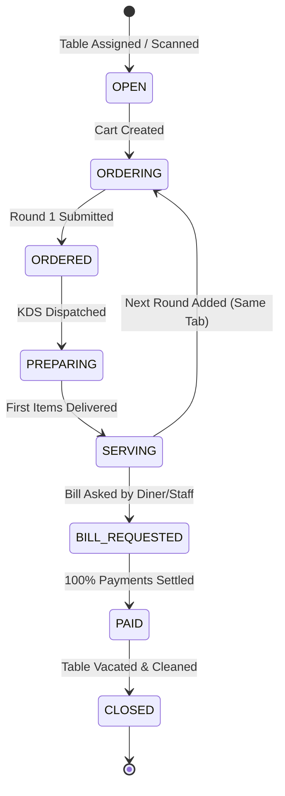
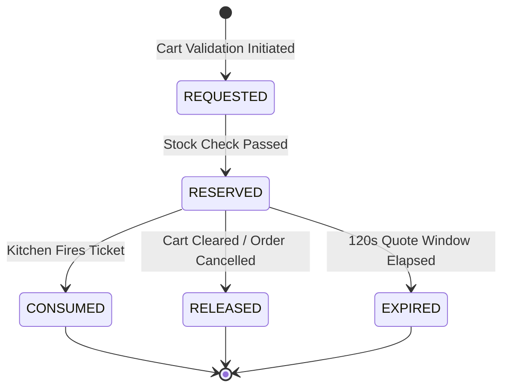

# 🔄 RestaurantOS State Machine Specifications (04)

> **Contract Reference:** `04_RestaurantOS_State_Machines.md`  
> **Status:** Production Architecture Baseline (v2.1 Hardened)  
> **Package Target:** `@orbitox-io/restaurant-order`, `@orbitox-io/restaurant-dining`, `@orbitox-io/restaurant-inventory`

---

## 1. The Four Orthogonal Order State Machines

In RestaurantOS v2.1, an order does not have a single monolithic status field. It is governed by **four independent, non-interfering domain state machines**.

```mermaid
flowchart TD
    subgraph COMMERCIAL ["1. CommercialState"]
        DRAFT --> SUBMITTED
        SUBMITTED --> CONFIRMED
        SUBMITTED --> CANCELLED
        CONFIRMED --> CANCELLED
        CONFIRMED --> COMPLETED
    end

    subgraph FULFILLMENT ["2. FulfillmentState"]
        UNFULFILLED --> IN_PROGRESS
        IN_PROGRESS --> PARTIALLY_FULFILLED
        IN_PROGRESS --> FULFILLED
        PARTIALLY_FULFILLED --> FULFILLED
    end

    subgraph PAYMENT ["3. PaymentState"]
        UNPAID --> AUTH_PENDING["AUTHORIZATION_PENDING"]
        AUTH_PENDING --> AUTHORIZED
        AUTH_PENDING --> AUTH_FAILED["AUTHORIZATION_FAILED"]
        AUTHORIZED --> CAPTURE_PENDING["CAPTURE_PENDING"]
        CAPTURE_PENDING --> PAID
        UNPAID --> PARTIALLY_PAID
        PARTIALLY_PAID --> PAID
        UNPAID --> PAY_FAILED["PAYMENT_FAILED"]
        PAID --> REFUND_PENDING["REFUND_PENDING"]
        REFUND_PENDING --> REFUNDED
        REFUND_PENDING --> PARTIALLY_REFUNDED
    end

    subgraph KITCHEN ["4. KitchenState"]
        QUEUED --> PREPARING
        PREPARING --> READY
        READY --> EXPO
    end
```



### 1.1 CommercialState Transition Table

| From State | To State | Allowed Actors | Reason Required? | Idempotency Required? | Terminal? |
|---|---|---|---|---|---|
| `DRAFT` | `SUBMITTED` | `GUEST`, `CAPTAIN`, `KIOSK` | No | Yes | No |
| `SUBMITTED` | `CONFIRMED` | `SYSTEM`, `MANAGER`, `CAPTAIN` | No | Yes | No |
| `SUBMITTED` | `CANCELLED` | `GUEST` (pre-auth), `MANAGER` | Yes | Yes | **Yes** |
| `CONFIRMED` | `CANCELLED` | `MANAGER` | Yes (Void reason) | Yes | **Yes** |
| `CONFIRMED` | `COMPLETED` | `SYSTEM` (on delivery+payment)| No | Yes | **Yes** |

### 1.2 PaymentState Transition Table

| From State | To State | Allowed Actors | Event Trigger | Terminal? |
|---|---|---|---|---|
| `UNPAID` | `AUTHORIZATION_PENDING` | `PAYMENT_GATEWAY` | Payment intent initialized | No |
| `AUTHORIZATION_PENDING` | `AUTHORIZED` | `PAYMENT_GATEWAY` | Card hold pre-authorized | No |
| `AUTHORIZED` | `CAPTURE_PENDING` | `SYSTEM`, `CASHIER` | Order confirmed / ready to capture | No |
| `CAPTURE_PENDING` | `PAID` | `PAYMENT_GATEWAY` | Funds captured | No |
| `AUTHORIZATION_PENDING` | `AUTHORIZATION_FAILED` | `PAYMENT_GATEWAY` | Card declined / expired | No |
| `UNPAID` | `PARTIALLY_PAID` | `CASHIER`, `GUEST` | Split payment tranche 1 settled | No |
| `PARTIALLY_PAID` | `PAID` | `CASHIER`, `GUEST` | Final split tranche settled | No |
| `UNPAID` | `PAYMENT_FAILED` | `PAYMENT_GATEWAY` | Direct charge failed | No |
| `PAID` | `REFUND_PENDING` | `MANAGER` | Refund initiated with reason | No |
| `REFUND_PENDING` | `REFUNDED` | `PAYMENT_GATEWAY` | 100% funds returned | **Yes** |
| `REFUND_PENDING` | `PARTIALLY_REFUNDED` | `PAYMENT_GATEWAY` | Partial amount returned | **Yes** |

---

## 2. CustomerVisibilityState as an Ephemeral Projection

`CustomerVisibilityState` is **never stored authoritatively** in the database to prevent synchronization drift. It is dynamically computed at the API layer:

```typescript
export type CustomerVisibility = 
  | 'ORDER_RECEIVED' 
  | 'CHEF_PREPARING' 
  | 'ALMOST_READY' 
  | 'READY_TO_SERVE' 
  | 'SERVED';

export function deriveCustomerVisibility(
  commercial: CommercialState,
  fulfillment: FulfillmentState,
  kitchen: KitchenState,
  tasks: PreparationTask[]
): CustomerVisibility {
  if (commercial === 'SUBMITTED') return 'ORDER_RECEIVED';
  if (fulfillment === 'FULFILLED') return 'SERVED';

  const readyCount = tasks.filter(t => t.status === 'READY').length;
  const totalCount = tasks.length;

  if (readyCount === totalCount && totalCount > 0) return 'READY_TO_SERVE';
  if (readyCount > 0) return 'ALMOST_READY';
  if (kitchen === 'PREPARING') return 'CHEF_PREPARING';

  return 'ORDER_RECEIVED';
}
```

---

## 3. DiningSession State Machine

Manages the lifecycle of a dining party seated at a physical table:



### 3.1 DiningSession Invariants
1. A session cannot transition to `PAID` until `paidAmountMinor >= tabTotalMinor`.
2. A session cannot transition to `CLOSED` if any order in the session is still in `CommercialState: SUBMITTED` or `CONFIRMED` without being either `COMPLETED` or `CANCELLED`.
3. Closing a session immediately resets `Table.occupancyStatus` from `OCCUPIED` to `DIRTY`.

---

## 4. InventoryReservation State Machine

Governs raw ingredient allocation to eliminate race conditions and stock overselling:



### 4.1 Transition Rules:
- **`REQUESTED ➔ RESERVED`:** Executes inside an atomic Redis Lua script or PostgreSQL `SELECT FOR UPDATE`.
- **`RESERVED ➔ CONSUMED`:** Fired when KDS transitions item to `PREPARING`. Ingredient consumption records are permanently posted to the immutable ledger.
- **`RESERVED ➔ RELEASED`:** Triggered if a payment fails, customer cancels draft, or quote expires.
