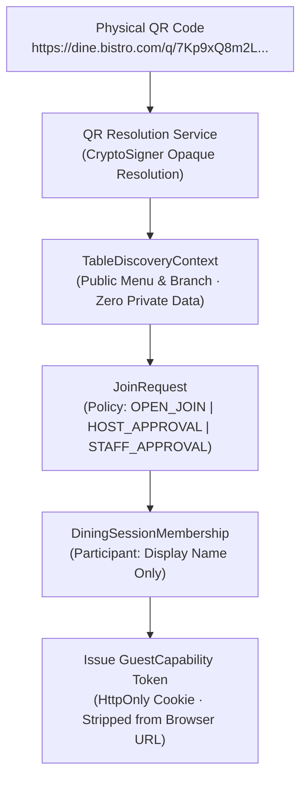

# 🛡️ RestaurantOS Security & Threat Model Specification (07)

> **Contract Reference:** `07_RestaurantOS_Security_Model.md`  
> **Status:** Production Architecture Baseline (v2.1 Hardened)  
> **Package Target:** `@orbitox-io/plugin-engine`, `@orbitox-io/policy`, `@orbitox-io/restaurant-core`

---

## 1. OWASP API Security Top 10 Mitigation Matrix

Restaurant APIs handle high volumes of public guest traffic alongside privileged cash and staff operations. Security is enforced across three discrete authorization planes:

```
[Incoming Request]
       │
       ▼
1. Function-Level (BFLA) ── Does the actor have the discrete capability? (e.g., 'orders.void')
       │
       ▼
2. Object-Level (BOLA)   ── Does this resource (Table/Order) belong to this Location/Tenant?
       │
       ▼
3. Property-Level (BOPLA) ── Is the actor permitted to mutate these specific JSON fields?
```

### 1.1 Property-Level Authorization (BOPLA) Enforcement Matrix

| Field in Mutation Payload | Guest (QR) | Waiter / Captain | Cashier | General Manager |
|---|---|---|---|---|
| `quantity` | ✅ Permitted | ✅ Permitted | ❌ Denied | ✅ Permitted |
| `selectedModifiers` | ✅ Permitted | ✅ Permitted | ❌ Denied | ✅ Permitted |
| `unitPriceMinor` | ❌ **Blocked** | ❌ **Blocked** | ❌ **Blocked** | ❌ **Blocked** (Catalog Only) |
| `discountAmountMinor` | ❌ **Blocked** | ❌ **Blocked** | ❌ **Blocked** | ✅ Permitted (with policy limit) |
| `taxRatePercent` | ❌ **Blocked** | ❌ **Blocked** | ❌ **Blocked** | ❌ **Blocked** (Tax Engine Only)|

---

## 2. Ephemeral `GuestCapability` QR System (v2.2 Contract)

A printed QR code is **never an authenticated dining-session credential**. The platform enforces the strict 4-tier security chain:

```text
QRIdentity ➔ TableDiscoveryContext ➔ DiningSessionMembership ➔ GuestCapability
(SCAN ≠ JOIN  ·  JOIN ≠ CUSTOMER IDENTITY  ·  IDENTITY ≠ SHARED DATA AUTHORIZATION)
```

$$\text{Table QR} = \textbf{Door Address} \quad\vert\quad \text{Dining Session} = \textbf{Room Currently Inside} \quad\vert\quad \text{Guest Capability} = \textbf{Key to That Specific Room}$$



### 2.1 Capability Scopes Granted to Guests
```json
{
  "sub": "anon_guest_91823",
  "sessionId": "sess_81023",
  "participantId": "part_99182",
  "tableId": "tbl_14",
  "locationId": "loc_ldh_01",
  "tenantId": "tenant_bistro",
  "sessionEpoch": 14,
  "scopes": [
    "guest.menu.read",
    "guest.session.read",
    "guest.session.shared_orders.read",
    "guest.session.participants.read",
    "guest.cart.create",
    "guest.order.create",
    "guest.order.read_own",
    "guest.order.read_shared",
    "guest.service_request.create",
    "guest.bill.read",
    "guest.payment.create",
    "guest.leave"
  ]
}
```

### 2.2 Bulk Session Revocation via `accessEpoch`
Every `DiningSession` maintains an integer `accessEpoch`. When the session is closed, merged, or flagged for fraud:
$$\text{DiningSession.accessEpoch} \leftarrow \text{DiningSession.accessEpoch} + 1$$
All active guest capabilities issued with the previous epoch become instantaneously revoked in bulk without requiring expensive token blacklists.

### 2.3 Strict Privacy Invariant
Knowing the physical QR locator **MUST NOT** be sufficient to obtain dining session membership, customer phone numbers, loyalty points, payment tokens, or shared order items. A remote attacker photographing the QR code at Table 14 sees only the public table menu.

---

## 3. PostgreSQL Row-Level Security (RLS) Policies

All database interactions execute through PostgreSQL connection sessions configured with tenant and location context variables injected via `AsyncLocalStorage`:

```sql
-- Enforce RLS on restaurant orders
ALTER TABLE restaurant_orders ENABLE ROW LEVEL SECURITY;

CREATE POLICY tenant_location_isolation_policy ON restaurant_orders
  FOR ALL
  USING (
    tenant_id = current_setting('app.current_tenant_id', true)
    AND location_id = current_setting('app.current_location_id', true)
  );
```

If an application bug or malicious IDOR attempt omits a `location_id` in a database query, PostgreSQL automatically filters the dataset to zero rows, preventing cross-outlet data leakage.

---

## 4. Anti-Abuse Rate Limiting & Velocity Controls

Sensitive public endpoints enforce Redis token-bucket rate limits and velocity checks:

| API Route | Rate Limit Threshold | Abuse Mitigation Action |
|---|---|---|
| `POST /api/v1/sessions/:id/quote` | 20 requests / min / IP | HTTP 429 · Cool-off banner |
| `POST /api/v1/orders` | 3 submissions / min / session | HTTP 429 · Prevents rapid double-ordering |
| `POST /api/v1/payments/intent` | 5 attempts / 15 min / device | Temporary payment freeze · Contact staff |
| `POST /api/v1/coupons/redeem` | 3 attempts / min / table | Atomic Redis lock · Replay prevention |
| `POST /api/v1/guest-requests` | 2 pending requests max / table | Throttles waiter spamming |
