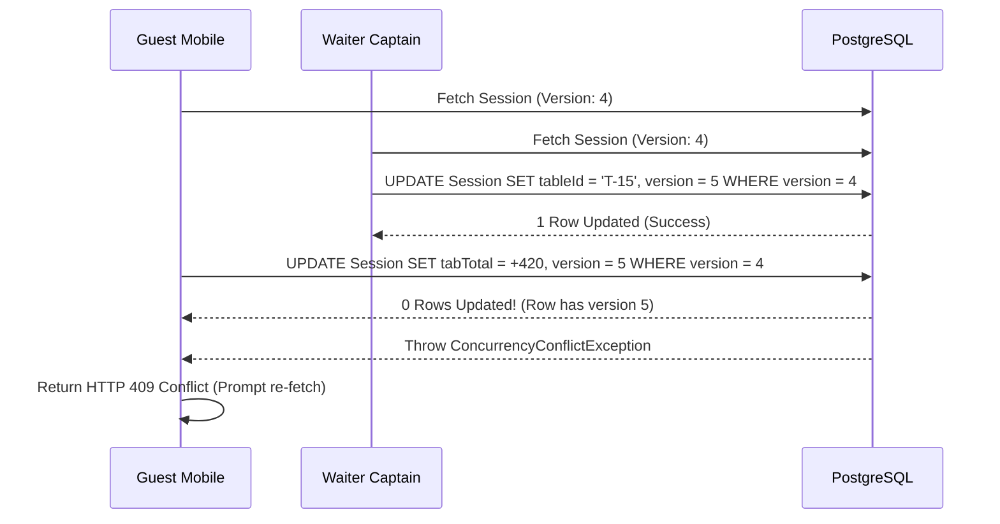
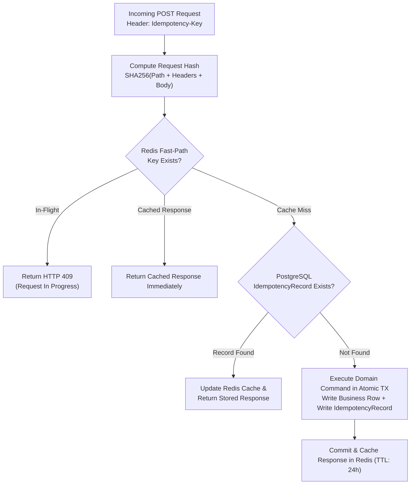

# ⚡ RestaurantOS Concurrency & Idempotency Specification (08)

> **Contract Reference:** `08_RestaurantOS_Concurrency_and_Idempotency.md`  
> **Status:** Production Architecture Baseline (v2.1 Hardened)  
> **Package Target:** `@orbitox-io/plugin-engine`, `@orbitox-io/restaurant-order`

---

## 1. Optimistic Concurrency Control (OCC)

In a high-velocity dining environment, multiple actors simultaneously interact with the same table (e.g., a guest ordering dessert via QR while a captain transfers the table and a cashier requests the bill).

To prevent silent overwrites without heavy distributed locks, all core aggregates implement **Optimistic Concurrency Control via integer version counters**:

```sql
UPDATE restaurant_dining_sessions
SET 
  tab_subtotal_minor = tab_subtotal_minor + 42000,
  tab_total_minor = tab_total_minor + 44100,
  version = version + 1
WHERE id = $1 AND version = $2;
```

### 1.1 Concurrency Failure Flow


---

## 2. Durable Multi-Tier Idempotency Architecture

Network timeouts during payment or order placement often cause clients to retry requests. To guarantee zero duplicate orders or payments, RestaurantOS implements a **dual-tier idempotency pipeline**:



### 2.1 The `IdempotencyRecord` Entity
```typescript
export interface IdempotencyRecord {
  readonly key: string;              // Client Idempotency-Key UUID
  readonly tenantId: string;
  readonly actorId: string;
  readonly endpoint: string;         // e.g., "POST /api/v1/orders"
  readonly requestHash: string;      // SHA-256 of request payload
  readonly responseCode: number;     // e.g., 201
  readonly responseBodyJson: string; // Serialized response payload
  readonly resourceId?: string;      // e.g., created order_id
  readonly createdAt: Date;
  readonly expiresAt: Date;          // Retained for 24 hours
}
```

*If a client reuses an `Idempotency-Key` with a modified request body (hash mismatch), the platform rejects the call with `422 Unprocessable Entity`.*

---

## 3. Atomic Stock Reservation (Race Condition Prevention)

When 100 diners simultaneously attempt to order the last 2 portions of a daily special, inventory reservation executes atomically inside PostgreSQL using row-level locking:

```sql
-- Atomic stock reservation within transaction
SELECT id, on_hand_grams, reserved_grams 
FROM restaurant_inventory_stock
WHERE location_id = $1 AND ingredient_id = $2
FOR UPDATE;

-- Verify sufficiency and update
UPDATE restaurant_inventory_stock
SET reserved_grams = reserved_grams + $3, version = version + 1
WHERE id = $4 AND (on_hand_grams - reserved_grams) >= $3;
```

If the available quantity is insufficient, the transaction immediately rolls back, returning `409 Insufficient Stock` to the client.
