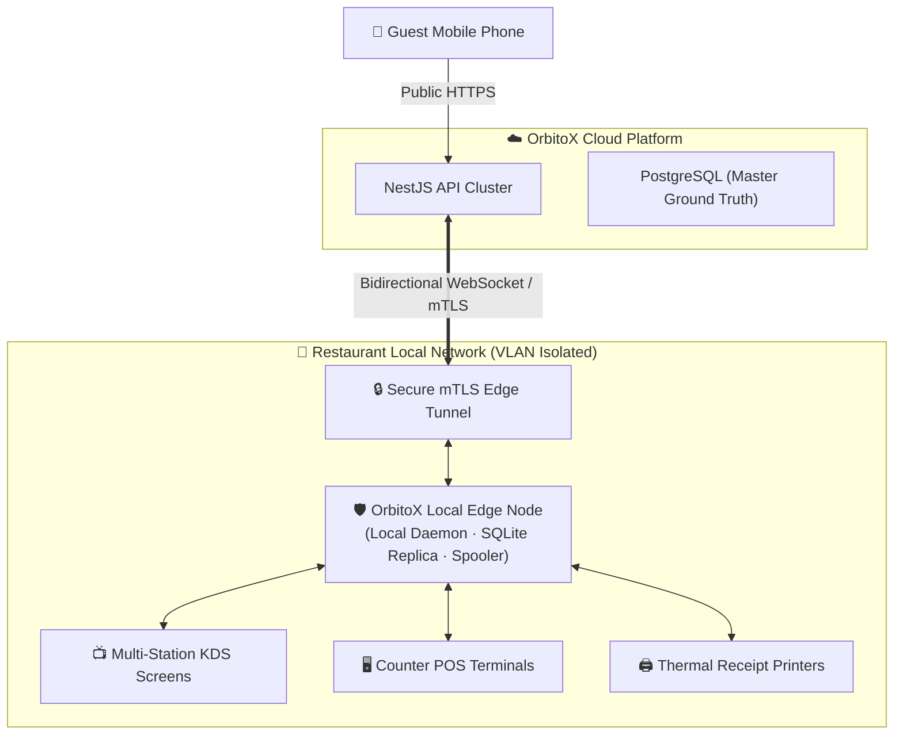

# 🌐 RestaurantOS Edge & Offline Resilience Specification (09)

> **Contract Reference:** `09_RestaurantOS_Edge_and_Offline.md`  
> **Status:** Production Architecture Baseline (v2.1 Hardened)  
> **Package Target:** `@orbitox-io/restaurant-edge`

---

## 1. Physical Edge Topology & Isolation

Kitchens cannot cease operations when commercial internet connectivity flickers. RestaurantOS deploys an **OrbitoX Local Edge Node** (running as a lightweight daemon on an in-restaurant Mini-PC, POS terminal, or Linux appliance).

### 1.1 Strict Isolation Rule
**Guest phones never connect directly to the Local Edge Node over LAN**. Public guest traffic routes exclusively through the Cloud API cluster. This preserves local LAN security and prevents malicious guests from scanning restaurant printers or KDS terminals.

---

## 2. Cloud vs. Edge Authority Matrix

| Domain Function | Cloud Authority | Edge Authority (During Offline Outage) | Conflict Resolution Rule |
|---|---|---|---|
| **Customers & Loyalty** | **Authoritative Ground Truth** | Read-Only (Local Cache) | Cloud always wins; local CRM updates buffered |
| **Catalog & Taxes** | **Authoritative Ground Truth** | Read-Only Local Snapshot | Local edits blocked; cloud snapshot preserved |
| **Payments & Billing** | **Authoritative Ground Truth** | Offline Voucher Mode (Configurable) | Reconciliation upon WAN reconnect |
| **KDS Queue & Stations** | Cloud Sync Mirror | **Authoritative Ground Truth** | **Edge wins**; cloud updates state from edge sequence |
| **Printers & Spoolers** | Cloud Sync Mirror | **Authoritative Ground Truth** | **Edge wins**; hardware spooler executes locally |
| **Table Occupancy** | Cloud Sync Mirror | **Authoritative Ground Truth** | **Edge wins**; local floor staff state takes priority |

---

## 3. Explicit Offline Capability Matrix

| Operational Capability | Online Status | Offline Mode Behavior |
|---|---|---|
| **KDS Active Queue & Task Timers** | Fully Functional | ✅ **100% Operational** (Runs entirely over local LAN) |
| **Thermal Kitchen Printing (KOT)** | Fully Functional | ✅ **100% Operational** (Local ESC/POS driver spooler) |
| **Counter POS Order Creation** | Fully Functional | ✅ **100% Operational** (Written to local SQLite queue) |
| **Floor Map & Table Status** | Fully Functional | ✅ **100% Operational** (Synchronized via local WebSocket) |
| **Guest QR Table Ordering** | Fully Functional | ⚠️ **Configurable:** Shows offline notice or buffers orders |
| **Card / UPI Online Payments** | Fully Functional | ❌ **Unavailable:** Requires external gateway connection |
| **Menu / Pricing Editing** | Fully Functional | ❌ **Blocked:** Prevents multi-node catalog split-brain |
| **Live Multi-Outlet Cloud Reports** | Fully Functional | ❌ **Deferred:** Metrics sync when WAN reconnects |

---

## 4. Reconnection & Delta Reconciliation

When external internet connectivity is restored:
1. The Edge Node establishes an authenticated mTLS handshake with the Cloud API.
2. The Edge Outbox replays all locally committed orders, ticket completions, and table state events in strict sequence order.
3. The Cloud API validates each event, executes state transitions, updates financial ledgers, and responds with an acknowledgment cursor.
4. Any edge-buffered payments are transmitted to the payment gateway for settlement.
