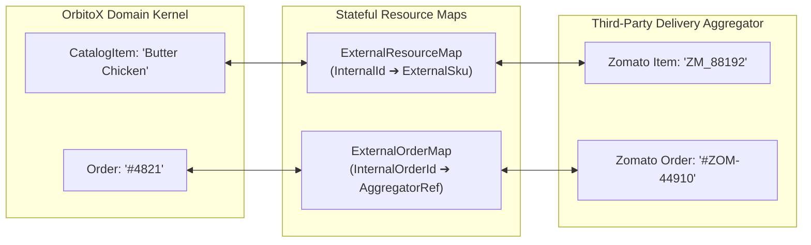
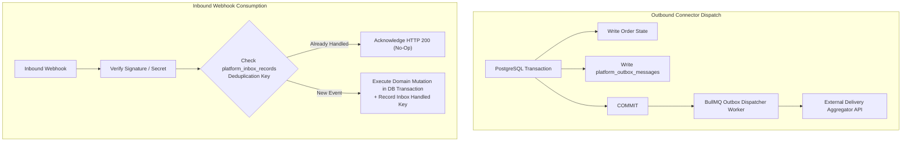

# 🔌 RestaurantOS Integration Contracts & Hardware HAL Specification (10)

> **Contract Reference:** `10_RestaurantOS_Integration_Contracts.md`  
> **Status:** Production Architecture Baseline (v2.1 Hardened)  
> **Package Target:** `@orbitox-io/restaurant-integrations`, `@orbitox-io/restaurant-edge`

---

## 1. Stateful External Connectors (Aggregators & Delivery)

Third-party integrations (Swiggy, Zomato, Deliverect, Uber Eats) are never modeled as thin API wrappers. They are managed through **stateful entity mappings**:



---

## 2. Transactional Outbox & Deduplicating Inbox Patterns

To guarantee event delivery across third-party boundaries without distributed two-phase commits:



---

## 3. Hardware Abstraction Layer (HAL)

RestaurantOS decouples business logic from physical hardware vendors (Epson, Star Micronics, Citizen, PAX, Verifone) through the **OrbitoX HAL**:

```typescript
export type HardwareDeviceType = 
  | 'THERMAL_PRINTER' 
  | 'KITCHEN_DISPLAY' 
  | 'CASH_DRAWER' 
  | 'BARCODE_SCANNER' 
  | 'PAYMENT_TERMINAL' 
  | 'KITCHEN_BUZZER';

export interface HardwareDevice {
  readonly deviceId: string;
  readonly locationId: string;
  readonly type: HardwareDeviceType;
  readonly name: string;
  readonly protocol: 'ESC_POS_NETWORK' | 'SERIAL' | 'USB' | 'MQTT' | 'WEBSOCKET';
  readonly ipAddress?: string;
  readonly macAddress?: string;
  readonly assignedStationId?: string;
  readonly status: 'ONLINE' | 'DEGRADED' | 'OFFLINE';
  readonly lastHeartbeatAt: Date;
}

export interface IPrinterDriver {
  printKOT(ticket: KitchenTicketDTO): Promise<boolean>;
  printCustomerReceipt(invoice: InvoiceDTO): Promise<boolean>;
  kickCashDrawer(): Promise<boolean>;
  getHealthStatus(): Promise<'READY' | 'PAPER_OUT' | 'COVER_OPEN' | 'ERROR'>;
}
```

*The kitchen dispatch engine routes print jobs using `station.defaultPrinterId`, agnostic to whether the destination is a network ESC/POS printer or an on-screen KDS terminal.*
