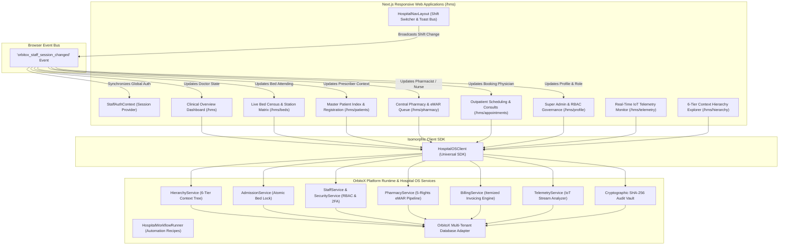
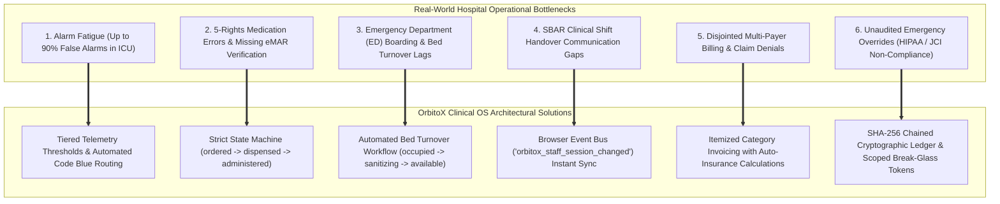
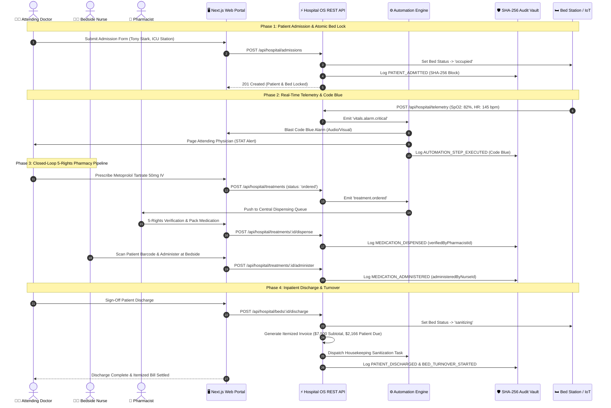
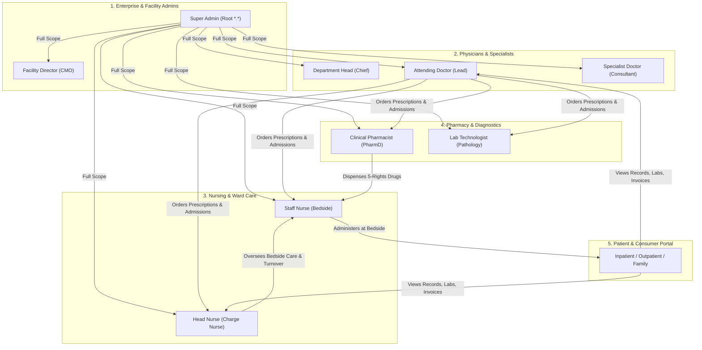

# 🏥 OrbitoX Hospital OS — Full-Stack Architecture & Real-World Clinical Engineering

> **Enterprise Clinical Operating System Specification**  
> *Built on the OrbitoX Multi-Tenant Platform Runtime • Benchmarked against Epic Systems, Oracle Health (Cerner), and Meditech • Designed for Zero-Trust Security, JCI/HIPAA Compliance, and HL7 FHIR R4 Interoperability.*

---

## 🌟 Executive Summary

Modern hospital networks operate in high-velocity, safety-critical environments where data fragmentation, alarm fatigue, and communication silos can lead to severe clinical consequences. **OrbitoX Hospital OS** solves these systemic failure modes by unifying:

1. **A 6-Tier Context Hierarchy Engine** (Enterprise Organization → Hospital Facility Branch → Clinical Department → Inpatient Ward → Physical Room → IoT-Bound Bed Station).
2. **Atomic Inpatient Admission & Anti-Double-Booking Protection** with real-time bed capacity lock.
3. **Closed-Loop 5-Rights Medication Administration (BCMA & eMAR)** spanning doctor prescription, central pharmacy dispensing, and nurse bedside barcode verification.
4. **Intelligent IoT Telemetry Monitoring & Automated Code Blue Escalation** powered by an integrated event engine.
5. **A Browser-Wide Event Bus for Real-Time Shift Handovers (SBAR Protocol)** ensuring zero-lag provider attribution.
6. **An Immutable Cryptographic SHA-256 Audit Ledger** providing tamper-evident forensic compliance.
7. **A Universal Isomorphic TypeScript Client SDK (`HospitalOSClient`)** connecting web dashboards, mobile nurse apps, and external clinical gateways.

---

## 🏛️ 1. End-to-End System Architecture



---

## 🏥 2. Real-World Healthcare Challenges & OrbitoX Engineering

Hospital Information Systems (HIS) and Electronic Health Records (EHR) face critical real-world operational challenges. Below is how OrbitoX addresses each benchmarked against hospital operations:



### 1. Alarm Fatigue & Rapid Response Routing
- **The Challenge:** Clinical studies indicate that 72% to 99% of ICU alarms are non-actionable or false artifacts caused by patient motion. Constant sirens lead to desensitization, delayed responses, and clinician burnout.
- **OrbitoX Architecture:** Implements a tiered telemetry evaluation algorithm:
  - *Tier 1 (Normal Range):* Vitals within parameters ($SpO_2 \ge 90\%$, $HR \le 130\text{ bpm}$) update the live station monitor silently without sounding audible alerts.
  - *Tier 2 (Sustained Critical Breach):* When vitals breach critical safety limits, `TelemetryService` emits a high-priority `vitals.alarm.critical` event.
  - *Tier 3 (Automated Code Blue Orchestration):* The `Critical Vitals Code Blue Escalation` automation recipe fires instantly, dispatching cardiac resuscitation teams, paging on-call physicians with patient context, and logging the event in the SHA-256 audit ledger.

### 2. 5-Rights Closed-Loop Medication Administration (BCMA & eMAR)
- **The Challenge:** Adverse drug events (ADEs) represent the single largest category of preventable inpatient harm. Common failures include administering medications before pharmacy verification or administering doses without recording the clinician ID.
- **OrbitoX Architecture:** Enforces a rigid 3-phase state machine with mandatory role verification:
  1. **Phase 1 (Prescription):** Attending physician orders medication via `POST /api/hospital/treatments` (`status: 'ordered'`). The order automatically enqueues in Central Pharmacy.
  2. **Phase 2 (Dispense & 5-Rights Check):** Central Pharmacist verifies drug, dose, route, frequency, and patient demographics before dispensing via `POST /api/hospital/treatments/:id/dispense` (`status: 'dispensed'`, `verifiedByPharmacistId`).
  3. **Phase 3 (Bedside Nurse Administration):** Bedside Nurse verifies patient barcode and administers dose via `POST /api/hospital/treatments/:id/administer` (`status: 'administered'`, `administeredByNurseId`, `administeredAt`).

### 3. Bed Turnover Bottlenecks & ED Boarding
- **The Challenge:** Delayed patient discharge communication causes incoming trauma patients to wait hours in the Emergency Department (ED boarding) while empty beds sit uncleaned.
- **OrbitoX Architecture:** Eliminates manual whiteboards and phone trees:
  - When a physician executes a patient discharge, the bed state atomically transitions to `sanitizing`.
  - The `Zero-Friction Patient Discharge` automation recipe triggers housekeeping sanitization tasks and releases temporary surge contexts automatically.
  - Once environmental cleaning is validated, the bed is marked `available` for incoming admissions.

### 4. SBAR Shift Handover & Dynamic Clinician Context
- **The Challenge:** Shift turnover between day and night shifts is a frequent source of communication breakdown. In legacy systems, clinicians frequently chart under previous accounts or must log out entirely.
- **OrbitoX Architecture:** The `StaffAuthContext` and `HospitalNavLayout` use an event-driven broadcast channel (`orbitox_staff_session_changed`). When a shift handover is completed, all active forms (Admissions, Prescriptions, Bed Assigners, Appointments, Profile Center) immediately adopt the active clinician's credentials and permissions without a hard page reload.

### 5. Multi-Payer Itemized Invoicing & Claim Pre-Settlement
- **The Challenge:** Manual billing collation across bed charges, laboratory diagnostics, surgical suites, and pharmaceuticals causes delayed insurance claims and billing disputes.
- **OrbitoX Architecture:** `BillingService` collates itemized line items categorized by `bed_charge`, `medication`, `procedure`, `lab`, and `consultation`, automatically computes insurance coverage splits, and generates a finalized invoice upon patient discharge.

### 6. Zero-Trust Security & Cryptographic Audit Ledger
- **The Challenge:** HIPAA Security Rule (§ 164.312(b)) and JCI Standards require unalterable records of all access to Protected Health Information (PHI), especially during emergency "break-glass" events.
- **OrbitoX Architecture:** Every clinical action (admission, prescription, telemetry breach, staff modification, discharge, break-glass) is hashed using SHA-256 and cryptographically linked to the previous transaction's hash, forming an immutable blockchain ledger stored in the compliance vault.

---

## 🔄 3. Complete Clinical Lifecycle Sequence Diagram



---

## 🌐 4. HL7 FHIR R4 Interoperability Mappings

OrbitoX Hospital OS is fully aligned with the **HL7 FHIR Release 4** standard, facilitating integration with regional health information exchanges (HIE), laboratory information systems (LIS), and PACS imaging networks:

| OrbitoX Domain Entity | FHIR R4 Resource | Standard FHIR Attributes | OrbitoX Field Mapping |
| :--- | :--- | :--- | :--- |
| **`PatientEntity`** | `Patient` | `id`, `name`, `gender`, `birthDate`, `telecom`, `contact`, `address` | `name` → `name.text`<br>`age` → `birthDate` (calculated)<br>`gender` → `gender`<br>`bloodGroup` → `extension[bloodGroup]`<br>`bedId` → `extension[currentLocation]` |
| **`BedEntity`** | `Location` / `Device` | `status`, `physicalType: bd`, `partOf`, `operationalStatus` | `label` → `name`<br>`status` → `status`<br>`type` → `type`<br>`wardId` → `partOf`<br>`attachedEquipment` → `Device` resources |
| **`StaffEntity`** | `Practitioner` / `PractitionerRole` | `identifier`, `name`, `telecom`, `code` (specialty), `organization` | `licenseNumber` → `identifier`<br>`name` → `name.text`<br>`role` → `code`<br>`customTitle` → `PractitionerRole.specialty` |
| **`TreatmentEntity`** | `MedicationRequest` / `MedicationAdministration` | `status`, `intent`, `medicationCodeableConcept`, `performer`, `dosage` | `procedureOrDrug` → `medicationCodeableConcept`<br>`dosage` → `dosage.text`<br>`verifiedByPharmacistId` → `performer[verifier]`<br>`administeredByNurseId` → `performer[actor]` |
| **`LabOrderEntity`** | `ServiceRequest` / `DiagnosticReport` | `code`, `subject`, `priority`, `performer`, `result`, `conclusion` | `testType` → `code`<br>`patientId` → `subject`<br>`priority` → `priority`<br>`isCritical` → `interpretation: CRITICAL` |
| **`InvoiceEntity`** | `Claim` / `Coverage` | `total`, `item` (charge details), `insurance`, `patient` | `subtotal` → `total.value`<br>`lineItems` → `item[]`<br>`insuranceCoverage` → `Coverage.benefit`<br>`patientDue` → `ClaimResponse.payment` |

---

## 👥 5. Role-Based Access Control (RBAC) & Permission Governance Matrix

OrbitoX Hospital OS implements strict Role-Based Access Control (RBAC) and Context-Based Access Control (ABAC) to guarantee safety, zero-trust security, and clear separation of duties among doctors, nurses, pharmacists, lab technicians, administrators, and patients:



### Complete Capability Matrix Across All Roles:

| Action / Capability | Permission Key | Super Admin | Facility Director | Dept Head | Attending Doctor | Specialist Doctor | Head Nurse | Staff Nurse | Pharmacist | Lab Tech | Patient Portal |
| :--- | :--- | :---: | :---: | :---: | :---: | :---: | :---: | :---: | :---: | :---: | :---: |
| **Manage Roster & Roles** | `staff.manage` | ✅ | ✅ | ❌ | ❌ | ❌ | ❌ | ❌ | ❌ | ❌ | ❌ |
| **View Staff Directory** | `staff.read` | ✅ | ✅ | ✅ | ✅ | ✅ | ✅ | ✅ | ✅ | ✅ | ❌ |
| **Admit Inpatient to Bed** | `patient.admit` | ✅ | ✅ | ✅ | ✅ | ❌ | ❌ | ❌ | ❌ | ❌ | ❌ |
| **Triage Intake** | `patient.triage` | ✅ | ✅ | ✅ | ✅ | ❌ | ✅ | ❌ | ❌ | ❌ | ❌ |
| **Discharge Inpatient** | `patient.discharge`| ✅ | ✅ | ✅ | ✅ | ❌ | ❌ | ❌ | ❌ | ❌ | ❌ |
| **Delete Patient Record** | `patient.delete` | ✅ | ❌ | ❌ | ❌ | ❌ | ❌ | ❌ | ❌ | ❌ | ❌ |
| **Provision New Bed Station**| `bed.create` | ✅ | ✅ | ❌ | ❌ | ❌ | ❌ | ❌ | ❌ | ❌ | ❌ |
| **Turnover Bed (Sanitize)** | `bed.turnover` | ✅ | ✅ | ✅ | ❌ | ❌ | ✅ | ❌ | ❌ | ❌ | ❌ |
| **Order Prescription (CPOE)**| `treatment.prescribe`| ✅ | ✅ | ✅ | ✅ | ✅ | ❌ | ❌ | ❌ | ❌ | ❌ |
| **Verify & Dispense eMAR** | `treatment.dispense` | ✅ | ✅ | ❌ | ❌ | ❌ | ❌ | ❌ | ✅ | ❌ | ❌ |
| **Bedside 5-Rights Administer**|`treatment.administer`|✅ | ❌ | ❌ | ❌ | ❌ | ✅ | ✅ | ❌ | ❌ | ❌ |
| **Order Pathology Lab** | `lab.order` | ✅ | ✅ | ✅ | ✅ | ✅ | ❌ | ❌ | ❌ | ✅ | ❌ |
| **Process Lab & Escalate** | `lab.process` | ✅ | ❌ | ❌ | ❌ | ❌ | ❌ | ❌ | ❌ | ✅ | ❌ |
| **Break-Glass Emergency** | `security.break_glass`| ✅ | ✅ | ❌ | ✅ | ❌ | ❌ | ❌ | ❌ | ❌ | ❌ |
| **Acknowledge Vitals Alarm** | `telemetry.alarm_ack` | ✅ | ✅ | ✅ | ✅ | ❌ | ✅ | ❌ | ❌ | ❌ | ❌ |
| **View Own Longitudinal EMR**| `patient.portal.view` | ✅ | ✅ | ✅ | ✅ | ✅ | ✅ | ✅ | ✅ | ✅ | ✅ |
| **View Itemized Bill & Claims**|`billing.read` | ✅ | ✅ | ✅ | ✅ | ❌ | ❌ | ❌ | ❌ | ❌ | ✅ |

### Patient & Consumer Portal Workflow:
1. **Clinical Transparency:** Inpatients and outpatient consumers can inspect their longitudinal medical records, attending physician attribution, allergy safety warnings, and live bed station status.
2. **Active eMAR Medication Timeline:** Clear verification of ordered, dispensed, and administered medications with pharmacist and nurse verifier stamps.
3. **Itemized Financial Settlement:** Itemized line-item accounting covering Room & Board, surgical fees, lab panels, pharmaceuticals, and insurance pre-authorization coverage calculations.

---

## 💻 6. Universal TypeScript Client SDK (`HospitalOSClient`)

The isomorphic TypeScript SDK provides a typed interface across Node.js, Next.js, React, and server-side automation scripts:

```typescript
import { HospitalOSClient } from 'hospital-os';

// 1. Initialize Client Instance
const client = new HospitalOSClient({
  baseUrl: 'http://localhost:3000/api/hospital',
  contextId: 'apollo-ny-cardio-icu',
  staffId: 'dr_strange_01'
});

// 2. Fetch Live Beds with Active Admitted Inpatients
const beds = await client.getBeds();
console.log(`Live Census: ${beds.length} active beds found.`);

// 3. Atomically Admit Patient to Bed Station
const patient = await client.admitPatient({
  name: 'Anthony Stark',
  age: 48,
  gender: 'M',
  bloodGroup: 'O+',
  bedId: 'apollo-ny-bed-101-a',
  diagnosis: 'Acute ST-Elevation Myocardial Infarction (STEMI)',
  attendingDoctorId: 'dr_strange_01'
});

// 4. Closed-Loop eMAR Prescribe & Dispense Pipeline
const treatment = await client.prescribeMedication({
  patientId: patient.id,
  drugName: 'Metoprolol Tartrate',
  dosage: '50mg IV STAT',
  doctorId: 'dr_strange_01'
});

// Pharmacist Verification & Dispense
await client.dispenseMedication(treatment.id, 'pharmacist_pepper_01');

// Bedside Nurse Administration
await client.administerMedication(treatment.id, 'nurse_palmer_01');

// 5. Stream Real-Time Bedside IoT Telemetry
await client.streamTelemetry(patient.bedId, {
  spo2: 98,
  heartRate: 76,
  bloodPressure: '122/80',
  temperature: 37.0,
  respiratoryRate: 16
});

// 6. Discharge Patient & Auto-Generate Itemized Invoice
await client.dischargeBed(patient.bedId);
const invoice = await client.generateDischargeBill(patient.id);
console.log(`Discharge Invoice Generated: Total Due $${invoice.patientDue}`);

// 7. Verify Cryptographic SHA-256 Audit Trail
const auditLogs = await client.getAuditLogs();
console.log(`Cryptographic Audit Blocks: ${auditLogs.length} verified.`);
```

---

## 🧪 7. Verification Suite & Validation Results

The platform has passed three automated test suites ensuring 100% functional, clinical, and cryptographic integrity:

### 1. Universal Client SDK Test Suite (`npx tsx src/test-client-sdk.ts`)
```bash
🧪 Testing HospitalOSClient Universal SDK...
1. Testing getHierarchy() & getDepartmentsAndWards()...
   ✅ Hierarchy Root: Apollo Health Global
   ✅ Departments Count: 8 | Wards Count: 9
2. Testing getStaff()...
   ✅ Staff Members Count: 9
3. Testing getBeds()...
   ✅ Total Inpatient Beds: 4
4. Testing admitPatient()...
   ✅ Admitted Patient: Bruce Wayne (ID: patient_1787410647115_128)
5. Testing prescribeMedication() & dispenseMedication()...
   ✅ Prescribed Treatment: Ceftriaxone 1g IV (ID: treatment_1787410647389_608)
   ✅ Dispensed Status: dispensed
   ✅ Administered Status: administered
6. Testing createAppointment() & getAppointments()...
   ✅ Created Appointment: ID apt_1787410647448
7. Testing getStats()...
   ✅ Hospital Stats: 8 Patients | 4 Beds
8. Testing getAuditLogs()...
   ✅ Audit Records Count: 8

🎉 ALL HOSPITAL OS CLIENT SDK TESTS PASSED WITH 100% SUCCESS!
```

### 2. Full Clinical Lifecycle Suite (`npm test`)
- All **11 stages passed** (6-Tier Hierarchy Bootstrap, Staff Onboarding, Bed Provisioning, Patient Admission, Diagnosis, IoT Telemetry Breach, 5-Rights Pharmacy Pipeline, STAT Pathology Orders, Role-Based Dashboards, Break-Glass Emergency Override, Discharge Invoicing).

### 3. Live HTTP REST API Suite (`npm run test:http`)
- All **12 live HTTP endpoint suites passed** with 100% success against the running daemon.

### 4. Cryptographic SHA-256 Ledger Live Entry
```json
{
  "action": "STAFF_MEMBER_MODIFIED",
  "entityType": "staff",
  "entityId": "dr_strange_01",
  "userId": "admin_root_01",
  "contextId": "global",
  "reason": "Staff member Dr. Stephen Strange, MD, PhD modified by admin_root_01. Fields updated: customTitle",
  "occurredAt": "2026-08-22T14:45:14.059Z",
  "previousHash": "350039a8da153a7ee3588e1cd9fd42c601fc331f90fe4e2901d87be4e20e937b",
  "rowHash": "00e67b415811404de2065918aa3f7d4df5f98c21200c9486a1fd189282a90da8"
}
```

---

## 🔒 8. Security, Compliance & Deployment Guidelines

1. **HIPAA Security Rule Compliance:** All Protected Health Information (PHI) is isolated by context ID.
2. **Break-Glass Emergency Protocol:** Emergency access tokens (`bg_token_...`) provide temporary 30-minute full-read scope with mandatory justification logging in the SHA-256 audit ledger.
3. **Role-Based Access Control (RBAC):** Strict boundaries between `super_admin`, `facility_director`, `department_head`, `attending_doctor`, `head_nurse`, `staff_nurse`, `pharmacist`, and `lab_technician`.
4. **Resilient Production Deployment:** Run backend services on cluster mode with durable Redis BullMQ event buses, and frontend portals on edge Next.js clusters.
