# 🪐 Celebrations — Product & Technical Specification
**Platform**: OrbitoX Platform (`@orbitox-io/celebrations`)  
**Package**: `orbitox/apps/celebrations` & `orbitox/plugins/celebrations`  
**Architecture**: Multi-Tenant Next.js App Router + Zero-Trust Plugin Engine  
**Target Market**: C2C (Couples/Families), B2B (Ateliers/Planners), O2B2C (Platform White-Label)  
**Version**: 1.5.0 (Studio Production & UI Style Specification)

---

## 1. Executive Summary & Vision

### 1.1 Product Positioning
**Celebrations** is a modern SaaS celebration experience platform. It elevates static invitations into immersive digital event worlds, combining:
- **Professional SaaS Clarity**: Clean ergonomics, calm hierarchical controls, zero administrative clutter.
- **Consumer Luxury Appeal**: Cinematic aesthetics, gold foil typography, ambient soundscapes, floating particle physics, and royal wax seal interactions.
- **B2B & White-Label Extensibility**: Multi-tenant isolation, custom domains, agency client switching, and cryptographic licensing.

```
                           ┌───────────────────────────────┐
                           │   OrbitoX Platform Core       │
                           │   (@orbitox-io/plugin-engine) │
                           └──────────────┬────────────────┘
                                          │
            ┌─────────────────────────────┼─────────────────────────────┐
            ▼                             ▼                             ▼
   ┌─────────────────┐           ┌─────────────────┐           ┌─────────────────┐
   │       C2C       │           │       B2B       │           │     O2B2C       │
   │ Direct Hosts,   │           │ Wedding Ateliers│           │ White-Label     │
   │ Couples, Brides,│           │ Event Planners, │           │ Hospitality,    │
   │ Families        │           │ Luxury Agencies │           │ Hotel Chains    │
   └─────────────────┘           └─────────────────┘           └─────────────────┘
```

---

## 2. Multi-Sided Operational Model

| Actor / Tier | Primary Use Case | Key Capabilities | Commercial Model |
| :--- | :--- | :--- | :--- |
| **C2C (Direct Host)** | Individual couples or families hosting weddings, anniversaries, birthdays. | Guided 3-zone studio, live preview, RSVP tracking, photo upload, digital registry/shagun. | Pay-per-event ($49 – $199) or freemium base tier. |
| **B2B (Ateliers & Planners)** | Professional wedding designers managing 10–50 client events concurrently. | Multi-client switcher, custom domain whitelabeling, branded monogram library, VIP guest segmenting. | Monthly SaaS subscription ($149/mo) + per-event license credits. |
| **O2B2C (Platform White-Label)** | Luxury hotel chains (e.g. Taj, Oberoi) offering branded digital invitations to guests. | Enterprise SSO, automated booking hooks, branded palace venue presets, zero-trust tenant data partitioning. | Enterprise licensing agreement + custom SLA. |

---

## 3. End-to-End System & User Flows

### 3.1 Platform Lifecycle Flow

```mermaid
flowchart TD
    subgraph Discovery ["1. Discovery & Onboarding"]
        A[Landing Page / Atelier Showcase] --> B[Explore Theme Universes]
        B --> C[Select Occasion & Base Template]
    end

    subgraph StudioFlow ["2. Studio Creation & Composition (/create)"]
        C --> D[Initialize CelebrationState]
        D --> E[Step 01: Beginning & Metadata]
        E --> F[Step 02: Style & Ambient Theme]
        F --> G[Step 03: People, Portraits & Crest]
        G --> H[Step 04: Moments & Itinerary]
        H --> I[Step 05: Love Story Milestones]
        I --> J[Step 06: Palatial Experience & Venue]
        J --> K[Step 07: Guests, RSVP & Digital Shagun]
    end

    subgraph ReviewPublish ["3. Review & Publication"]
        K --> L[Full Guest Experience Preview]
        L --> M{Approve?}
        M -- "Edit" --> StudioFlow
        M -- "Publish" --> N[Assign Custom Domain / Slug]
        N --> O[Sign Manifest & Bind License via @orbitox-io]
    end

    subgraph GuestReception ["4. Guest Consumption Experience (/e/slug)"]
        O --> P[Guest Opens Link]
        P --> Q[Virtual Wax Seal / Door Reveal Ceremony]
        Q --> R[Atelier Ambient Soundscape Initiates]
        R --> S[Cinematic Parallax Storytelling]
        S --> T[Interactive Ceremony Schedule]
        T --> U[Submit RSVP & Dietary Notes]
        U --> V[Send Digital Shagun / Gift Registry]
        V --> W[Leave Blessing on Wall]
        W --> X[Add to Calendar .ics / Navigate via Map]
    end
```



---

### 3.2 Creator Studio 7-Step Operational Flow

```
┌─────────────────────────────────────────────────────────────────────────────────────────────┐
│                             CREATOR STUDIO 7-STEP JOURNEY FLOW                              │
└─────────────────────────────────────────────────────────────────────────────────────────────┘

 [01 Beginning] ──────► [02 Style] ──────► [03 People] ──────► [04 Moments]
  • Title & Slug         • Theme Universe   • Host Roles        • Multi-Day Itinerary
  • Occasion Type        • Gold Accents     • Studio Photo      • Ceremony Timings
  • Couple vs Single     • Typography Pair    Uploader (No      • Dress Codes
  • Milestone Date       • Particle Mood      Presets)          • Custom Notes
                                            • Monogram Crest
                                                    │
                                                    ▼
 [Publish Live] ◄────── [07 Guests] ◄───── [06 Experience] ◄─── [05 Story]
  • Custom Domain        • RSVP Deadline    • Palace Venue Map  • Romance / Journey
  • Tenant Scoping       • Dietary Fields   • Travel & Stay     • Chapter Milestones
  • Cryptographic Seal   • Shagun UPI QR    • Live Weather      • Curated Memories
                         • Blessings Wall   • Landmark Directs
```

#### Step Details & Visual Repercussions

| Step ID | Workflow Title | Intent & Controls | Immediate Live Canvas Reaction |
| :--- | :--- | :--- | :--- |
| **01** | `beginning` | Event title, occasion category, host configuration (Couple vs Single Host), primary celebration date. | Header parchment text, celebration hero banner, and countdown timer re-render instantly. |
| **02** | `style` | Theme Universe selection (Royal Regalia, Celestial Twilight, Ivory Minimal, Velvet Noir, Bohemian Rhapsody). | Palette shifts instantly; background textures, ambient gold dust, and font pairings switch with smooth CSS crossfades. |
| **03** | `people` | Celebrant names, roles, bios, custom photo uploaders with hover camera replacement, and wax seal monogram initials. | Celebrant portrait cards update with gold circular frames; wax seal initials update in real time. |
| **04** | `moments` | Multi-event itinerary builder (Mehendi, Sangeet, Pheras, Grand Reception, Cocktail). | Itinerary timeline timeline nodes inject chronologically with event icon badges and dress code ribbons. |
| **05** | `story` | Milestones, chapter years, narrative paragraphs, engagement recollections. | Interactive narrative scroll section populates with editorial photo masonry and poetic quotes. |
| **06** | `experience` | Palatial venue coordinates, Google Maps links, valet details, airport distance, climate guidance. | Venue showcase card renders luxury architecture photo, live navigation button, and weather badge. |
| **07** | `guests` | RSVP cutoff date, attendance headcount counters, UPI QR Code for cashless Shagun, blessings wall toggle. | Interactive RSVP modal preview updates, digital envelope shagun wallet activates, guest wall unlocks. |

---

### 3.3 Guest Interactive Experience Flow (`/e/[slug]`)

```
   ┌──────────────────────────────────────────────────────────────────┐
   │                    GUEST OPENING CEREMONY                        │
   └──────────────────────────────────────────────────────────────────┘
                                   │
                                   ▼
                   [ 3D Gold Foil Envelope Center Screen ]
                   [ Custom Wax Seal Initials: 'A & M' ]
                                   │
                                   ▼
                   Guest clicks wax seal or taps "Open"
                                   │
                                   ▼
                   ┌───────────────────────────────────┐
                   │ • Particle Burst (24k Gold Flakes)│
                   │ • Wax Seal Fractures & Slides Off │
                   │ • Flap Folds Open (3D CSS RotateX)│
                   │ • Atelier Soundscape Fades In     │
                   └───────────────────────────────────┘
                                   │
                                   ▼
                   [ Invitation Parchment Glides Upward ]
                                   │
                                   ▼
       ┌───────────────────────────┴───────────────────────────┐
       ▼                                                       ▼
[ Narrative Scroll ]                                    [ Action Cluster ]
 • Honored Celebrants                                    • RSVP Confirmation
 • Multi-Day Ceremony Itinerary                          • Add to Apple / Google Cal
 • Venue Directions & Valet                              • Cashless Shagun UPI
 • Love Story Milestones                                 • Leave Heartfelt Blessing
```

---

## 4. UI Style Guide & Design System

### 4.1 Design Philosophy: "Editorial High Luxury + Calm SaaS Ergonomics"
Celebrations avoids the generic clichés of flat SaaS dashboards (heavy purple gradients, dense borders, loud badges) and replaces them with an editorial luxury experience inspired by Cartier, Apple, and luxury auction houses:
- **Calm, Focused Controls**: The controls never scream. Borders are whispered at `rgba(255, 255, 255, 0.08)`.
- **Heroic Canvas**: The invitation itself is the hero, taking center stage with realistic proportions and live reactive states.
- **Deep Obsidian Surfaces**: Layered depth from `#09090d` to `#1a1a24` with no harsh 100% black.
- **Imperial Gold Accents**: Hand-calibrated warm gold (`#fbbf24`) balanced with radiant champagne (`#fef3c7`).

---

### 4.2 Semantic Color Tokens & Palette

```
  OBSIDIAN BASES                 PRECIOUS GOLD ACCENTS              FUNCTIONAL STATUS
┌──────────────────────┐        ┌──────────────────────┐        ┌──────────────────────┐
│ Base Void:   #09090d │        │ Primary Gold: #fbbf24│        │ Verified:    #10b981 │
│ Surface:     #131318 │        │ Bronze Glow:  #d97706│        │ Destructive: #ef4444 │
│ Elevated:    #1a1a24 │        │ Champagne:    #fef3c7│        │ Muted Text:  #71717a │
│ Card Glass:  #181820 │        │ Gold Tint:    #fbbf241f│      │ High Text:   #ffffff │
└──────────────────────┘        └──────────────────────┘        └──────────────────────┘
```

| Token Name | Hex / Value | Semantic Role & Context |
| :--- | :--- | :--- |
| `surface-void` | `#09090d` | Studio canvas background, app root backdrop |
| `surface-panel` | `#131318` | Left Rail, Right Sidebar, modal window backdrops |
| `surface-elevated` | `#1a1a24` | Input fields, selected cards, dropdown menus |
| `surface-glass` | `rgba(255, 255, 255, 0.03)` | Media rows, inactive buttons, container fills |
| `border-subtle` | `rgba(255, 255, 255, 0.08)` | Default card borders, divider lines, rail separators |
| `border-active` | `rgba(255, 255, 255, 0.16)` | Hovered inputs, focused cards, active tab outlines |
| `gold-primary` | `#fbbf24` | Primary brand accent, active step badges, focus rings |
| `gold-glow` | `rgba(251, 191, 36, 0.45)` | Avatar thumbnail rim, wax seal highlights, glowing icons |
| `gold-subtle` | `rgba(251, 191, 36, 0.12)` | Active button states, selected radio badges |
| `text-display` | `#ffffff` | Headings, hero names, primary text labels |
| `text-muted` | `#a1a1aa` | Form labels, section descriptions, secondary text |
| `text-dim` | `#71717a` | Helper text, format guidelines, metadata timestamps |
| `status-success` | `#10b981` | Photo verified checkmark, saved status indicator |
| `status-danger` | `#ef4444` | Delete photo button, cancellation actions |

---

### 4.3 Typography System

The platform balances high-fashion editorial serif with razor-sharp sans-serif for UI clarity:

```
  DISPLAY & HEADINGS                  STUDIO & SYSTEM CONTROLS
 ┌────────────────────────────────┐  ┌────────────────────────────────┐
 │   Cormorant Garamond & Cinzel  │  │    Plus Jakarta Sans / Inter   │
 │   "The Royal Invitation"       │  │    "CELEBRANTS & CREST"        │
 │   "Honoring the Couple"        │  │    "Uploaded & active"         │
 └────────────────────────────────┘  └────────────────────────────────┘
```

| Type Style | Font Family | Size | Weight | Line Height | Tracking | Application |
| :--- | :--- | :--- | :--- | :--- | :--- | :--- |
| **Display Hero** | `Cormorant Garamond` | `46px – 56px` | 600 SemiBold | `1.1` | `0.02em` | Main Invitation Title, Couple Names |
| **Section Serif** | `Cinzel Decorative` | `24px – 28px` | 600 SemiBold | `1.25` | `0.06em` | Section Titles (`HONORING THE COUPLE`) |
| **Studio Section**| `Plus Jakarta Sans` | `11px` | 700 Bold | `1.2` | `0.08em` | Sidebar Section Headers (UPPERCASE) |
| **Input Label** | `Plus Jakarta Sans` | `10px` | 600 SemiBold | `1.3` | `0.04em` | Form field labels (`Partner Note or Bio`) |
| **Form Input** | `Plus Jakarta Sans` | `12px – 13px` | 500 Medium | `1.4` | `normal` | Text inputs, dropdowns, textareas |
| **Media Title** | `Plus Jakarta Sans` | `11.5px` | 600 SemiBold | `1.3` | `normal` | Image uploader title (`Portrait Photo`) |
| **Helper Label** | `Plus Jakarta Sans` | `10px` | 400 Regular | `1.3` | `normal` | Sub-helper text (`JPG, PNG or WEBP`) |
| **Button Text** | `Plus Jakarta Sans` | `11px` | 600 SemiBold | `1.0` | `0.02em` | `[ Change ]`, `[ Publish ]`, `[ Browse ]` |

---

### 4.4 Spatial Grid & Structural Dimensions

The creator studio adheres strictly to the **3-Zone Layout**:

```
 ┌───────────────┬────────────────────────────────────────────┬──────────────────┐
 │  ZONE 1: RAIL │            ZONE 2: LIVE CANVAS             │  ZONE 3: SIDEBAR │
 │    (220px)    │                  (Flex 1)                  │     (360px)      │
 ├───────────────┼────────────────────────────────────────────┼──────────────────┤
 │               │  • Viewport Switcher Toolbar (Top)        │                  │
 │ • Brand Mark  │  • Center Preview Artboard (1280/768/375)  │ • Step Title &   │
 │ • 7 Steps Nav │  • Floating Section Jump Dock (Bottom)     │   Context Badge  │
 │ • Status Dot  │  • Distraction-Free Focus Mode Trigger     │ • Fine Controls  │
 │ • Publish CTA │                                            │ • Media Uploaders│
 └───────────────┴────────────────────────────────────────────┴──────────────────┘
```

- **Left Rail**: `220px` width, fixed sticky layout, border-right: `1px solid rgba(255, 255, 255, 0.08)`.
- **Center Canvas**: `flex: 1`, minimum width `500px`, dark backdrop `#09090d` with ambient particle layer.
- **Right Editor Sidebar**: `360px` width, fixed sticky layout, border-left: `1px solid rgba(255, 255, 255, 0.08)`.
- **Spacing Scale (8pt System)**:
  - `xxs`: 4px | `xs`: 6px | `sm`: 8px | `md`: 12px | `base`: 16px | `lg`: 20px | `xl`: 24px | `2xl`: 32px
- **Corner Radiuses**:
  - Buttons & Inputs: `8px`
  - Media Rows: `10px`
  - Artboard & Cards: `12px – 16px`
  - Avatar Portraits: `50%` (Circle) or `8px` (Rounded) or `6px` (Banner)
  - Navigation Pills & Badges: `9999px`

---

### 4.5 Component Specifications

#### A. Studio Media Row (`StudioImageUploader.tsx`)
Redesigned to eliminate all preset chip clutter, featuring a studio-grade integrated row:

```
┌────────────────────────────────────────────────────────────────────────┐
│ ┌───────┐  Portrait Photo  ✓                                           │
│ │ (📷)  │  Uploaded & active on invitation       [ 📷 Change ]  [ 🗑️ ] │
│ └───────┘                                                              │
└────────────────────────────────────────────────────────────────────────┘
```
1. **Interactive Avatar (48×48px)**:
   - Gold border: `1.5px solid rgba(251, 191, 36, 0.45)`.
   - Hover camera overlay (`rgba(0, 0, 0, 0.45)`) indicates 1-click replacement.
   - Drag-and-drop enabled on row and thumbnail.
2. **Context & Verification**:
   - High-contrast white label with green `<Check size={11} color="#10b981" />`.
   - Dimmed helper note: `"Uploaded & active on invitation"`.
3. **Action Cluster**:
   - `[ 📷 Change ]`: Glass pill with gold text hover transition (`150ms`).
   - `[ 🗑️ Remove ]`: Subtle icon button with soft red highlight on hover (`rgba(239, 68, 68, 0.15)`).

#### B. Text Input & Textareas
- Background: `#131318`
- Border: `1px solid rgba(255, 255, 255, 0.08)`
- Focus state: Border transitions to `rgba(251, 191, 36, 0.6)` with subtle glow.
- Padding: `9px 12px` for standard inputs; `8px 12px` for multiline textareas.

#### C. Floating Jump Dock (Center Canvas)
- Pinned `24px` above the bottom edge of the viewport.
- Translucent backdrop: `background: rgba(14, 14, 18, 0.85)` with `backdrop-filter: blur(16px)`.
- Gold active indicator on the currently scrolled section.

---

### 4.6 Motion, Transitions & Micro-Interactions

```
  LUXURY EASING CURVE
  cubic-bezier(0.16, 1, 0.3, 1)  ──► Smooth, weighted deceleration
```

| Interaction Event | Duration | Easing Function | Visual Effect |
| :--- | :--- | :--- | :--- |
| **Button / Hover State** | `150ms` | `ease` | Border and text color shift to gold (`#fbbf24`) |
| **Media Dropzone DragOver** | `150ms` | `ease` | Dashed border illuminates from `0.14` to gold `0.6` |
| **Canvas Viewport Switch** | `250ms` | `cubic-bezier(0.16, 1, 0.3, 1)` | Smooth width interpolation (1280px ↔ 768px ↔ 375px) |
| **Focus Mode Transition** | `300ms` | `cubic-bezier(0.16, 1, 0.3, 1)` | Sidebars slide off-screen; canvas smoothly expands |
| **Wax Seal Shatter** | `600ms` | `ease-out` | Radial particle burst with fragments fading out |
| **Envelope Flap Opening** | `800ms` | `cubic-bezier(0.25, 1, 0.5, 1)` | 3D `rotateX(180deg)` fold reveal |
| **Atelier Soundscape Fade** | `1200ms`| `linear` | AudioContext gain node ramps from `0.0` to `0.35` |

---

## 5. Sensory & Atmospheric Engine

### 5.1 Atelier Soundscape (`atelier-soundscape.ts`)
Procedural ambient audio synthesized via the WebAudio API without external heavyweight MP3 assets:
- **Harmonic Layers**: Warm organ drone, gentle celesta chimes, and ambient resonance tuned to pentatonic intervals.
- **Interaction FX**: Soft envelope paper tear, wax seal click, and gentle bell chimes upon RSVP submission.
- **User Governance**: Persisted mute/unmute state with a global status button on the studio toolbar.

### 5.2 Parallax Atmosphere (`ParallaxAtmosphere.tsx`)
- Multi-layer canvas with physics-driven particles:
  - **Royal Gold**: Floating 24k gold dust with variable opacity and Brownian drift.
  - **Celestial**: Subtle shimmering stars for evening and sangeet themes.
  - **Floral Embers**: Floating rose petals and jasmine blossoms with subtle 3D rotational oscillation.

---

## 6. Data Schema & Core State Machine

### 6.1 Celebration State Interface (`StudioData.ts`)
```typescript
export interface CelebrationState {
  // Occasion & Theme
  occasion: OccasionType; // 'wedding' | 'birthday' | 'anniversary' | 'gala' | ...
  theme: ThemeType;       // 'royal-regalia' | 'celestial-twilight' | 'ivory-minimal' | ...
  title: string;

  // Celebrants / Hosts
  isSingleCelebrant: boolean;
  protagonist1: string;
  protagonist1Role: string;
  protagonist1Bio?: string;
  protagonist1Image?: string;
  protagonist2?: string;
  protagonist2Role?: string;
  protagonist2Bio?: string;
  protagonist2Image?: string;

  // Monogram & Insignia
  monogramInitials: string;
  crestStyle: 'royal-shield' | 'floral-wreath' | 'modern-minimal' | 'custom-upload';
  crestCustomImage?: string;

  // Event Schedule & Venue
  venueName: string;
  venueCity: string;
  venueAddress: string;
  venueImage?: string;
  eventDate: string;
  events: Array<{
    id: string;
    title: string;
    date: string;
    time: string;
    venue: string;
    dressCode?: string;
    description?: string;
  }>;

  // Guest Management & Registry
  rsvpDeadline: string;
  rsvpOptions: string[];
  registryEnabled: boolean;
  shagunEnabled: boolean;
  shagunUpiId?: string;
  blessingsEnabled: boolean;
}
```

---

## 7. Multi-Tenancy & Platform Security

Adheres strictly to the guidelines defined in [AGENTS.md](file:///Users/apple/Documents/Office/company/Orbito/OrbitoX%20Platform/AGENTS.md):

1. **Scoped Package Names**:
   - All modules published and imported under `@orbitox-io/` scope.
2. **Zero-Trust Multi-Tenancy**:
   - All state mutations scoped strictly by `tenantId` via `AsyncLocalStorage` (`getActiveTenant()`).
   - Custom domains resolved dynamically via `wildcardRootDomain` (`tenant.celebrations.orbitox.io` or `celebration.clientdomain.com`).
3. **Cryptographic Signing & Anti-Tamper**:
   - Manifest signed via Ed25519 digital signature.
   - Internal facades deeply frozen using `SandboxGuard.freezeAllFacades()`.
4. **Production Compilation**:
   - Built with `tsconfig.prod.json` (`sourceMap: false`, `removeComments: true`).

---

## 8. Verification & Performance Benchmarks

- **Type Safety**: Passed `npx tsc --noEmit` with **0 errors**.
- **First Contentful Paint (FCP)**: < 0.8s on 3G network conditions.
- **Audio Autoplay Compliance**: WebAudio `AudioContext` initializes strictly on user gesture to comply with browser autoplay security policies.
- **Zero Media Clutter**: Zero preset buttons or mock clutter in the production UI.
