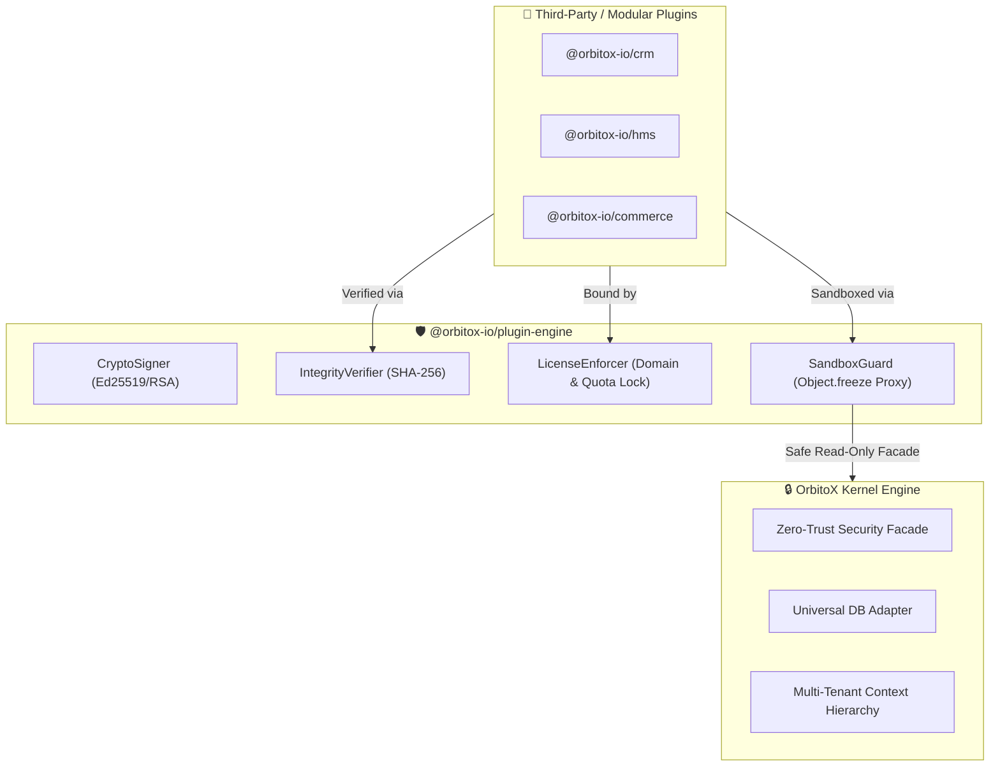

# 🛡️ @orbitox-io/plugin-engine

> **Zero-Trust Security, Cryptographic Signer, Anti-Tamper Verifier, Enterprise Licensing & Plugin Registry Engine for the OrbitoX SaaS Operating System.**

[](https://github.com/OrbitoX-io/OrbitoX-Platform/packages)
[](https://github.com/OrbitoX-io/OrbitoX-Platform)
[](https://github.com/OrbitoX-io/OrbitoX-Platform)

---

## 📑 Table of Contents
1. [Overview & Architecture](#-overview--architecture)
2. [Installation](#-installation)
3. [Quick Start](#-quick-start)
4. [Core Security Modules](#-core-security-modules)
   - [1. Cryptographic Signer & Hasher (`CryptoSigner`)](#1-cryptographic-signer--hasher-cryptosigner)
   - [2. Anti-Tamper Verifier (`IntegrityVerifier`)](#2-anti-tamper-verifier-integrityverifier)
   - [3. Enterprise License & Domain Lock (`LicenseEnforcer`)](#3-enterprise-license--domain-lock-licenseenforcer)
   - [4. Zero-Trust Sandbox Guard (`SandboxGuard`)](#4-zero-trust-sandbox-guard-sandboxguard)
5. [CLI Tooling Reference](#-cli-tooling-reference)
6. [Security Best Practices](#-security-best-practices)

---

## 🌟 Overview & Architecture

`@orbitox-io/plugin-engine` provides the enterprise security and execution boundary for OrbitoX plugins and packages. It ensures:

- 🔒 **IP Protection**: Plugins run with frozen facades and strictly protected kernel internals.
- 🛡️ **Tamper Detection**: Every manifest and package file is hashed with SHA-256 and cryptographically signed with Ed25519 or RSA-2048 keys.
- 🔑 **Cryptographic Licensing**: Built-in RSA licensing engine with domain binding, quota enforcement, and automated expiration checks.



---

## 📦 Installation

Configure your `.npmrc` file with GitHub Packages authentication:

```ini
# .npmrc
@orbitox-io:registry=https://npm.pkg.github.com
//npm.pkg.github.com/:_authToken=${NODE_AUTH_TOKEN}
always-auth=true
```

Then install via `npm` or `pnpm`:

```bash
# Using npm
npm install @orbitox-io/plugin-engine

# Using pnpm
pnpm add @orbitox-io/plugin-engine
```

---

## 🚀 Quick Start

```javascript
const {
  CryptoSigner,
  IntegrityVerifier,
  LicenseEnforcer,
  SandboxGuard
} = require('@orbitox-io/plugin-engine/dist/security');

// 1. Generate an Ed25519 / RSA Keypair
const keypair = CryptoSigner.generateSigningKeyPair('ed25519');

// 2. Cryptographically Sign a Manifest Payload
const manifest = { id: 'crm', version: '1.0.0', author: 'OrbitoX' };
const signature = CryptoSigner.signPayload(manifest, keypair.privateKey);

// 3. Verify Authenticity & Detect Tampering
const isValid = IntegrityVerifier.verifyPayloadSignature(manifest, signature, keypair.publicKey);
console.log('Signature Authentic?', isValid); // true
```

---

## 🔐 Core Security Modules

### 1. Cryptographic Signer & Hasher (`CryptoSigner`)

Generates digital signatures and computes SHA-256 file hashes across package distribution trees:

```typescript
import { CryptoSigner } from '@orbitox-io/plugin-engine';

// Generate signing keypair
const { publicKey, privateKey } = CryptoSigner.generateSigningKeyPair('ed25519');

// Sign payload
const signature = CryptoSigner.signPayload({ pluginId: 'hms', version: '2.0.0' }, privateKey);

// Hash local file
const fileSha256 = CryptoSigner.calculateFileHash('dist/bundle.js');
```

---

### 2. Anti-Tamper Verifier (`IntegrityVerifier`)

Validates signatures and file checksums before loading plugins to prevent MITM attacks or malware injection:

```typescript
import { IntegrityVerifier } from '@orbitox-io/plugin-engine';

const isValid = IntegrityVerifier.verifyPayloadSignature(payload, signatureHex, publicKeyPem);

if (!isValid) {
  throw new Error('SECURITY ALERT: Tampered plugin payload detected!');
}
```

---

### 3. Enterprise License & Domain Lock (`LicenseEnforcer`)

Issues and validates RSA-signed license tokens to prevent software piracy and enforce host domain binding:

```typescript
import { LicenseEnforcer } from '@orbitox-io/plugin-engine';

// 1. Issue signed license token for a client
const token = LicenseEnforcer.issueLicenseToken({
  licenseId: 'lic_apollo_100',
  issuedTo: 'Apollo Hospitals',
  allowedDomain: 'hospital.apollo.com',
  allowedTenants: 50,
  features: ['ai_diagnostics', 'telehealth'],
  issuedAt: new Date().toISOString(),
  expiresAt: '2027-12-31T23:59:59Z',
  tier: 'enterprise'
}, privateKeyPem);

// 2. Validate license at runtime boot
const check = LicenseEnforcer.verifyLicenseToken(token, publicKeyPem, {
  currentDomain: 'hospital.apollo.com',
  activeTenantsCount: 30,
  requiredFeature: 'ai_diagnostics'
});

if (!check.valid) {
  console.error('License Verification Failed:', check.errors);
  process.exit(1);
}
```

---

### 4. Zero-Trust Sandbox Guard (`SandboxGuard`)

Freezes facades and creates sandboxed execution proxies that prevent untrusted plugins from accessing kernel memory or private symbols:

```typescript
import { SandboxGuard } from '@orbitox-io/plugin-engine';

const runtime = {
  security: { authorize: () => true },
  database: { query: () => [] },
  _privateDbPassword: 'root-password-123'
};

// Deeply freeze runtime facades
SandboxGuard.freezeAllFacades(runtime);

// Create safe proxy restricting access to private properties
const safeFacade = SandboxGuard.createSandboxedProxy(runtime, ['security', 'database']);

safeFacade._privateDbPassword; // ❌ Throws Sandbox Security Alert!
```

---

## 🛠️ CLI Tooling Reference

Use the built-in `@orbitox/cli` for automated security operations:

```bash
# 1. Generate Ed25519 Signing Keys
node tools/cli/dist/bin.js keygen --type=ed25519 --out=keys/

# 2. Package, Hash & Sign a Plugin
node tools/cli/dist/bin.js package crm --key=keys/private.pem

# 3. Verify Signature & File Tree Checksums
node tools/cli/dist/bin.js verify crm --publicKey=keys/public.pem

# 4. Issue a Signed License Token
node tools/cli/dist/bin.js license issue --to="Customer" --domain="app.domain.com" --key=keys/private.pem
```

---

## 🛡️ Security Best Practices

1. **Never Commit Private Keys**: Store `keys/private.pem` in CI/CD repository secrets (`ORBITOX_RELEASE_PRIVATE_KEY`).
2. **Strip Source Maps**: Always compile production packages with `tsconfig.prod.json` (`sourceMap: false`).
3. **Enforce Read-Only Tokens**: Distribute only fine-grained read-only tokens (`read:packages`) to runtime deployment servers.

---

## 📄 License

Proprietary & Confidential — **OrbitoX Platform**. All rights reserved.
