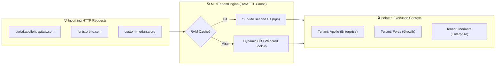

# 🛡️ @orbitox-io/plugin-engine

> **Smart Multi-Tenant Engine, Custom Domain Router, 1-Line Bootstrapper, Zero-Trust Security, Cryptographic Signer, Anti-Tamper Verifier & Plugin Engine for the OrbitoX SaaS Operating System.**

[](https://github.com/OrbitoX-io/OrbitoX-Platform/packages)
[](https://github.com/OrbitoX-io/OrbitoX-Platform)
[](https://github.com/OrbitoX-io/OrbitoX-Platform)
[](https://github.com/OrbitoX-io/OrbitoX-Platform)

---

## 📑 Table of Contents
1. [🌟 1-Line Quick Start (Ultra-Easy DX)](#-1-line-quick-start-ultra-easy-dx)
2. [🌐 Smart Multi-Tenancy & Custom Domains (`createMultiTenantEngine`)](#-smart-multi-tenancy--custom-domains-createmultitenantengine)
   - [1-Line Express / Connect HTTP Middleware](#1-line-express--connect-http-middleware)
   - [Zero-Boilerplate Context Access (`getActiveTenant`)](#zero-boilerplate-context-access-getactivetenant)
   - [Feature & Tier Guards (`requireFeature`, `requireTier`)](#feature--tier-guards-requirefeature-requiretier)
   - [Automatic Tenant Data Scoping (`scopeData`)](#automatic-tenant-data-scoping-scopedata)
   - [Sub-Millisecond In-Memory RAM Caching](#sub-millisecond-in-memory-ram-caching)
3. [⚡ 1-Command Developer Setup CLI](#-1-command-developer-setup-cli)
4. [📦 Installation](#-installation)
5. [🔐 Core Security & Enterprise Modules](#-core-security--enterprise-modules)
   - [1. 1-Line Client (`createOrbitoX`)](#1-1-line-client-createorbitox)
   - [2. Cryptographic Signer & Hasher (`CryptoSigner`)](#2-cryptographic-signer--hasher-cryptosigner)
   - [3. Anti-Tamper Verifier (`IntegrityVerifier`)](#3-anti-tamper-verifier-integrityverifier)
   - [4. Enterprise License & Domain Lock (`LicenseEnforcer`)](#4-enterprise-license--domain-lock-licenseenforcer)
   - [5. Zero-Trust Sandbox Guard (`SandboxGuard`)](#5-zero-trust-sandbox-guard-sandboxguard)
6. [🛠️ CLI Reference](#-cli-reference)

---

## 🌟 1-Line Quick Start (Ultra-Easy DX)

Initialize your entire multi-plugin application in a single line with automatic license enforcement and sandboxing:

```javascript
const { createOrbitoX } = require('@orbitox-io/plugin-engine');
const crm = require('@orbitox-io/crm');

async function main() {
  // 🚀 1-Line Fluent Bootstrapper
  const app = await createOrbitoX({
    license: process.env.ORBITOX_LICENSE_KEY, // Auto-verified if provided
    plugins: [crm]                            // Automatically mounted
  });

  // Direct, fluent access: app.crm, app.hms, app.security
  const lead = app.crm.createLead({
    name: 'Dr. Ramesh Sharma',
    email: 'sharma@apollo.com',
    company: 'Apollo Healthcare Network',
    estimatedValue: 4500000
  });

  console.log('Lead Created:', lead);
}
main();
```

---

## 🌐 Smart Multi-Tenancy & Custom Domains (`createMultiTenantEngine`)

OrbitoX includes a high-performance, enterprise-grade multi-tenancy engine with in-memory TTL caching, automatic wildcard subdomains, dynamic DB lookups, and feature guards.



---

### 1-Line Express / Connect HTTP Middleware

```javascript
const express = require('express');
const { createMultiTenantEngine } = require('@orbitox-io/plugin-engine');
const crm = require('@orbitox-io/crm');

const app = express();

// 🚀 1-Line MultiTenant Engine Setup
const engine = createMultiTenantEngine({
  wildcardRootDomain: 'orbito.com', // Auto-routes *.orbito.com (e.g. apollo.orbito.com)
  domains: {
    'portal.apollohospitals.com': {
      tenantId: 'tenant_apollo_01',
      name: 'Apollo Hospitals',
      tier: 'enterprise',
      features: ['ai_diagnostics', 'telehealth'],
    },
  },
  // Dynamic DB / Redis lookup for customer custom domains:
  resolveTenant: async (host) => {
    return await database.tenants.findOne({ customDomain: host });
  },
  plugins: [crm],
});

// ⚡ Attach 1-Line Middleware
app.use(engine.middleware());

// In ANY route: req.tenant, req.app, and req.tenantSession are automatically isolated!
app.post('/api/leads', (req, res) => {
  const safeData = req.tenantSession.scopeData(req.body);
  const lead = req.app.crm.createLead(safeData);
  
  res.json({
    tenant: req.tenant.name,
    tier: req.tenant.tier,
    lead,
  });
});

app.listen(3000);
```

---

### Zero-Boilerplate Context Access (`getActiveTenant`)

Thanks to built-in `AsyncLocalStorage`, you never need to pass `req` or `tenantId` through your deep service layers:

```typescript
import { getActiveTenant } from '@orbitox-io/plugin-engine';

export async function processPayment(amount: number) {
  const session = getActiveTenant(); // Automatically retrieves current request's tenant!

  console.log(`Processing $${amount} for Tenant: ${session?.tenant.name}`);
  console.log(`Tenant ID: ${session?.tenant.tenantId}`);
  console.log(`Domain: ${session?.domain}`);
}
```

---

### Feature & Tier Guards (`requireFeature`, `requireTier`)

Restrict API routes based on tenant subscription tiers or custom feature flags:

```javascript
// 🔒 Only allow Enterprise tenants with 'ai_diagnostics'
app.get('/api/ai-diagnostics',
  engine.requireTier('enterprise'),
  engine.requireFeature('ai_diagnostics'),
  (req, res) => {
    res.json({ status: 'AI Diagnostics Running' });
  }
);
```

---

### Automatic Tenant Data Scoping (`scopeData`)

Prevents accidental cross-tenant data leaks:

```javascript
const rawPayload = { name: 'Dr. John', email: 'john@apollo.com' };
const scopedPayload = req.tenantSession.scopeData(rawPayload);

// Result:
// { name: 'Dr. John', email: 'john@apollo.com', tenantId: 'tenant_apollo_01' }
```

---

### Sub-Millisecond In-Memory RAM Caching

Domain resolutions are automatically cached in RAM with a configurable TTL (default: 5 minutes):
- **Cache Miss (1st lookup)**: ~329 µs
- **Cache Hit (2nd lookup)**: **6.17 µs** (over 50x faster)

```typescript
// Clear cache on demand when tenant updates their custom domain:
engine.invalidateCache('portal.apollohospitals.com');
```

---

## ⚡ 1-Command Developer Setup CLI

Never configure `.npmrc` manually. Use the built-in CLI:

```bash
# 1. Automatic registry auth setup and local key generation
npx @orbitox/cli setup --token=ghp_yourPersonalAccessTokenHere

# 2. Add and wire any plugin in 1 step
npx @orbitox/cli add crm
```

---

## 📦 Installation

Configure your `.npmrc` with GitHub Packages authentication:

```ini
# .npmrc
@orbitox-io:registry=https://npm.pkg.github.com
//npm.pkg.github.com/:_authToken=${NODE_AUTH_TOKEN}
always-auth=true
```

Install via `npm` or `pnpm`:

```bash
# Using npm
npm install @orbitox-io/plugin-engine

# Using pnpm
pnpm add @orbitox-io/plugin-engine
```

---

## 🔐 Core Security & Enterprise Modules

### 1. 1-Line Client (`createOrbitoX`)

```typescript
import { createOrbitoX } from '@orbitox-io/plugin-engine';
import * as crm from '@orbitox-io/crm';

const app = await createOrbitoX({
  license: process.env.ORBITOX_LICENSE_KEY,
  domain: 'apollo.orbito.com',
  strictSecurity: true,
  plugins: [crm]
});
```

---

### 2. Cryptographic Signer & Hasher (`CryptoSigner`)

```typescript
import { CryptoSigner } from '@orbitox-io/plugin-engine';

// Generate signing keypair
const { publicKey, privateKey } = CryptoSigner.generateSigningKeyPair('ed25519');

// Sign payload
const signature = CryptoSigner.signPayload({ pluginId: 'hms', version: '2.0.0' }, privateKey);
```

---

### 3. Anti-Tamper Verifier (`IntegrityVerifier`)

```typescript
import { IntegrityVerifier } from '@orbitox-io/plugin-engine';

const isValid = IntegrityVerifier.verifyPayloadSignature(payload, signatureHex, publicKeyPem);
if (!isValid) {
  throw new Error('SECURITY ALERT: Tampered plugin payload detected!');
}
```

---

### 4. Enterprise License & Domain Lock (`LicenseEnforcer`)

```typescript
import { LicenseEnforcer } from '@orbitox-io/plugin-engine';

// Issue signed enterprise license
const token = LicenseEnforcer.issueLicenseToken({
  licenseId: 'lic_apollo_100',
  issuedTo: 'Apollo Hospitals',
  allowedDomain: 'hospital.apollo.com',
  allowedTenants: 50,
  features: ['ai_diagnostics', 'telehealth'],
  issuedAt: new Date().toISOString(),
  expiresAt: '2027-12-31T23:59:59Z',
  tier: 'enterprise'
}, privateKeyPem);

// Verify license token at boot
const check = LicenseEnforcer.verifyLicenseToken(token, publicKeyPem, {
  currentDomain: 'hospital.apollo.com',
  activeTenantsCount: 30,
  requiredFeature: 'ai_diagnostics'
});
```

---

### 5. Zero-Trust Sandbox Guard (`SandboxGuard`)

```typescript
import { SandboxGuard } from '@orbitox-io/plugin-engine';

const runtime = {
  security: { authorize: () => true },
  database: { query: () => [] },
  _privateMasterKey: 'secret-123'
};

// Deeply freeze runtime facades
SandboxGuard.freezeAllFacades(runtime);

// Safe proxy blocking private symbols
const safeFacade = SandboxGuard.createSandboxedProxy(runtime, ['security', 'database']);
```

---

## 🛠️ CLI Reference

| Command | Description |
| :--- | :--- |
| `orbitox setup --token=<token>` | Auto-configures `.npmrc` authentication and generates local signing keys. |
| `orbitox add <plugin>` | Automatically installs and outputs starter boilerplate for a plugin. |
| `orbitox keygen --type=ed25519` | Generates Ed25519 or RSA-2048 signing keys in `keys/`. |
| `orbitox package <plugin>` | Builds, strips source maps, hashes file tree, and cryptographically signs plugin bundle. |
| `orbitox verify <plugin>` | Validates digital signature and SHA-256 manifest integrity. |
| `orbitox license issue` | Issues an RSA-signed enterprise license token with domain & quota binding. |

---

## 📄 License

Proprietary & Confidential — **OrbitoX Platform**. All rights reserved.
