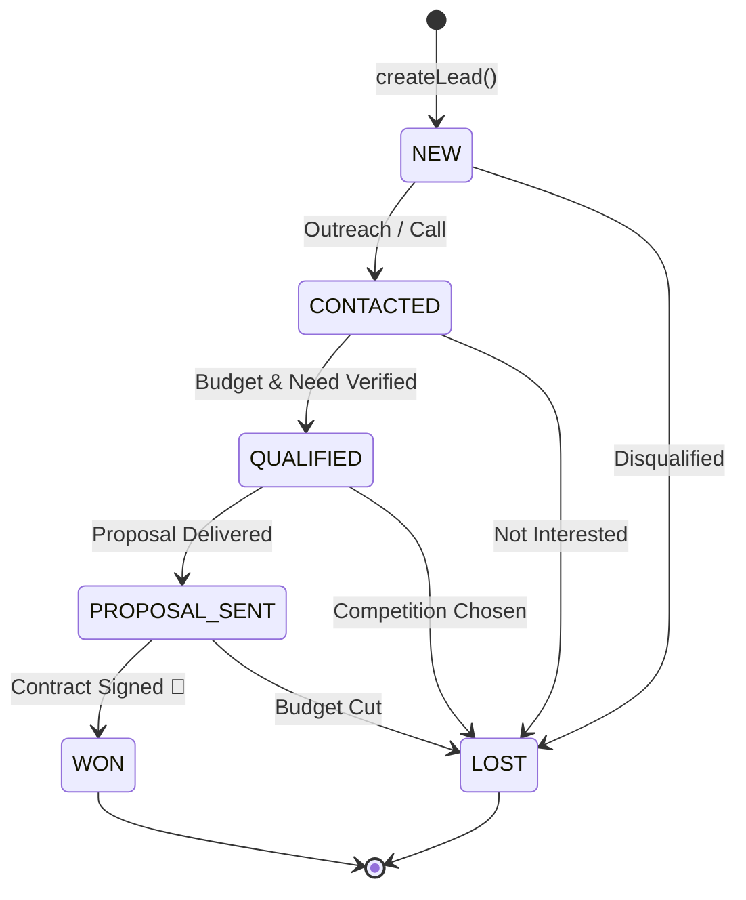

# 💼 @orbitox-io/crm

> **Headless CRM Domain Engine — Lead State Machines, Sales Pipeline Lifecycle, AI Summaries & Multi-Tenant Lead Actions for the OrbitoX Platform.**

[](https://github.com/OrbitoX-io/OrbitoX-Platform/packages)
[](https://github.com/OrbitoX-io/OrbitoX-Platform)
[](https://github.com/OrbitoX-io/OrbitoX-Platform)

---

## 📑 Table of Contents
1. [Overview](#-overview)
2. [Installation](#-installation)
3. [Quick Start](#-quick-start)
4. [Sales Pipeline State Machine](#-sales-pipeline-state-machine)
5. [API Reference](#-api-reference)
   - [`HeadlessCrmService`](#headlesscrmservice)
   - [`LeadStateMachine`](#leadstatemachine)
   - [React Hooks (`useLeads`, `useLeadActions`)](#react-hooks)
6. [AI Copilot Integration](#-ai-copilot-integration)

---

## 🌟 Overview

`@orbitox-io/crm` is a UI-agnostic, headless domain package providing complete customer relationship management, sales pipeline automation, and lead intelligence.

- ⚡ **Headless & UI-Agnostic**: Works across Node.js backends, Next.js apps, React SPAs, and React Native mobile applications.
- 🚦 **State Machine Engine**: Enforces strict sales lifecycle invariants (`NEW` ➔ `CONTACTED` ➔ `QUALIFIED` ➔ `PROPOSAL_SENT` ➔ `WON`).
- 🤖 **AI Lead Intelligence**: Automatic lead scoring and natural language deal summaries.

---

## 📦 Installation

Configure your `.npmrc` file with your GitHub Packages token:

```ini
# .npmrc
@orbitox-io:registry=https://npm.pkg.github.com
//npm.pkg.github.com/:_authToken=${NODE_AUTH_TOKEN}
always-auth=true
```

Install via `npm` or `pnpm`:

```bash
# Using npm
npm install @orbitox-io/crm

# Using pnpm
pnpm add @orbitox-io/crm
```

---

## 🚀 Quick Start

```javascript
const { HeadlessCrmService, LeadStateMachine } = require('@orbitox-io/crm');

const crm = new HeadlessCrmService();

// 1. Create a Lead
const lead = crm.createLead({
  name: 'Dr. Ramesh Sharma',
  email: 'r.sharma@apollo.com',
  company: 'Apollo Healthcare Network',
  estimatedValue: 4500000,
  source: 'website'
});

// 2. Compute Lead Score (0 - 100)
const score = LeadStateMachine.calculateLeadScore(lead);
console.log(`Lead Score: ${score}/100`);

// 3. Progress Through Sales Pipeline
crm.updateLeadStatus(lead.id, 'CONTACTED');
crm.updateLeadStatus(lead.id, 'QUALIFIED');
crm.updateLeadStatus(lead.id, 'PROPOSAL_SENT');
const wonLead = crm.updateLeadStatus(lead.id, 'WON');

console.log('Deal Closed! Final Status:', wonLead.status);

// 4. Generate AI Deal Summary
const summary = crm.generateAiSummary(lead.id);
console.log(summary);
```

---

## 🔄 Sales Pipeline State Machine

The CRM enforces strict transition guards to prevent jumping directly to invalid states:



### Transition Validation Rules:
- `LeadStateMachine.canTransition('NEW', 'QUALIFIED')` ➔ **`false`** *(Must go through `CONTACTED` first)*.
- `LeadStateMachine.canTransition('NEW', 'WON')` ➔ **`false`** *(Direct jumps to `WON` are blocked)*.
- `LeadStateMachine.getNextValidStates('QUALIFIED')` ➔ **`['PROPOSAL_SENT', 'LOST']`**.

---

## 📚 API Reference

### `HeadlessCrmService`

| Method | Parameters | Returns | Description |
| :--- | :--- | :--- | :--- |
| `createLead(dto)` | `CreateLeadDto` | `Lead` | Validates input, calculates initial score, and creates a lead in `NEW` state. |
| `updateLeadStatus(id, status)` | `string, LeadStatus` | `Lead` | Validates transition rules and updates the lead state. |
| `getLeadById(id)` | `string` | `Lead \| undefined` | Retrieves a lead record by ID. |
| `filterLeads(filters)` | `LeadFilterOptions` | `Lead[]` | Filters leads by status, score range, or search term. |
| `generateAiSummary(id)` | `string` | `string` | Generates a structured AI summary with recommended next actions. |

---

### `LeadStateMachine`

| Method | Parameters | Returns | Description |
| :--- | :--- | :--- | :--- |
| `canTransition(from, to)` | `LeadStatus, LeadStatus` | `boolean` | Checks if a transition between two states is valid. |
| `getNextValidStates(status)` | `LeadStatus` | `LeadStatus[]` | Returns all permissible next states from the given status. |
| `calculateLeadScore(lead)` | `Lead` | `number (0-100)` | Calculates lead qualification score based on data density and deal value. |

---

### React Hooks (Front-End)

For React and Next.js applications, import directly from the React submodule:

```tsx
import React from 'react';
import { useLeads, useLeadActions } from '@orbitox-io/crm/react';

export function CrmDashboard() {
  const { leads, isLoading } = useLeads();
  const { createLead, changeStatus } = useLeadActions();

  if (isLoading) return <div>Loading Leads...</div>;

  return (
    <div className="crm-grid">
      {leads.map((lead) => (
        <div key={lead.id} className="lead-card">
          <h3>{lead.name}</h3>
          <p>{lead.company} — ${lead.estimatedValue}</p>
          <span className={`badge ${lead.status}`}>{lead.status}</span>
          <button onClick={() => changeStatus(lead.id, 'QUALIFIED')}>
            Qualify
          </button>
        </div>
      ))}
    </div>
  );
}
```

---

## 📄 License

Proprietary & Confidential — **OrbitoX Platform**. All rights reserved.
