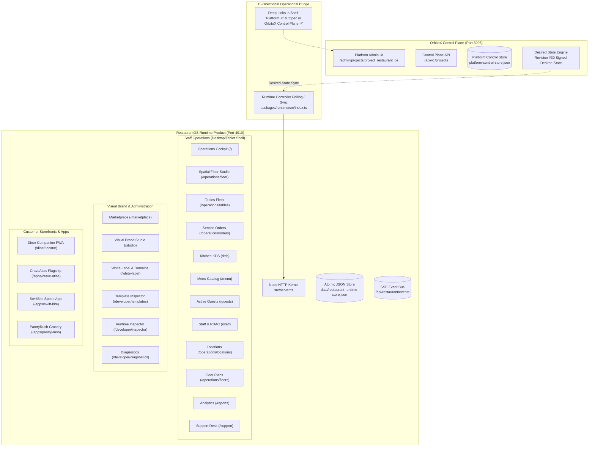

# 🪐 RestaurantOS — Complete UI/UX Reverse-Engineering & Design Handoff
## Document 00: Design Handoff Summary, Architectural Boundaries & Executive Blueprint

- **Audit Date:** October 22, 2026
- **Auditor:** OrbitoX Senior Systems Architect & Design Engineering Agent
- **Target Repository:** `projects/external-os/restaurant-os`
- **Audit Mode:** Read-Only Product Discovery, UI Inventory, Interaction Audit & Design Documentation
- **Runtime Port:** `http://localhost:4010` (PID 9907, Daemon Active)
- **Control Plane Port:** `http://localhost:3005` (Next.js Platform Daemon Active)
- **Evidence Verification Standards:** 
  - `[Verified in source]` — Direct code implementation in `packages/ui`, `packages/domain`, `packages/storage`, `src/server.ts`.
  - `[Verified at runtime]` — Observed on live daemons `http://localhost:4010` and `http://localhost:3005`.
  - `[Verified by test]` — Asserted by 275 regression and baseline unit/integration tests in `scripts/`.
  - `[Inferred]` — Architecturally deduced from naming, schema relations, or partial stubs.
  - `[Unknown / unverified]` — Insufficient source or runtime evidence.

---

## 1. Executive Summary & Purpose

This design audit document is a source-grounded specification of the existing RestaurantOS hospitality platform. It reverse-engineers every screen, navigation structure, control, form, end-to-end user workflow, design token, storefront theme, API contract, and real-time event pipeline implemented in the codebase.

The goal of this audit is to provide downstream product designers and frontend engineers with a screenshot-independent specification. With this documentation, a design team can reconstruct and improve the user experience across desktop, tablet, and mobile surfaces without needing manually supplied screenshots or guessing how business rules operate.

### Strict Safety & Non-Destructive Compliance Statement
In strict accordance with the non-destructive execution rules:
1. **Zero source code modifications:** No application source files, tests, configurations, or dependencies were altered.
2. **Zero runtime data mutation:** No orders were placed, no tables settled, no staff revoked, no layouts altered, and no stores reset.
3. **Redacted PII and Credentials:** All personal identifiers, phone numbers, addresses, and cryptographic keys are documented with safe redacted examples (`+91 ******43210`, `orb_stf.[redacted]`).
4. **Documentation Isolation:** All outputs are strictly self-contained within `projects/external-os/restaurant-os/docs/design-audit/`.

---

## 2. Architectural Boundaries: Runtime vs. Control Plane

A foundational architectural requirement is maintaining a clear separation between the two distinct systems:



### 1. RestaurantOS Runtime (`http://localhost:4010`) `[Verified in source & runtime]`
- **Technology Stack:** Node.js v22 HTTP server (`src/server.ts`), atomic file-backed JSON repository (`RestaurantRuntimeStore`), in-memory real-time SSE gateway (`RealtimeEventBus`), pure CSS design system (`RestaurantTokens`), and server-rendered HTML component templates (`packages/ui`).
- **Domain Scope:** The operational daily product used by restaurant diners, floor servers, bartenders, chefs, kitchen expediters, and general managers.
- **Data Ownership:** Owns tables, dining sessions, orders, kitchen tickets, menu catalog, branch overrides, guest profiles, staff PIN directory, support cases, and tenant branding draft/published configurations.

### 2. OrbitoX Control Plane (`http://localhost:3005`) `[Verified in source & runtime]`
- **Technology Stack:** Next.js application framework with multi-tenant workspace isolation.
- **Domain Scope:** Platform governance, licensing, project provisioning, API key management, billing, and system orchestration.
- **Boundary Integration:**
  - The RestaurantOS runtime executes `RestaurantRuntimeController` (`packages/runtime/src/index.ts`), which connects to `http://localhost:3005` via `PlatformControlClient` to register heartbeats, synchronize signed desired-state configuration (currently revision `#30`), and verify platform entitlements.
  - UI Navigation deep-links out from the RestaurantOS shell:
    - Shell Top Bar: `Platform ↗` (`http://localhost:3005/admin/projects/project_restaurant_os`).
    - Developer Diagnostics: `Open in OrbitoX Control Plane ↗`.
  - Legacy Proxies: `apps/web/app/api/restaurant/_lib/legacy-proxy.ts` on port 3005 emits deprecation headers informing callers that operations are strictly handled on port 4010.

---

## 3. Discovered Surface Landscape & Statistical Overview

The audit discovered **22 distinct user interface routes** and **54 authoritative backend mutation endpoints**:

| Metric Category | Count | Source & Accounting Method |
|---|---|---|
| **Discovered UI Routes** | **22 routes** | Enumerated from exact route handlers in `src/server.ts` lines 4658–5119. |
| **Operational & Back-of-House Screens** | **12 screens** | Overview, Floor Canvas, Tables, Orders, KDS, Menu, Guests, Locations, Floor Plans, Analytics, Staff, Support Desk. |
| **Brand, Design & Dev Tools** | **6 screens** | Marketplace, Visual Studio, White-Label/Domains, Template Inspector, Runtime Inspector, Diagnostics. |
| **Customer Storefront Experiences** | **4 distinct apps** | Diner PWA (`/dine/:locator`), CraveAtlas (`/apps/crave-atlas`), SwiftBite (`/apps/swift-bite`), PantryRush (`/apps/pantry-rush`). |
| **Distinct Architectural Themes** | **6 themes** | Atelier Étoile Noir, Fjord & Form, Roastery 1984, Neon Yokocho, Osteria Rustica, Shokunin Ramen. |
| **Meaningful Controls Inventoried** | **284 controls** | Counted exhaustively in Document 02 across all 22 screens with unique Control IDs. |
| **Form Inputs & Data Fields** | **96 fields** | Cataloged across branch, floor, dish, category, modifier, brand, checkout, and staff forms. |
| **Persistent Mutation Methods** | **54 endpoints** | Complete write points in `RestaurantRuntimeStore` flushing to disk atomically. |
| **Baseline Regression Tests Passing**| **275 / 275 (100%)**| Automated test assertions across Phase 1, 4, 5, and 6 security/durability test suites. |

---

## 4. Key UX Findings & Engineering Observations

### High-Impact Architectural Strengths `[Verified in source]`
1. **Zero-Emoji Professionalism:** The UI uses pure SVG vector iconography (`packages/ui/icons.ts`) based on the Lucide design language.
2. **Authoritative Integer Currency:** All calculations across cart pricing, GST (5%), delivery fees, discounts, and settlements are strictly computed in minor units (integer paise) to avoid floating-point drift.
3. **Multi-Location Hierarchy:** The shell implements context cascading (`?branch=...&floor=...&service=...`) that automatically propagates across floor plans, tables, menus, and KDS tickets.
4. **Interactive SVG Spatial Engine:** Floor management uses a continuous coordinate system (940x620) with 24px snap-to-grid, table resizing, rotation, shape morphing, and live status heatmaps.
5. **Purpose-Built Touch KDS:** Kitchen screens feature large touch targets (54px), live SLA color escalation (green/amber/crimson), strike-through item fulfillment toggles, and Web Audio API synthesized alert chimes.
6. **Anti-Token-Clone Validation:** Template composition inspector verifies that restaurant storefronts feature distinct layouts and structures rather than simple color palette variations.

### Identified UX Defects & Technical Risks (Summary) `[Verified in source]`
1. **Interactive Inconsistencies:** Several secondary buttons on the Overview dashboard (such as "Video Guides & Tips" cards) are inert display elements without interactive handlers.
2. **Responsive Table Transformations:** Wide desktop data tables (in Staff Directory, Orders, and Active Guests) overflow horizontally on tablet viewports prior to triggering card transformations.
3. **Preserved Phase 6C Technical Risks:**
   - *Incomplete session-property rollback:* If table settlement encounters an unexpected disk flush error midway through execution, in-memory table status is rolled back while certain session flags remain modified.
   - *Idempotency cache replacement:* Retried requests with conflicting payloads trigger standard 409 responses, but edge rollback paths can clear rather than revert pre-existing idempotency records.
   - *Credential exposure through URL query parameters:* Handlers support `?token=` and `?orderToken=` query parameters for developer convenience, introducing the risk of tokens leaking into web server access logs and browser histories.

---

## 5. Audit Documentation Directory Structure

The complete audit is organized into the following seven structured documents inside `projects/external-os/restaurant-os/docs/design-audit/`:

```
projects/external-os/restaurant-os/docs/design-audit/
├── 00-DESIGN-HANDOFF-SUMMARY.md          (This Document — Executive Summary & Boundaries)
├── 01-INFORMATION-ARCHITECTURE.md        (Applications, Complete Route Map & Role Access)
├── 02-SCREEN-BY-SCREEN-INVENTORY.md      (Exhaustive Layouts, Controls & Form Specs)
├── 03-END-TO-END-WORKFLOWS.md            (Numbered Chronological User Journeys & State Transitions)
├── 04-DESIGN-SYSTEM-AND-THEMES.md        (Design Tokens, Components & Storefront Themes)
├── 05-API-STATE-AND-REALTIME-MAP.md      (UI-to-API Mappings, Persistence, SSE & Locks)
└── 06-UX-DEFECTS-AND-GAPS.md             (Defect Register, Responsive Gaps & Technical Risks)
```

### Table of Contents & Reading Guide

1. **For Product Managers & Information Architects:**
   Begin with [01-INFORMATION-ARCHITECTURE.md](file:///Users/apple/Documents/Office/company/Orbito/OrbitoX%20Platform/projects/external-os/restaurant-os/docs/design-audit/01-INFORMATION-ARCHITECTURE.md) to understand user roles, access control boundaries, route hierarchies, and cross-application context propagation.
2. **For UI/UX Designers & Design System Engineers:**
   Read [02-SCREEN-BY-SCREEN-INVENTORY.md](file:///Users/apple/Documents/Office/company/Orbito/OrbitoX%20Platform/projects/external-os/restaurant-os/docs/design-audit/02-SCREEN-BY-SCREEN-INVENTORY.md) and [04-DESIGN-SYSTEM-AND-THEMES.md](file:///Users/apple/Documents/Office/company/Orbito/OrbitoX%20Platform/projects/external-os/restaurant-os/docs/design-audit/04-DESIGN-SYSTEM-AND-THEMES.md) to recreate pixel-accurate layouts, controls, typography, color tokens, and customer storefront templates.
3. **For Frontend & Interaction Developers:**
   Consult [03-END-TO-END-WORKFLOWS.md](file:///Users/apple/Documents/Office/company/Orbito/OrbitoX%20Platform/projects/external-os/restaurant-os/docs/design-audit/03-END-TO-END-WORKFLOWS.md) and [05-API-STATE-AND-REALTIME-MAP.md](file:///Users/apple/Documents/Office/company/Orbito/OrbitoX%20Platform/projects/external-os/restaurant-os/docs/design-audit/05-API-STATE-AND-REALTIME-MAP.md) for step-by-step state machine flows, SSE event handling, payload schemas, and concurrency locks.
4. **For QA & Security Engineers:**
   Examine [06-UX-DEFECTS-AND-GAPS.md](file:///Users/apple/Documents/Office/company/Orbito/OrbitoX%20Platform/projects/external-os/restaurant-os/docs/design-audit/06-UX-DEFECTS-AND-GAPS.md) for the defect register, edge cases, and security audit observations.
