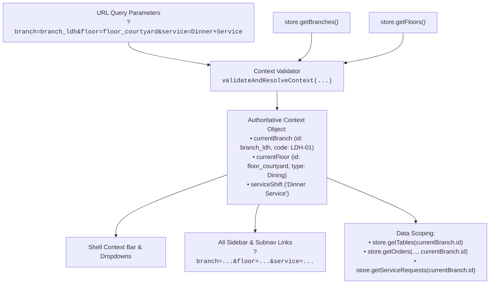

# 🪐 RestaurantOS — Complete UI/UX Reverse-Engineering & Design Handoff
## Document 01: Information Architecture, Application Map & Access Hierarchy

- **Audit Date:** October 22, 2026
- **Auditor:** OrbitoX Senior Systems Architect & Design Engineering Agent
- **Target Repository:** `projects/external-os/restaurant-os`
- **Audit Mode:** Read-Only Product Discovery & Information Architecture Reverse-Engineering
- **Primary Source Files:** `src/server.ts`, `packages/ui/shell.ts`, `packages/ui/pages/*`, `packages/domain/security.ts`, `packages/domain/index.ts`

---

## 1. Information Architecture Overview

RestaurantOS is structured into four primary operational surface families, supported by a shared desktop/mobile application shell, an outbox-driven real-time synchronization gateway, and an external control plane integration bridge:

1. **Back-of-House (BOH) & Operational Command:** Desktop/tablet-optimized workspaces for restaurant floor managers, hosts, servers, and general managers.
2. **Kitchen Execution Instrument (KDS):** Industrial touchscreen workstation designed for kitchen stations (Tandoor, Curry Line, Bar, Dessert, and Expo).
3. **Brand Studio & Administration:** Visual site builder, multi-template marketplace, white-label DNS/SSL management, and developer diagnostic tools.
4. **Customer-Facing Storefronts & Apps:** Responsive diner companion PWA, brand flagship site (CraveAtlas), speed ordering app (SwiftBite), and dark-store grocery (PantryRush).

---

## 2. Complete Discovered Route Inventory & Component Mapping

Every discovered route in `src/server.ts` has been audited and classified with its owning UI component, layout shell, primary purpose, and role restrictions:

| Route Path | Primary Component | Layout Shell | User Role & Access | Primary Purpose | Evidence |
|---|---|---|---|---|---|
| `/` or `/overview` | `renderOperationsHome` | `renderShell` | `MANAGER`, `ADMIN` | Shift cockpit, live metrics, table folio preview, pending service attention, station workloads, timeline. | `[Verified in source]` |
| `/operations/floor` or `/operations` | `renderFloorStudio` | `renderShell` | `STAFF`, `MANAGER`, `ADMIN` | Interactive SVG spatial floor canvas, table drag/grid-snap, multi-tab table inspector (Overview, Seats, Orders, Bill, Layout). | `[Verified in source]` |
| `/operations/tables` | `renderTablesList` | `renderShell` | `STAFF`, `MANAGER`, `ADMIN` | Fleet data table of all dining tables, section filter pills, occupancy, tab balances, direct links to Canvas and Diner PWA. | `[Verified in source]` |
| `/operations/orders` or `/orders` | `renderOrdersWorkspace` | `renderShell` | `STAFF`, `MANAGER`, `ADMIN` | Master commercial order queue, status filter tabs, search, itemized drawer, kitchen progression, void/cancel modal. | `[Verified in source]` |
| `/kds` | `renderKdsWorkspace` | Standalone Fullscreen KDS Shell | `CHEF`, `STATION`, `MANAGER` | High-density touchscreen kitchen pass, station filters, SLA timers, item-level fulfillment, bump actions, audio alerts, recall. | `[Verified in source]` |
| `/menu` | `renderMenuWorkspace` | `renderShell` | `MANAGER`, `ADMIN` | Menu engineering suite: Master Dishes, Category taxonomy hierarchy (CRUD & reorder), Branch overrides & 86'ing. | `[Verified in source]` |
| `/guests` | `renderGuestsWorkspace` | `renderShell` | `STAFF`, `MANAGER`, `ADMIN` | Real-time seated guest registry, role (Host vs Companion), seat label, dietary preferences, lifetime spend, visit count. | `[Verified in source]` |
| `/operations/locations` | `renderLocationsWorkspace` | `renderShell` | `MANAGER`, `ADMIN` | Multi-branch fleet directory, branch status, address, timezone, currency, service area counts, add/edit/duplicate modal. | `[Verified in source]` |
| `/operations/floors` | `renderFloorsWorkspace` | `renderShell` | `MANAGER`, `ADMIN` | Floor plans & service layouts management, capacity, shift layout switcher (Dinner vs Lunch), add floor modal. | `[Verified in source]` |
| `/reports` | `renderReportsWorkspace` | `renderShell` | `MANAGER`, `ADMIN` | Real-time shift analytics: gross revenue, seated covers, average ticket size, station throughput distribution. | `[Verified in source]` |
| `/staff` or `/operations/staff` | `renderStaffWorkspace` | `renderShell` | `MANAGER`, `ADMIN` | Cryptographic staff directory, salted SHA-256 PIN hashes, RBAC matrix, station scopes, brute-force lockout, revocation. | `[Verified in source]` |
| `/support` | `renderSupportWorkspace` | `renderShell` | `STAFF`, `MANAGER`, `ADMIN` | 3-pane hospitality support desk: ticket queue, chronological incident thread, internal notes composer, runtime telemetry. | `[Verified in source]` |
| `/marketplace` | `renderMarketplaceWorkspace` | Standalone Marketplace Shell | `MANAGER`, `ADMIN` | 6 authentic restaurant design systems, live responsive mini-previews, anti-clone verification, 1-click installation. | `[Verified in source]` |
| `/studio` | `renderVisualStudio` | Standalone Visual Studio Shell | `MANAGER`, `ADMIN` | 3-pane visual storefront builder: sections tree, viewport switcher (Mobile/Tablet/Desktop), undo/redo, draft & publish. | `[Verified in source]` |
| `/white-label` or `/whitelabel` | `renderWhiteLabelWorkspace` | `renderShell` | `ADMIN` | Multi-tenant white-label branding, custom domain DNS verification (CNAME/TXT), SSL status, branch overrides, scoped CSS. | `[Verified in source]` |
| `/developer/templates` | `renderTemplateCompositionInspector`| `renderShell` | Developer / Admin | AST composition inspector, side-by-side diff engine, anti-token-clone divergence score calculation. | `[Verified in source]` |
| `/developer/inspector` | `renderDeveloperInspector` | `renderShell` | Developer / Admin | Canonical runtime context debugger, storage revision monitor, live event outbox stream, reseed trigger. | `[Verified in source]` |
| `/developer/diagnostics` | Standalone Monospace HTML | Standalone Diagnostics Shell | Developer / Admin | System diagnostics, process PID, memory heap, storage revision, SSE client count, control plane sync status. | `[Verified in source]` |
| `/dine/:locator` | `renderDinerPwa` | Dynamic Themed Customer Shell | `DINER`, `GUEST`, Anonymous | Guest mobile web companion: digital menu browsing, modifier selection, cart folio, order tracking, service requests. | `[Verified in source]` |
| `/apps/crave-atlas` | `renderCraveAtlasPage` | Standalone CraveAtlas Shell | Customer / Anonymous | Single-brand discovery flagship website: culinary storytelling, branch picker, signature carousel, slide-in cart, tracking. | `[Verified in source]` |
| `/apps/swift-bite` | `renderSwiftBitePage` | Standalone SwiftBite Shell | Customer / Anonymous | Speed-first mobile food ordering app: 20-min delivery SLA, 1-tap past favorites, instant quantity steppers, cart folio. | `[Verified in source]` |
| `/apps/pantry-rush` | `renderPantryRushPage` | Standalone PantryRush Shell | Customer / Anonymous | 15-minute hyperlocal dark-store grocery: SKU catalog, stock-count enforcement, substitution preferences, atomic checkout. | `[Verified in source]` |

---

## 3. Global Hierarchical Context Cascading

A key design feature across all operational surfaces is the **Unified Context Cascading Engine** (`packages/ui/shell.ts` and `src/server.ts` lines 364–378):



### Context Rules `[Verified in source]`
1. **Branch Scoping:** Tables, orders, service requests, and staff affiliations are scoped by `branchId`. If a user selects branch `Chandigarh Sector 26` (`branch_chd`), the floor canvas, table list, and orders immediately filter to that branch.
2. **Floor Scoping:** When switching branches, if the previously active floor does not exist in the new branch, the context engine automatically falls back to the new branch's primary floor (`branchFloors[0]`).
3. **Session State Propagation:** The global staff credential is injected into the window context:
   ```javascript
   window.__STAFF_SESSION__ = {
     token: "orb_stf.[redacted]",
     role: "OPERATIONS",
     branchId: "branch_ldh"
   };
   ```
4. **Context Switchers in Top Bar:**
   - **Branch Switcher:** Interactive dropdown showing branch name, city code, operational status (`● Live` / `○ Setup`), plus links to `Add New Branch...` and `Manage Branches`.
   - **Floor Switcher:** Lists all service areas for the active branch, showing area type (`Dining`, `Bar Lounge`, `Outdoor`), layout name, and seated capacity (`40p`).
   - **Service Shift Selector:** Switches between `Dinner Service`, `Lunch Service`, `Late Night`, and `Private Event`.
   - **Live Clock:** Real-time ticking 24h digital clock (`live-clock`).

---

## 4. Shared Shell Architecture

All 12 operational screens and 3 developer tools inherit the unified application shell (`renderShell` in `packages/ui/shell.ts`):

```
+----------------------------------------------------------------------------------------------------+
| TOP CONTEXT BAR (Height: 52px, Sticky, z-index: 20)                                                |
| [MapPin] Ludhiana Main [LDH-01] v | [Floor] Courtyard v | [Clock] Dinner Service v | * 19:42:05   |
|                                                     [Search... Cmd+K] [Platform ->]                 |
+--------------------------+-------------------------------------------------------------------------+
| LEFT RAIL (Width: 220px) | MAIN SCROLLABLE WORKSPACE (Flex: 1, Overflow-y: auto)                   |
| Brand Mark [R]           |                                                                         |
| OrbitoX Bistro           | (Page Content rendered by specific screen component)                    |
| Ludhiana Main            |                                                                         |
|                          |                                                                         |
| OPERATIONS               |                                                                         |
|  * Overview              |                                                                         |
|  * Floor Canvas          |                                                                         |
|  * Tables                |                                                                         |
|  * Orders                |                                                                         |
|  * Kitchen KDS           |                                                                         |
|                          |                                                                         |
| CATALOG & GUESTS         |                                                                         |
|  * Menu Catalog          |                                                                         |
|  * Active Guests         |                                                                         |
|  * Analytics             |                                                                         |
|                          |                                                                         |
| BRAND & STUDIO           |                                                                         |
|  * Brand Studio          |                                                                         |
|  * Templates             |                                                                         |
|  * White-Label & Domains |                                                                         |
|                          |                                                                         |
| MANAGEMENT & SUPPORT     |                                                                         |
|  * Staff & Security      |                                                                         |
|  * Branches              |                                                                         |
|  * Floor Plans           |                                                                         |
|  * Support Desk          |                                                                         |
|                          |                                                                         |
| FOOTER: RestaurantOS 3.1 |                                                                         |
| [Code] Inspector | Diag->|                                                                         |
+--------------------------+-------------------------------------------------------------------------+
| MOBILE BOTTOM BAR (Visible <= 768px, Height: 58px, Fixed bottom, z-index: 50)                      |
| [Home] Overview  |  [Floor] Floor  |  [Tables] Tables  |  [Orders] Orders  |  [KDS] Kitchen KDS     |
+----------------------------------------------------------------------------------------------------+
```

### Global Command Palette (`Cmd+K` / `Ctrl+K`) `[Verified in source]`
The shell embeds a modal command palette (`#cmdk-modal`) triggered via keyboard shortcut or header button:
- Real-time client-side substring filtering (`handleCmdkInput`).
- Quick navigation shortcuts:
  - Jump to Brand Studio (`/studio`)
  - Browse Template Marketplace (`/marketplace`)
  - Template Composition Inspector (`/developer/templates`)
  - White-Label & Custom Domain Settings (`/white-label`)
  - Staff Directory & RBAC Security (`/staff`)
  - Customer Support Desk (`/support`)
  - Spatial Floor Canvas (`/operations/floor`)
  - Kitchen Display System (`/kds`)
  - Diner Mobile Companion (`/dine/7Kp9xQ8m2L`)
  - Table Fleet, Orders, Menu, Guests, Branches, Floor Plans, and Analytics.

---

## 5. Role-Based Access Control (RBAC) & Permission Matrix

Access control across the platform is enforced cryptographically using HMAC-SHA256 tokens (`orb_stf.[claims].[signature]`), hardware station tokens, or guest capability tokens (`cap_[random]`):

| Domain Action / Capability | System Key | `ADMIN` / `OWNER` | `MANAGER` | `SERVER` / `STAFF` | `CHEF` / `STATION` | `DINER` / `GUEST` |
|---|---|:---:|:---:|:---:|:---:|:---:|
| **Access Operational Shell** | `shell.access` | YES | YES | YES | NO (KDS Only) | NO |
| **View Table Fleet & Floor** | `floor.read` | YES | YES | YES | NO | NO |
| **Mutate Floor Canvas Geometry** | `floor.mutate` | YES | YES | NO | NO | NO |
| **Create Dine-In Table Orders** | `orders.write` | YES | YES | YES | NO | YES (Own Table) |
| **Advance Order Fulfillment** | `orders.status` | YES | YES | YES | NO | NO |
| **Cancel / Void Service Orders** | `orders.cancel`| YES | YES | NO | NO | Conditional |
| **Bump Kitchen Tasks** | `kds.bump` | YES | YES | NO | YES | NO |
| **Item-Level Kitchen Fulfillment**| `kds.fulfill` | YES | YES | NO | YES | NO |
| **Recall Fulfilled Kitchen Ticket**| `kds.recall` | YES | YES | NO | YES | NO |
| **Expo Dispatch & Readiness Pass** | `kds.expo` | YES | YES | NO | YES (Expo Station)| NO |
| **Settle Table Bill & Settle** | `tables.settle`| YES | YES | YES | NO | NO (Request only)|
| **Mutate Menu Items & Prices** | `menu.mutate` | YES | YES | NO | NO | NO |
| **Manage Category Taxonomy** | `category.mutate`| YES | YES | NO | NO | NO |
| **Set Branch Menu Overrides (86)**| `menu.override`| YES | YES | NO | NO | NO |
| **Provision & Revoke Staff PINs**| `staff.manage` | YES | YES | NO | NO | NO |
| **Install Marketplace Templates**| `templates.install`| YES | NO | NO | NO | NO |
| **Publish Live Brand Config** | `brand.publish` | YES | NO | NO | NO | NO |
| **Verify Custom Domain DNS/SSL** | `domain.verify`| YES | NO | NO | NO | NO |

---

## 6. Route Aliases, Legacy Proxies & Deprecations

Forensic inspection of `src/server.ts` and the control plane revealed the following alias and deprecation mappings:

| Primary Canonical Route | Aliases Discovered | Handling Logic in Source | Status / Notes |
|---|---|---|---|
| `/` | `/overview` | `if (pathname === '/' \|\| pathname === '/overview')` | Active canonical alias. |
| `/operations/floor` | `/operations` | `if (pathname === '/operations' \|\| pathname === '/operations/floor')` | Active canonical alias. |
| `/operations/orders` | `/orders` | `if (pathname === '/operations/orders' \|\| pathname === '/orders')` | Active canonical alias. |
| `/white-label` | `/whitelabel` | `if (pathname === '/white-label' \|\| pathname === '/whitelabel')` | Active canonical alias. |
| `/staff` | `/operations/staff` | `if (pathname === '/staff' \|\| pathname === '/operations/staff')` | Active canonical alias. |
| `/api/restaurant/auth/staff-token` | `/api/restaurant/auth/login`, `/api/restaurant/auth/staff` | `pathname === '...staff-token' \|\| pathname === '...login' \|\| pathname === '...staff'` | Consolidated auth endpoints. |
| `/api/restaurant/kds` | `/api/restaurant/kds/tasks` | `pathname === '/api/restaurant/kds' \|\| pathname === '/api/restaurant/kds/tasks'` | Query tasks alias. |
| `/api/restaurant/menu/branch-overrides` | `/api/restaurant/menu/branch-override` | Plural and singular match handled identically. | URL spelling alias. |
| `/api/commerce/restaurants` | None | Emits header: `X-API-Deprecation: single-brand-migration; use /api/commerce/menu instead` | Deprecated multi-tenant marketplace endpoint. |
| `http://localhost:3005/api/restaurant/*` | None | Handled by `apps/web/app/api/restaurant/_lib/legacy-proxy.ts` | **Deprecated legacy proxy.** Emits console warning to connect directly to port 4010. |

---

## 7. Authoritative Sources of Truth Across Surfaces

Where features overlap across multiple screens, the system designates clear authoritative sources:

| Feature / Domain Entity | Primary Authoritative Screen | Secondary Readout Screens | Synchronization Mechanism |
|---|---|---|---|
| **Table Layout & Coordinates** | Spatial Floor Studio (`/operations/floor`) | Operations Home (`/`), Tables Fleet (`/operations/tables`) | Mutated via `POST /api/restaurant/floor/save`. Refreshes trigger atomic file rewrite and SSE `table.status_changed`. |
| **Table Folio & Billing** | Floor Table Inspector Tab 4 (`/operations/floor`) | Overview Tabs Table (`/`), Tables Fleet (`/operations/tables`), Diner Bill (`/dine/:locator`) | Computed authoritatively via `GET /api/restaurant/tables/:id/bill` from orders. Settled via `POST /api/restaurant/tables/:id/settle`. |
| **Kitchen Task Progression** | Kitchen KDS Workstation (`/kds`) | Orders Workspace (`/operations/orders`), Overview Station Gauges (`/`), Diner Tracking (`/dine/:locator`) | Mutated via `POST /api/restaurant/kds/bump` or `/fulfill-item`. Broadcasts `task.bumped` via SSE to all listeners. |
| **Menu Items & Pricing** | Menu Catalog Workspace (`/menu`) | Storefront Themes (`/dine/:locator`), CraveAtlas (`/apps/crave-atlas`), SwiftBite (`/apps/swift-bite`) | Mutated via `POST /api/restaurant/menu/items`. Resolved at branch level via `store.getResolvedMenuForBranch(branchId)`. |
| **Brand Identity & Tokens** | White-Label & Domains (`/white-label`) | Visual Studio (`/studio`), Diner Companion (`/dine/:locator`), CraveAtlas (`/apps/crave-atlas`) | Stored in `data.tenantBrand`. Published from draft via `POST /api/restaurant/studio/publish`. Propagates CSS variables. |
| **Active Guests & Seating** | Active Guests Workspace (`/guests`) | Floor Studio Tab 2 (`/operations/floor`), Diner PWA (`/dine/:locator`) | Stored in `data.tables[].seats` and `data.guests`. Mutated on table seating or diner session join. |
| **Incident Tickets** | Customer Support Desk (`/support`) | None | Stored in `data.supportTickets`. Mutated via `POST /api/restaurant/support/tickets`. |
