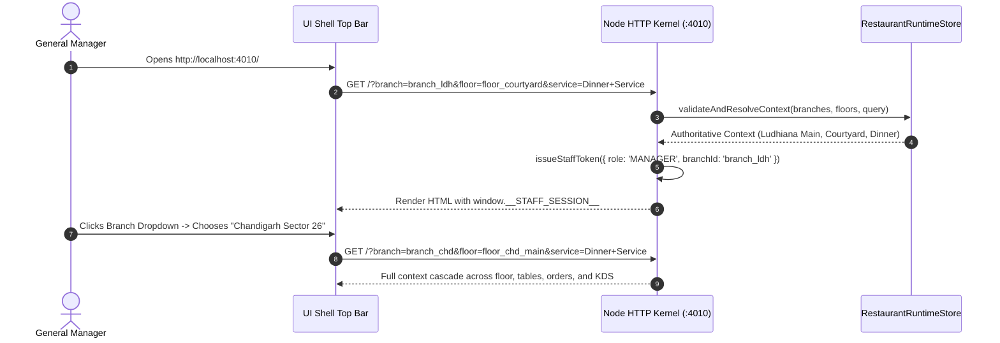
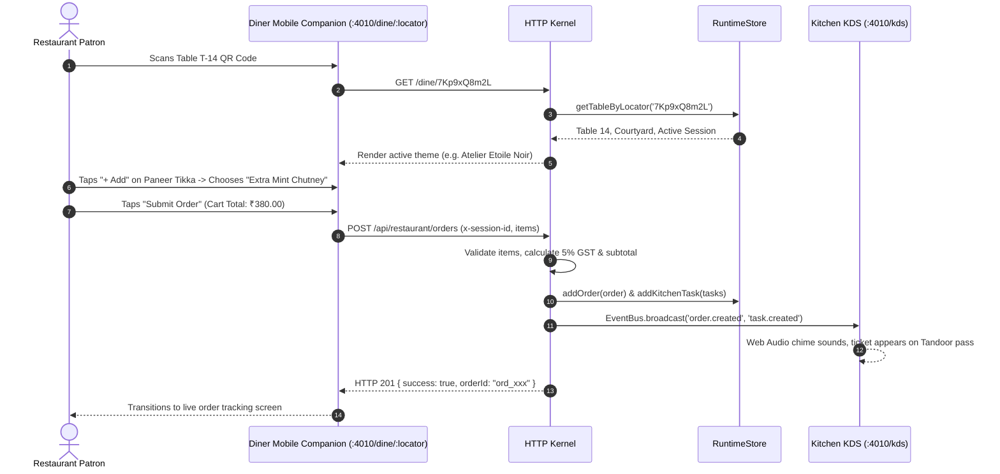
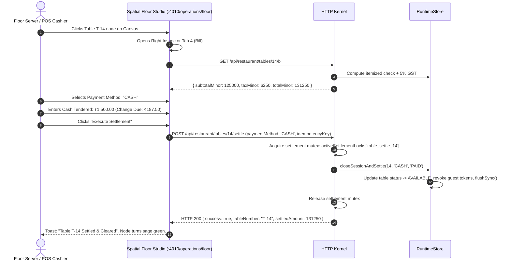
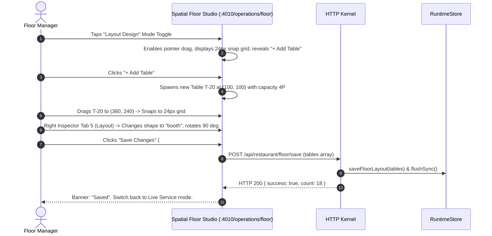
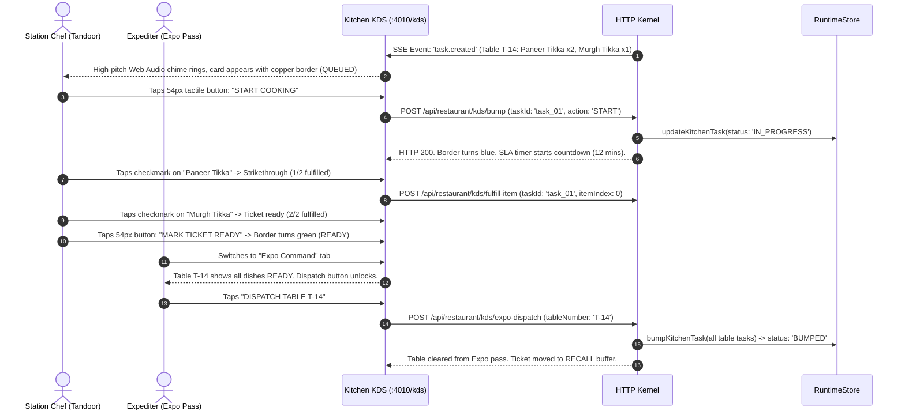
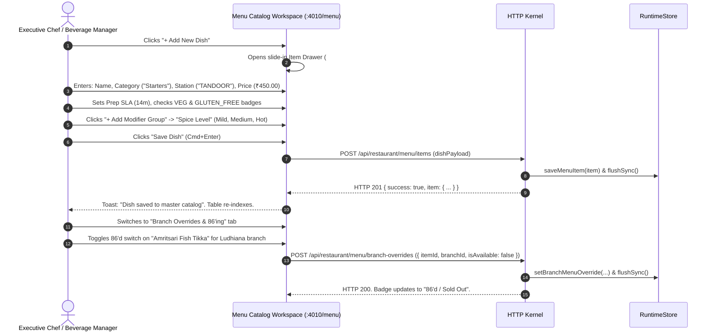
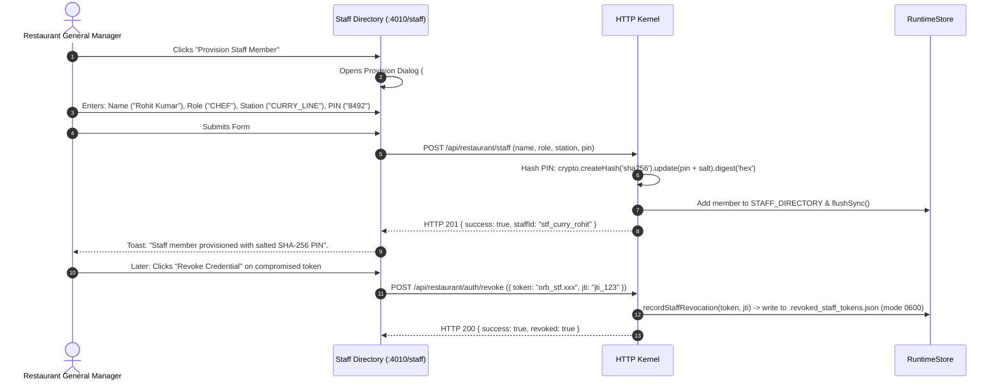
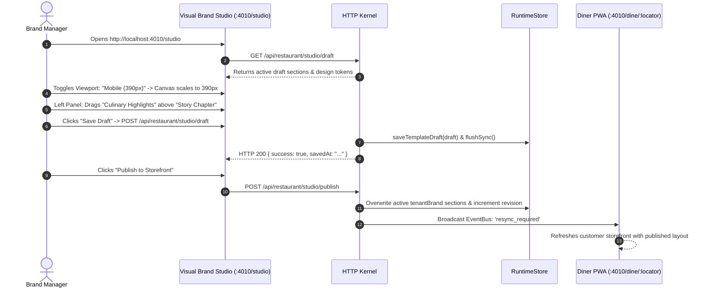
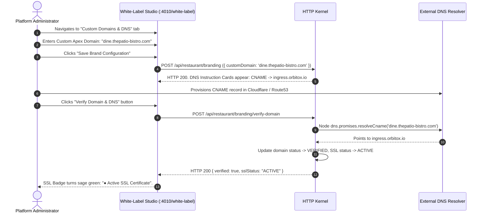
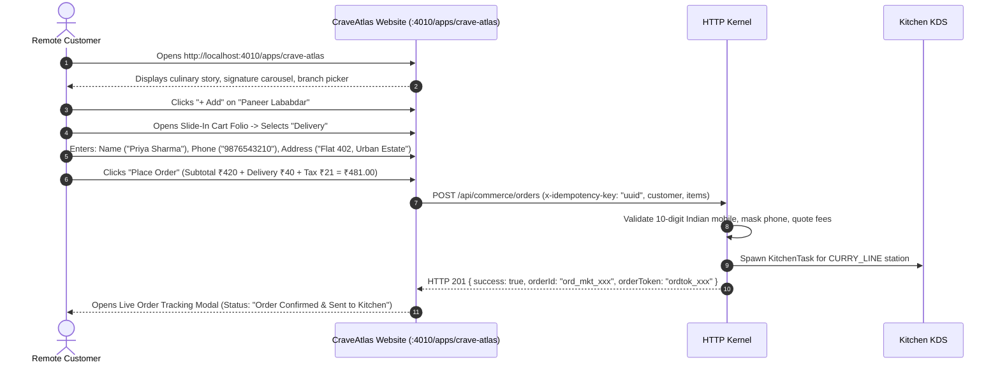

# 🪐 RestaurantOS — Complete UI/UX Reverse-Engineering & Design Handoff
## Document 03: End-to-End User Workflows & Operational State Transitions

- **Audit Date:** October 22, 2026
- **Auditor:** OrbitoX Senior Systems Architect & Design Engineering Agent
- **Target Repository:** `projects/external-os/restaurant-os`
- **Audit Scope:** 15 Complete User Journeys with Numbered Steps, Alternate Paths, Failure Recovery, and API Traces

---

## Workflow 1: Establish Global Context & Authenticate Staff Session



### Chronological Steps
1. **Starting Screen:** Any operational page (e.g. Operations Command `/`).
2. **User Role:** General Manager / Host (`MANAGER`, `ADMIN`).
3. **Step 1:** The user loads `http://localhost:4010/`. The server executes `validateAndResolveContext` (`src/server.ts:365`), verifying `branch` and `floor` against persisted `store.getBranches()` and `store.getFloors()`.
4. **Step 2:** If query parameters are missing or invalid, the engine defaults to `branches[0]` (`branch_ldh`) and its first floor (`floor_courtyard`).
5. **Step 3:** The server issues an ephemeral HMAC-SHA256 signed staff token (`orb_stf.[claims].[sig]`) and embeds it in `window.__STAFF_SESSION__`.
6. **Step 4 (Branch Switch):** The user clicks the top bar location button (`#branch-menu`). The dropdown displays all branches with live status (`● Live` / `○ Setup`). The user selects `Chandigarh Sector 26` (`branch_chd`).
7. **Step 5 (Cascading Resolution):** The browser navigates to `?branch=branch_chd&floor=floor_chd_main&service=Dinner+Service`. All left sidebar links, floor layouts, table fleet records, and active orders automatically filter to the new branch context.
8. **Failure & Recovery:** If a staff member enters an invalid PIN via the auth gateway (`POST /api/restaurant/auth/staff-token`), the server records a failed attempt in `failedPinAttempts`. On the 5th consecutive failure from the same client IP, a 15-minute brute-force lockout is triggered (`HTTP 429 TOO_MANY_FAILED_ATTEMPTS`). An admin must call `POST /api/restaurant/staff/reset-lockout` to restore access.

---

## Workflow 2: QR Discovery & In-Restaurant Dine-In Guest Ordering



### Chronological Steps
1. **Starting Screen:** Diner Mobile Companion (`/dine/:locator`).
2. **User Role:** In-Restaurant Dining Guest (`DINER`, Anonymous).
3. **Step 1 (Table Entry):** Patron scans the physical QR code mounted on Table T-14. The URL resolves `locator: '7Kp9xQ8m2L'` via `store.getTableByLocator`. The server generates a unique guest capability token (`cap_[random]`).
4. **Step 2 (Menu Browsing):** The patron browses menu categories (Starters, Mains, Breads, Beverages, Desserts). Dishes display names, photographs, descriptions, dietary badges (VEG, NON_VEG), and base prices.
5. **Step 3 (Item Customization):** For items with modifier groups (e.g. "Kashmiri Murgh Tikka"), clicking `+ Add` slides up the modifier drawer (`#ca-modifier-modal`). The patron selects spice level ("Medium") and accompaniment ("Garlic Naan +₹60"). Price deltas calculate in real time.
6. **Step 4 (Cart Review):** The bottom cart bar slides up (`#diner-cart-bar`). The patron taps `View Order Summary`. The folio computes: Subtotal ₹350.00 + Accompaniment ₹60.00 + 5% GST ₹20.50 = Total ₹430.50 (stored as `43050` minor units).
7. **Step 5 (Order Submission):** The patron clicks `Place Order`. The client sends `POST /api/restaurant/orders` with headers `x-session-id: sess_14` and `Authorization: Bearer cap_[token]`.
8. **Step 6 (Server Validation):** The server verifies item availability, validates the quote, persists the `RestaurantOrder`, spawns individual `KitchenTask` records routed to station queues (`TANDOOR`, `CURRY_LINE`), and emits `order.created` and `task.created` via the SSE EventBus.
9. **Step 7 (Kitchen Notification):** Connected KDS screens play a synthesized Web Audio alert chime. The ticket immediately appears on the Tandoor and Curry Line passes.
10. **Failure Paths:**
    - If an item was 86'd at that branch (`isAvailableAtBranch: false`), the API returns `HTTP 400 ITEM_UNAVAILABLE_AT_BRANCH`. The client displays an inline alert: "Dish is currently sold out."
    - If the table session was closed by the host, the API returns `HTTP 401 REVOKED_CAPABILITY`. The client prompts the guest to rescan the table QR.

---

## Workflow 3: Table Session Management, Folio Auditing & POS Settlement



### Chronological Steps
1. **Starting Screen:** Spatial Floor Studio (`/operations/floor?table=14`).
2. **User Role:** Floor Server / Cashier (`STAFF`, `MANAGER`).
3. **Step 1:** The server clicks Table T-14 on the SVG canvas. The right-hand Table Inspector drawer opens and switches to the `Bill` tab (`#tab-bill`).
4. **Step 2:** The client requests `GET /api/restaurant/tables/14/bill`. The backend aggregates all orders tied to `sessionId: sess_14`, calculates subtotal, 5% GST, discounts, and returns the authoritative balance.
5. **Step 3:** The server selects payment method from the dropdown (`CASH`, `CARD`, `UPI`). When `CASH` is chosen, the `Cash Tendered` input appears. The cashier types `1500`. The change calculator displays `Change Due: ₹187.50`.
6. **Step 4:** The cashier clicks `Execute Settlement`.
7. **Step 5 (Mutex & Idempotency):** The backend acquires an in-memory settlement lock `activeSettlementLocks['table_settle_14']`. Any concurrent settlement attempt on the same table is immediately rejected with `HTTP 409 CONCURRENT_SETTLEMENT_IN_PROGRESS`.
8. **Step 6 (Atomic Persistence):** The server marks all session orders `PAID`, sets table status to `AVAILABLE`, clears `activeSessionId`, revokes guest capability tokens, appends `TABLE_SETTLED` to the domain event log, flushes to disk via atomic file rename, and releases the mutex.
9. **Step 7 (SSE Broadcast):** The server broadcasts `table.status_changed` (`T-14 -> AVAILABLE`). The table node turns sage green across all open floor canvas screens, tables fleet lists, and the manager cockpit.

---

## Workflow 4: Spatial Floor Layout Planning & Table Geometry Mutation



### Chronological Steps
1. **Starting Screen:** Spatial Floor Studio (`/operations/floor`).
2. **User Role:** General Manager / Floor Designer (`MANAGER`, `ADMIN`).
3. **Step 1:** The user clicks `Layout Design` (`#mode-edit-btn`). Live operational actions are disabled and spatial editing tools are activated.
4. **Step 2:** The canvas reveals the 24px snap-to-grid dots, architectural boundary lines, and displays the `+ Add Table` and `Save Changes` buttons in the toolbar.
5. **Step 3:** The user clicks `+ Add Table`. A new table record (`T-[N]`) is staged at coordinate (100, 100) with default dimensions 72x72px and 4 covers.
6. **Step 4:** The user drags the table across the canvas. `pointermove` calculates coordinates with snap formula:
   ```javascript
   const snappedX = Math.round(rawX / 24) * 24;
   const snappedY = Math.round(rawY / 24) * 24;
   ```
7. **Step 5:** The user opens Inspector Tab 5 (`Layout`) to adjust dimensions: Width 120px, Height 80px, Shape `booth`. Clicking `Rotate 90°` cycles the table orientation.
8. **Step 6:** The user clicks `Save Changes`. The client posts the full tables array to `POST /api/restaurant/floor/save`. The server validates coordinates within architectural boundaries (940x620) and atomically commits to disk.

---

## Workflow 5: Kitchen Station Preparation, Item Fulfillment & Expo Pass



### Chronological Steps
1. **Starting Screen:** Kitchen KDS Workstation (`/kds?station=TANDOOR`).
2. **User Role:** Line Chef / Kitchen Expediter (`CHEF`, `STATION`).
3. **Step 1 (Order Arrival):** An order submitted from Table T-14 is received via SSE. The Web Audio synthesizer triggers an 880 Hz two-tone chime. A new ticket card appears with a copper border (`QUEUED`).
4. **Step 2 (Start Cook):** The chef taps the 54px bump button `START COOKING`. The task status transitions to `IN_PROGRESS`. The border turns sky blue and the station SLA countdown begins (Tandoor = 12 minutes).
5. **Step 3 (Item Fulfillment):** When the Paneer Tikka skewers leave the clay oven, the chef taps the checkmark button next to the item. The item receives a strikethrough styling and the progress badge updates to `1/2 items fulfilled`.
6. **Step 4 (Station Completion):** Once all items are checked, the chef taps `MARK TICKET READY`. The ticket turns sage green (`READY`).
7. **Step 5 (Expo Command):** The expediter at the pass views `/kds?station=EXPO`. Table T-14 aggregates items across Tandoor, Curry Line, and Bar. Once all station tasks reach `READY`, the global `DISPATCH TABLE T-14` button unlocks.
8. **Step 6 (Dispatch):** The expediter taps `DISPATCH`. The server bumps all tasks to `BUMPED` and notifies floor staff via SSE `order.status_changed -> SERVED`.
9. **Failure / Recall Path:** If a server returns stating a dish was damaged or sent to the wrong table, the expediter switches to the `Recall Fulfilled` tab and taps `RECALL / REFIRE`. The ticket immediately returns to the active station queue with a flashing priority alert.

---

## Workflow 6: Menu Engineering, Category Taxonomy & Branch 86'ing



### Chronological Steps
1. **Starting Screen:** Menu Catalog Workspace (`/menu`).
2. **User Role:** Executive Chef / Food & Beverage Manager (`MANAGER`, `ADMIN`).
3. **Step 1:** The user clicks `+ Add New Dish` (`#btn-add-dish`). The item drawer slides in.
4. **Step 2:** Form fields are populated:
   - Name: `Tandoori Malai Broccoli`
   - Category: `Starters`
   - Kitchen Station: `TANDOOR`
   - Base Price: `450` (automatically converted to `45000` paise)
   - Prep SLA: `14` minutes
   - Image URL: Validates live image preview with error fallback.
5. **Step 3:** The user configures modifier groups: Group Name "Marinade Style" with options "Cardamom Cream (₹0)" and "Truffle Infused (+₹120)".
6. **Step 4:** The user submits with `Cmd+Enter`. The server validates payload types, stores the item in `data.menuItems`, flushes to disk, and broadcasts catalog updates.
7. **Step 5 (Branch 86'ing):** The user switches to the `Branch Overrides` tab. A supplier informs the kitchen that Atlantic Salmon is unavailable. The chef toggles the availability switch next to Salmon Tikka for `branch_ldh`.
8. **Step 6 (Instant Customer Lockout):** The server saves the override. Any customer browsing Diner PWA, CraveAtlas, or SwiftBite immediately sees the dish grayed out with a `Sold Out` badge. The `+ Add` button is disabled.

---

## Workflow 7: Staff Credential Provisioning, Station Scoping & Revocation



### Chronological Steps
1. **Starting Screen:** Staff Directory & RBAC Security (`/staff`).
2. **User Role:** General Manager / Administrator (`ADMIN`, `MANAGER`).
3. **Step 1:** The manager clicks `Provision Staff Member` (`#btn-provision-staff`).
4. **Step 2:** The dialog prompts for staff name, role (`MANAGER`, `SERVER`, `CHEF`, `EXPO`), branch assignment, kitchen station scope (`TANDOOR`, `CURRY_LINE`, `BAR`, `EXPO`, `ALL`), and a 4-digit PIN.
5. **Step 3:** The server salts and hashes the PIN using SHA-256:
   ```typescript
   const salt = 'orbitox_bistro_salt_2026';
   const pinHash = crypto.createHash('sha256').update(pin + salt).digest('hex');
   ```
6. **Step 4:** The member is committed to persistent storage. Ephemeral tokens issued to this chef will strictly contain `station: 'CURRY_LINE'`. If the chef attempts to bump a Tandoor ticket, the server rejects the request with `HTTP 403 STATION_MISMATCH`.
7. **Step 5 (Emergency Revocation):** If a staff token or tablet is compromised, the manager clicks `Revoke Credential`.
8. **Step 6 (Durable Revocation Registry):** The server writes the token and JTI into both `data.revokedStaffTokens` and the secure file `data/.revoked_staff_tokens.json` (`chmod 0600`). Even if the Node process restarts, any subsequent request bearing that token is immediately rejected with `HTTP 401 REVOKED_CAPABILITY`.

---

## Workflow 8: Visual Brand Studio Customization, Preview & Live Publishing



### Chronological Steps
1. **Starting Screen:** Visual Brand Studio & Editor (`/studio`).
2. **User Role:** Brand Director / General Manager (`ADMIN`, `MANAGER`).
3. **Step 1:** The user opens `/studio`. The 3-pane authoring canvas loads the current template draft.
4. **Step 2:** The user tests responsive layouts by clicking the viewport segment buttons: `Mobile (390px)`, `Tablet (768px)`, and `Desktop (1200px)`.
5. **Step 3:** The user reorders sections in the left layer tree, dragging `Culinary Signatures` above `Chef Story Chapter`. The center canvas updates immediately.
6. **Step 4:** The user modifies color tokens in the design tokens pane: Primary Accent changes from `#C86B3C` to `#D87B4C`.
7. **Step 5:** The user clicks `Save Draft`. The changes are persisted to `data.templateDraft` without altering the customer-facing storefront.
8. **Step 6:** After reviewing in mobile preview, the user clicks `Publish to Storefront`.
9. **Step 7:** The server promotes the draft to `data.tenantBrand`, increments the template revision, and broadcasts `resync_required` over SSE. All connected customer diner PWAs refresh and reflect the new section hierarchy and color theme.

---

## Workflow 9: White-Label Custom Domain Setup & DNS State Machine



### Chronological Steps
1. **Starting Screen:** White-Label & Custom Domains Studio (`/white-label`).
2. **User Role:** Restaurant Owner / Platform Admin (`ADMIN`).
3. **Step 1:** The admin enters the restaurant's custom hostname: `dine.thepatio-bistro.com`.
4. **Step 2:** The admin saves the configuration. The UI displays DNS instruction cards:
   - Record 1: CNAME `dine` -> `ingress.orbitox.io`
   - Record 2: TXT `_orbitox-challenge` -> `orb-domain-verification-token`
5. **Step 3:** The admin configures the records in their DNS provider (Cloudflare, AWS Route53).
6. **Step 4:** The admin clicks `Verify Domain & DNS`. The server performs real-time DNS resolution (`dns.promises.resolveCname`).
7. **Step 5:** Once verified, the domain status transitions to `VERIFIED` and SSL certificate state transitions to `ACTIVE`.
8. **Failure & Retry Path:** If DNS propagation has not completed, the API returns `HTTP 422 DNS_VERIFICATION_PENDING` with the message: "CNAME record not yet detected. Propagation may take up to 30 minutes." The UI displays a warning banner and retains the retry button.

---

## Workflow 10: CraveAtlas Flagship Discovery & Delivery Checkout



### Chronological Steps
1. **Starting Screen:** CraveAtlas Flagship (`/apps/crave-atlas`).
2. **User Role:** Web Customer (Anonymous).
3. **Step 1:** The customer browses the signature dish carousel and selects `Paneer Lababdar`.
4. **Step 2:** The customer opens the slide-in cart folio and toggles fulfillment to `Delivery`.
5. **Step 3:** The customer fills in required contact fields:
   - Name: `Priya Sharma` (validated between 2 and 80 characters, no HTML tags).
   - Phone: `9876543210` (validated against Indian mobile regex `/^[6-9]\d{9}$/`).
   - Street Address: `Flat 402, Urban Estate, Ludhiana` (minimum 5 characters).
6. **Step 4:** The client generates a high-entropy UUID for `x-idempotency-key` and submits `POST /api/commerce/orders`.
7. **Step 5 (Server Validation & Quoting):** The server verifies branch catalog availability, calculates delivery fee (₹40.00), tax (5% GST), and formats masked customer credentials (`+91 ******3210`).
8. **Step 6 (Kitchen Insertion):** The server spawns kitchen tasks routed to station `CURRY_LINE` and returns a high-entropy tracking token (`ordtok_[hex24]`).
9. **Step 7 (Live Status Modal):** The web interface opens the live tracking modal. As kitchen chefs bump the order on KDS, the customer screen advances through milestones: `Order Confirmed` -> `Preparing in Kitchen` -> `Ready for Dispatch` -> `Completed`.

---

## Workflow 11: SwiftBite Speed-First 1-Tap Reordering

### Chronological Steps
1. **Starting Screen:** SwiftBite Speed App (`/apps/swift-bite`).
2. **User Role:** Fast-Casual Ordering Customer.
3. **Step 1:** The customer opens SwiftBite. The header highlights the 20-minute delivery SLA from the nearest branch.
4. **Step 2:** The customer views the "Order Again in 1-Tap" past favorites carousel.
5. **Step 3:** Tapping a favorite dish card (e.g. "Dal Makhani") immediately adds it to the cart and transforms the button into a tactile `[- 1 +]` stepper without navigating away.
6. **Step 4:** The customer taps the floating bottom checkout capsule.
7. **Step 5:** With delivery address and phone pre-cached, the customer taps `Place Swift Order`.
8. **Step 6:** The order is committed idempotently and routes to kitchen stations within 300ms.

---

## Workflow 12: PantryRush Hyperlocal Dark-Store Grocery Checkout

### Chronological Steps
1. **Starting Screen:** PantryRush Grocery (`/apps/pantry-rush`).
2. **User Role:** Quick-Commerce Patron.
3. **Step 1:** The customer enters their postal code (`141001`). The dark-store engine confirms serviceability with an estimated 12–15 minute dispatch ETA.
4. **Step 2:** The customer browses grocery SKUs (Dairy, Fresh Vegetables, Pantry Staples).
5. **Step 3:** Each SKU displays real stock quantities. If an item has only 2 units remaining, tapping `+` past 2 is prevented with an inline badge: "Max stock reached".
6. **Step 4:** In the cart, the customer chooses their **Substitution Preference**:
   - `Ask me first` (Default)
   - `Allow store to choose equivalent brand`
   - `Do not substitute (refund item)`
7. **Step 5:** Free delivery engine applies: Orders >= ₹199 receive free delivery; orders below ₹199 add a ₹25 delivery fee.
8. **Step 6:** The customer taps `Place Grocery Order`. The server executes `transactGroceryStock` atomically. If any item ran out of stock concurrently, the transaction rolls back cleanly and returns `HTTP 400 INSUFFICIENT_STOCK`.

---

## Workflow 13: Customer Support Desk & Engineering Incident Resolution

### Chronological Steps
1. **Starting Screen:** Customer Support Desk (`/support`).
2. **User Role:** Operations Manager / Support Specialist (`STAFF`, `MANAGER`).
3. **Step 1:** The user clicks `+ New Case` to report a hardware issue: "KDS ticket printer paper feed jammed during dinner rush".
4. **Step 2:** The ticket is assigned severity `HIGH` and category `HARDWARE_KDS`.
5. **Step 3:** The ticket appears in the priority queue inbox (Pane 1).
6. **Step 4:** The support specialist selects the ticket. Pane 2 opens the incident thread. Pane 3 loads live telemetry: active branch, memory heap, and SSE connection health.
7. **Step 5:** The specialist toggles the composer to `Internal Staff Note` (yellow accent) and enters: "Advised kitchen staff to use touch bump bar while replacement roller is dispatched."
8. **Step 6:** The specialist updates the status dropdown to `RESOLVED`. The ticket badge shifts from amber to sage green.

---

## Workflow 14: Global Command Palette (`Cmd+K`) & Keyboard Acceleration

### Chronological Steps
1. **Starting Screen:** Any operational page within `renderShell`.
2. **User Role:** Any staff member.
3. **Step 1:** The user presses `Cmd+K` (macOS) or `Ctrl+K` (Windows). The backdrop blurs and `#cmdk-modal` centers on screen.
4. **Step 2:** The search input gains focus automatically.
5. **Step 3:** The user types `floor`. The item list filters in real time to show "Spatial Floor Canvas Editor".
6. **Step 4:** The user presses `Enter`. The modal closes and navigates immediately to `/operations/floor`.
7. **Step 5 (KDS Shortcuts):** On the Kitchen KDS screen, the chef uses physical bump bar shortcuts:
   - `Space`: Bumps the oldest focused ticket to the next cooking stage.
   - `Enter`: Toggles the first incomplete item fulfillment checkmark.
   - `R`: Jumps directly to the Recall Fulfilled buffer.
   - `E`: Switches to the Expo Command pass view.
   - `A`: Returns to All Tickets view.

---

## Workflow 15: Real-Time SSE Gateway Synchronization & Resynchronization

### Chronological Steps
1. **Starting Screen:** All operational and customer clients.
2. **Step 1 (Subscription):** On page mount, the browser opens an EventSource connection:
   ```javascript
   const evtSource = new EventSource('/api/restaurant/events');
   ```
3. **Step 2 (Event Dispatch):** Whenever a mutation occurs (order placed, table seated, bill requested, kitchen ticket bumped), `RealtimeEventBus` assigns a strictly monotonic sequence integer:
   ```json
   {
     "id": "evt_1730000000000",
     "sequence": 42,
     "type": "order.created",
     "timestamp": "2026-10-22T19:42:00.000Z",
     "branchId": "branch_ldh",
     "payload": { ... }
   }
   ```
4. **Step 3 (Client Wakeup):** Connected browser tabs receive the event and selectively update DOM components or trigger seamless table refreshes without disrupting user text entry.
5. **Step 4 (Reconnection & Replay):** If network connectivity drops momentarily, the client reconnects passing `Last-Event-ID: 41`. The server replays missed events from the outbox buffer.
6. **Step 5 (Resync Gate):** If the gap exceeds the buffer limit, the server emits `resync_required`. The client automatically re-fetches authoritative baseline state.
