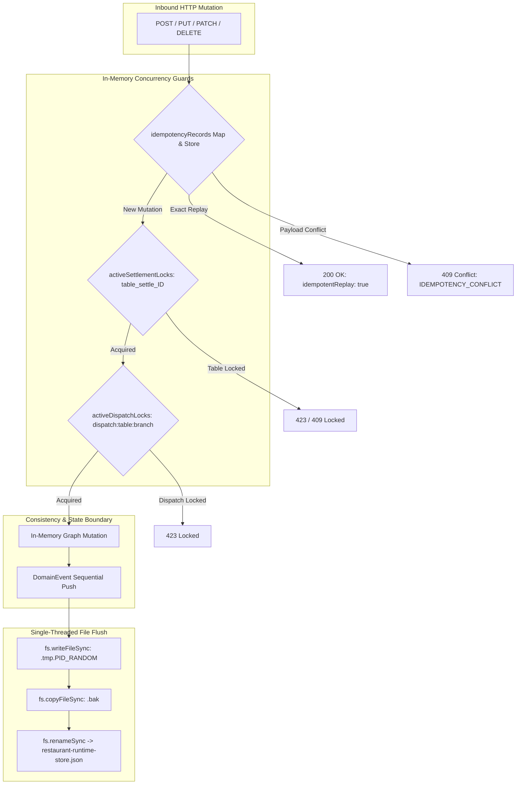
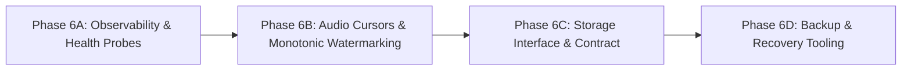

# 🪐 RestaurantOS Phase 6 — Operational Foundations: Architecture & Readiness Assessment
## Master Engineering Assessment, Storage Contract, Resilience Blueprint & Implementation Gate

**Date:** October 22, 2026  
**Auditor / Systems Architect:** OrbitoX Senior Systems Architect (Antigravity)  
**Status:** **READ-ONLY AUDIT COMPLETE — AWAITING HUMAN APPROVAL PRIOR TO IMPLEMENTATION**  
**Runtime Endpoint:** `http://localhost:4010` (PID 9907, Revision 30 Synced)  
**Control Plane Endpoint:** `http://localhost:3005` (PID 83820, Healthy)  

---

## 1. Verified Repository and Runtime Baseline

A read-only forensic audit was conducted on October 22, 2026, across the active repository. All claims in this document are derived directly from the active filesystem and live process state.

### 1.1 Process & Daemon Runtime
- **RestaurantOS Runtime:** Running as daemon on port 4010 (`http://localhost:4010`), executing `npx -y tsx src/server.ts` (Node.js `v22.20.0`, macOS).
- **Control Plane Daemon:** Running on port 3005 (`http://localhost:3005`), delivering desired-state config revision `#30`.
- **Active Compilation:** `npx tsc --noEmit` executed cleanly with **0 errors**.

### 1.2 Baseline Test Execution Audit (Pre-Change Record)
Prior to planning or modifying source code, all existing test suites were executed against the live runtime:
- **Dedicated Phase 5 Suite (`scripts/test-phase5-kds-and-staff.js`):** **43 / 43 Passed (100%)**
- **Phase 4 Forensic Audit (`scripts/audit-phase4-e2e-and-security.js`):** **18 / 18 Passed (100%)**
- **Phase 1 Security & Settlement (`scripts/test-phase1-security-and-settlement.js`):** **28 / 28 Passed (100%)**
- **Gate A & Gate B Integrity (`scripts/test-gate-a-and-b-integrity.js`):** **117 / 117 Passed (100%)**
- **Customer Identity & PII Masking (`scripts/test-phase4-customer-identity.js`):** **22 / 22 Passed (100%)**
- **Live Order Tracking State Machine (`scripts/test-phase4-live-tracking.js`):** **23 / 23 Passed (100%)**
- **White-Label Brand Durability (`scripts/test-phase4-whitelabel-durability.js`):** **24 / 24 Passed (100%)**
- **Total Executed Baseline Assertions:** **275 / 275 Passed (0 Failures)**.  
  *Accounting distinction confirmed:* 43 assertions are dedicated to Phase 5 KDS and staff features; the remaining 232 checks represent cumulative regression baseline coverage.

### 1.3 Active Storage & File Artifacts
- **Primary JSON Store:** `projects/external-os/restaurant-os/data/restaurant-runtime-store.json` (615 KB, 2-space indented JSON).
- **Store Backup Copy:** `projects/external-os/restaurant-os/data/restaurant-runtime-store.json.bak` (615 KB).
- **Staff Revocation Registry:** `projects/external-os/restaurant-os/data/.revoked_staff_tokens.json` (`mode 0600`, containing persistent tokens, JTIs, and staff IDs).
- **Visual Audit Artifacts:** 6 verified screenshots residing in `projects/external-os/restaurant-os/data/phase5-audit/` (Desktop ALL, EXPO, RECALL, Tablet Tandoor, Staff Workspace, and RBAC Matrix).

---

## 2. Current Storage and Mutation Inventory

The persistent runtime state is encapsulated within `RestaurantRuntimeStore` (`packages/storage/store.ts`). All domain entities reside in a single in-memory data object (`this.data: RestaurantRuntimeStoreData`).

### 2.1 Complete Inventory of Persistent Mutations (54 Write Points)
Every mutation mutates `this.data` in memory and synchronously calls `this.flushSync()` (lines 467–482 of `store.ts`), which writes to a unique temporary file (`${filePath}.tmp.${suffix}`) and invokes `fs.renameSync`:

| Domain Area | Store Mutation Method | In-Memory Graph Mutated | Disk Write Target |
|---|---|---|---|
| **Tables & Floor** | `saveTableFloor(table)` | `data.tables` | `restaurant-runtime-store.json` |
| | `saveFloor(floor)` | `data.floors` | `restaurant-runtime-store.json` |
| | `mergeTables(sourceId, targetId)` | `data.tables` | `restaurant-runtime-store.json` |
| | `unmergeTable(tableId)` | `data.tables` | `restaurant-runtime-store.json` |
| | `rotateTableLocator(tableNumber)` | `data.tables` | `restaurant-runtime-store.json` |
| | `addSeat(tableNumber, seat)` | `data.tables[].seats` | `restaurant-runtime-store.json` |
| | `removeSeat(tableNumber, seatId)` | `data.tables[].seats` | `restaurant-runtime-store.json` |
| | `assignSeatGuest(tableNumber, seatId, guest)`| `data.tables[].seats` | `restaurant-runtime-store.json` |
| **Dining Sessions**| `createOrJoinSession(...)` | `data.sessions`, `data.tables` | `restaurant-runtime-store.json` |
| | `closeSessionAndSettle(...)` | `data.sessions`, `data.tables`, `data.orders`, `data.invalidatedCapabilityTokens` | `restaurant-runtime-store.json` |
| | `revokeCapabilityToken(token)` | `data.invalidatedCapabilityTokens` | `restaurant-runtime-store.json` |
| **Orders & Commerce**| `addOrder(order)` | `data.orders`, `data.kitchenTasks` | `restaurant-runtime-store.json` |
| | `updateOrderStatus(orderId, status)` | `data.orders` | `restaurant-runtime-store.json` |
| | `transactGroceryStock(orders)` | `data.grocerySkus` | `restaurant-runtime-store.json` |
| **Kitchen Tasks** | `addKitchenTask(task)` | `data.kitchenTasks` | `restaurant-runtime-store.json` |
| | `updateKitchenTask(taskId, updates)`| `data.kitchenTasks` | `restaurant-runtime-store.json` |
| | `fulfillKitchenItem(taskId, index)` | `data.kitchenTasks` | `restaurant-runtime-store.json` |
| | `bumpKitchenTask(taskId)` | `data.kitchenTasks` | `restaurant-runtime-store.json` |
| | `recallKitchenTask(taskId)` | `data.kitchenTasks` | `restaurant-runtime-store.json` |
| **Menu & Branding** | `saveMenuItem(item)` / `deleteMenuItem(id)` | `data.menuItems` | `restaurant-runtime-store.json` |
| | `saveBranchMenuOverride(override)` | `data.branchMenuOverrides` | `restaurant-runtime-store.json` |
| | `deleteBranchMenuOverride(bId, itemId)`| `data.branchMenuOverrides` | `restaurant-runtime-store.json` |
| | `saveTenantBrand(brand)` | `data.tenantBrand` | `restaurant-runtime-store.json` |
| | `saveTemplateDraft(draft)` / `publish`| `data.templateDraft` | `restaurant-runtime-store.json` |
| **Staff & Auth** | `recordStaffRevocation(token, jti)`| `data.revokedStaffTokens`, `data.revokedStaffTokenJtis` | `restaurant-runtime-store.json` + `.revoked_staff_tokens.json` |
| | `revokeStaffMember(staffId)` | `data.revokedStaffIds` | `restaurant-runtime-store.json` + `.revoked_staff_tokens.json` |
| **Idempotency** | `saveIdempotencyRecord(key, record)`| `data.idempotencyRecords` | `restaurant-runtime-store.json` |
| **Events** | `recordDomainEvent(event)` | `data.events`, `data.lastEventSequence` | `restaurant-runtime-store.json` |

---

## 3. Transaction, Lock, and Idempotency Map



### 3.1 Operations Requiring True Atomic Transactions
1. **Table Settlement & Session Closure (`closeSessionAndSettle`):**
   - Must atomically transition Table (`OCCUPIED` -> `AVAILABLE`), Session (`ACTIVE` -> `CLOSED`), Orders (`DELIVERED` -> `PAID`), invalidate all capability tokens, record the integer-paise financial settlement ledger entry, and save the idempotency record.
   - *Current failure risk:* If the process crashes mid-memory mutation before `flushSync()` completes, in-memory state is lost; if it crashes during file writing, the temp file remains orphaned and disk reverts to pre-mutation `.bak`.
2. **Expo Table Dispatch (`/api/restaurant/kds/expo-dispatch`):**
   - Must atomically verify that all kitchen tasks for a table are `READY`, bump all tasks to `BUMPED`, update the parent order to `SERVED`, and broadcast event stream entries.
3. **Grocery Stock Checkout (`transactGroceryStock`):**
   - Two-phase check: validates that all requested SKUs have `stock >= qty` before decrementing any stock; rolls back entirely if any SKU is insufficient.
4. **Staff Credential Revocation (`revokeStaffMember`):**
   - Must atomically persist to both `restaurant-runtime-store.json` and `.revoked_staff_tokens.json` while disconnecting active SSE clients.

### 3.2 Concurrency Primitives Inventory
- **`activeSettlementLocks: Set<string>`** (`src/server.ts:88`): Keyed by `table_settle_${tableId}` and `idemp_${idempotencyKey}`. Prevents parallel billing on the same table.
- **`activeDispatchLocks: Set<string>`** (`src/server.ts:89`): Keyed by `dispatch:${tableNumber}:${branchId}`. Prevents concurrent expo fulfillment.
- **`idempotencyRecords: Map<string, any>`** (`src/server.ts:86`): In-memory Map backed by `store.saveIdempotencyRecord(key, record)`. Hashes payloads with SHA-256; returns 200 on exact replay, 409 on conflict.

---

## 4. SSE Event Flow and Audio Notification Analysis

### 4.1 Server-Side SSE Architecture (`packages/domain/event-bus.ts`)
- **Transport:** HTTP `text/event-stream` at `/api/restaurant/events`.
- **Ordering:** Events carry strictly monotonic integer sequence numbers (`sequence: number`).
- **Authorization & Scoping:** Scoped by role:
  - `DINER`: Locked to `tableNumber`, `sessionId`, `branchId`.
  - `ORDER_TRACKER`: Strictly locked to `orderId`.
  - `STAFF` / `CHEF`: Scoped to `branchId`.
- **Replay & Resync Semantics:**
  - Evaluates `Last-Event-ID` header or `?lastEventId=` query parameter.
  - Queries `store.getEvents(sinceSeq)`.
  - If `sinceSeq < store.getOldestEventSequence() - 1`, the server emits an explicit `event: resync_required` frame with `code: 'RESYNC_REQUIRED'`, signaling that the client has fallen behind the retained history window.

### 4.2 Client Audio Notification Vulnerability & Hardening Design
- **Current Client Logic (`packages/ui/pages/kds.ts:1133`):**
  Uses an in-memory `processedEventIds = new Set()` and a heuristic:
  `(Date.now() - eventTime) < 10000 && eventTime >= (pageInitTimestamp - 2000)`.
- **Vulnerabilities Identified:**
  1. *Full Page Reload:* `location.reload()` occurs on ticket changes; the in-memory `processedEventIds` Set is wiped on reload, and `EventSource` reconnects without `Last-Event-ID`.
  2. *Window Rollover:* If bounded in-memory cache is used (e.g. 1,000 events), prolonged disconnection causes eviction, replaying alerts upon reconnect.
  3. *Clock Skew:* Client timestamp heuristics fail if the terminal's system clock deviates from the server.
- **Monotonic Cursor & Audio Watermark Specification (P2 Hardening):**
  - **Client-Persisted Watermark:** Store `kds_audio_highwater_seq` in `localStorage`.
  - **Initial Connection Handshake:** On initial boot, fetch `/api/restaurant/events/cursor` (or read initial HTML payload watermark). Set `kds_audio_highwater_seq = serverCurrentSequence`.
  - **Audio Gating Rule:**
    - Sound plays **ONLY IF** `event.sequence > kds_audio_highwater_seq` AND `eventType IN ['order.created', 'task.created']`.
    - Catch-up events replayed upon reconnect (`event.sequence <= kds_audio_highwater_seq`) update DOM/state but **NEVER produce audio**.
    - Immediately upon playing sound for sequence `N`, update `kds_audio_highwater_seq = N` in `localStorage`.
    - If `resync_required` is received, client updates watermark to `event.oldestAvailableSequence` and executes a silent DOM refresh without triggering alerts.

---

## 5. Proposed `IRestaurantStore` Repository Contract

To decouple application logic from the underlying storage mechanism and establish clean transactional boundaries, the following asynchronous TypeScript contract is proposed:

```typescript
/**
 * 🪐 IRestaurantStore — Core Asynchronous Domain Storage Contract
 * Standard repository interface supporting atomic transactions, zero-trust multitenancy,
 * and pluggable persistence engines (JSON File, SQLite WAL, PostgreSQL).
 */
export interface IRestaurantStore {
  // Lifecycle & Health
  initialize(): Promise<void>;
  close(): Promise<void>;
  checkHealth(): Promise<{ healthy: boolean; latencyMs: number; error?: string }>;
  getRevisions(): number;

  // Transaction Boundary (Unit of Work)
  transaction<T>(operation: (tx: ITransactionContext) => Promise<T>): Promise<T>;

  // Branches & Floors
  getBranches(): Promise<BranchRecord[]>;
  getBranch(id: string): Promise<BranchRecord | undefined>;
  saveBranch(branch: BranchRecord): Promise<void>;
  getFloors(branchId?: string): Promise<FloorRecord[]>;
  saveFloor(floor: FloorRecord): Promise<void>;

  // Spatial Floor & Tables
  getTables(branchId?: string, floorId?: string): Promise<TableFloorRecord[]>;
  getTable(id: number | string): Promise<TableFloorRecord | undefined>;
  getTableByNumber(number: string): Promise<TableFloorRecord | undefined>;
  getTableByLocator(locator: string): Promise<TableFloorRecord | undefined>;
  saveTableFloor(table: TableFloorRecord): Promise<void>;
  rotateTableLocator(tableNumber: string): Promise<TableFloorRecord>;
  mergeTables(sourceTableId: number, targetTableId: number): Promise<TableFloorRecord>;
  unmergeTable(tableId: number): Promise<TableFloorRecord>;

  // Dining Sessions & Capabilities
  getSession(sessionId: string): Promise<DiningSessionRecord | undefined>;
  createOrJoinSession(tableNumber: string, hostName: string, token: string, branchId: string, floorId: string): Promise<DiningSessionRecord>;
  isCapabilityValid(token: string): Promise<boolean>;
  revokeCapabilityToken(token: string): Promise<boolean>;
  closeSessionAndSettle(
    tableNumber: string,
    settlement: SettlementRecord,
    authorizedBy?: string,
    reason?: string,
    idempotencyKey?: string
  ): Promise<SessionCloseResult>;

  // Orders & Commerce
  getOrders(status?: string, tableNumber?: string, branchId?: string): Promise<RestaurantOrder[]>;
  getOrder(orderId: string): Promise<RestaurantOrder | undefined>;
  addOrder(order: RestaurantOrder): Promise<void>;
  updateOrderStatus(orderId: string, status: RestaurantOrder['status']): Promise<void>;

  // Kitchen Display System (KDS)
  getKitchenTasks(branchId?: string, station?: string): Promise<KitchenTask[]>;
  getKitchenTask(taskId: string): Promise<KitchenTask | undefined>;
  addKitchenTask(task: KitchenTask): Promise<void>;
  updateKitchenTask(taskId: string, updates: Partial<KitchenTask>): Promise<KitchenTask | undefined>;
  fulfillKitchenItem(taskId: string, itemIndex: number): Promise<KitchenTask | undefined>;
  bumpKitchenTask(taskId: string): Promise<KdsTransitionResult>;
  recallKitchenTask(taskId: string): Promise<KdsTransitionResult>;

  // Menu Catalog & White-Label Overrides
  getMenuItems(includeUnavailable?: boolean): Promise<MenuItem[]>;
  saveMenuItem(item: MenuItem): Promise<void>;
  deleteMenuItem(itemId: string): Promise<boolean>;
  getBranchMenuOverrides(branchId?: string): Promise<BranchMenuOverride[]>;
  saveBranchMenuOverride(override: BranchMenuOverride): Promise<void>;
  deleteBranchMenuOverride(branchId: string, itemId: string): Promise<boolean>;

  // Staff Identity & Revocations
  isStaffTokenRevoked(token: string, jti?: string, staffId?: string): Promise<boolean>;
  recordStaffRevocation(token: string, jti?: string): Promise<void>;
  revokeStaffMember(staffId: string): Promise<void>;

  // Idempotency Records
  getIdempotencyRecord(key: string): Promise<{ payloadHash?: string; response?: any; createdAt: string } | undefined>;
  saveIdempotencyRecord(key: string, record: { payloadHash?: string; response?: any; createdAt: string }): Promise<void>;

  // Domain Events & Outbox
  recordDomainEvent(event: DomainEvent): Promise<DomainEvent>;
  getEvents(sinceSequence?: number, limit?: number): Promise<DomainEvent[]>;
  getOldestEventSequence(): Promise<number>;
}

export interface ITransactionContext extends Omit<IRestaurantStore, 'transaction' | 'initialize' | 'close' | 'checkHealth'> {
  rollback(): Promise<void>;
}
```

---

## 6. Storage Migration and Rollback Plan

### 6.1 Evaluation of SQLite with WAL Mode vs. JSON Store
| Evaluation Dimension | Current JSON Store | SQLite (WAL Mode) | Assessment for RestaurantOS |
|---|---|---|---|
| **ACID Guarantees** | Pseudo-ACID via atomic temp rename; no transaction rollbacks across entities. | Full ACID via write-ahead logging; atomic multi-table rollback on failure. | **Superior:** Eliminates partial state corruption during complex mutations. |
| **Concurrency Model** | In-process Node event loop; single writer; blocking sync file writes. | Multi-reader concurrent with single-writer; non-blocking asynchronous I/O. | **Superior:** Unblocks event loop while maintaining serialized write safety. |
| **Write Amplification** | Writes entire 615 KB file on every single item check or task bump. | Appends small binary frames to WAL file; periodic checkpointing. | **Massive Improvement:** From 615 KB/mutation to < 4 KB/mutation. |
| **External Dependencies**| Zero external dependencies (built-in `fs`). | Available natively via Node.js 22 `node:sqlite` or standard `better-sqlite3`. | **Zero Friction:** Node 22 native support or standard embedded C binding. |
| **Single-Node Fit** | Highly aligned with single-process deployment. | Ideal for single-process local runtime (`port 4010`). | **Optimal Target Architecture.** |

### 6.2 Staged Migration Strategy
1. **Stage 1 (Adapter Decoupling):** Implement `JsonFileRestaurantStore` adhering to `IRestaurantStore`. Keep `RestaurantRuntimeStore` as a synchronous compatibility wrapper where UI templates require direct in-memory array access.
2. **Stage 2 (SQLite Schema Creation):** Design normalized relational tables (`branches`, `floors`, `tables`, `orders`, `kitchen_tasks`, `menu_items`, `sessions`, `revoked_tokens`, `idempotency_records`, `events`).
3. **Stage 3 (Data Migration Utility):** Author `scripts/migrate-json-to-sqlite.ts`:
   - Reads `data/restaurant-runtime-store.json`.
   - Validates schema and integrity constraints (e.g. table counts, unique numbers).
   - Inserts all records inside a single SQLite transaction.
   - Computes SHA-256 checksums to verify zero data loss.
4. **Stage 4 (Rollback Strategy):** Author `scripts/export-sqlite-to-json.ts`:
   - Dumps SQLite tables back into the exact canonical `RestaurantRuntimeStoreData` JSON shape.
   - Allows instant reversion to the JSON storage engine without application downtime if anomalies arise.

---

## 7. Backup and Recovery Design

### 7.1 Backup Protocol
- **Scheduled Point-in-Time Snapshots:** Tooling in `scripts/backup-runtime-state.ts`.
- **Consistency Protection:**
  - For JSON Store: Copies file only after flushing; calculates SHA-256 hash.
  - For SQLite: Uses SQLite Online Backup API (`VACUUM INTO 'data/backups/snapshot_YYYYMMDD_HHMMSS.db'`) to guarantee zero corruption while writes are active.
- **Retention Policy:** Retains last 10 snapshots in `data/backups/`; prunes older snapshots automatically.
- **File Permissions:** Enforces `0600` permissions on backup files to protect customer PII and token hashes.

### 7.2 Restoration Validation
- **Automated Restore Verification (`scripts/verify-backup-integrity.ts`):**
  1. Spawns an isolated sandbox directory (`scratch/restore-sandbox/`).
  2. Restores snapshot file into the sandbox.
  3. Boots an ephemeral test instance of `IRestaurantStore` pointing to the sandbox.
  4. Asserts that table count matches expected baseline ($\ge 5$).
  5. Asserts financial settlement records balance to integer minor units.
  6. Validates that staff revocation records remain intact.
  7. Cleans up sandbox upon success and reports verification evidence.

---

## 8. Observability and Health-Check Design

### 8.1 Truthful Health Probes
Replace the current static `/health` endpoint with standardized, truthful Kubernetes/Docker probes:

1. **Liveness Probe (`GET /healthz/live`):**
   - **Purpose:** Verifies that the Node.js process is responsive and event loop is not deadlocked.
   - **Logic:** Instant response; returns `HTTP 200 OK` `{ "status": "LIVE", "uptimeSeconds": ... }`.
2. **Readiness Probe (`GET /healthz/ready`):**
   - **Purpose:** Verifies that all dependencies required to process hospitality traffic are fully functional.
   - **Checks:**
     1. *Storage Engine:* Verifies storage descriptor is writable and readable.
     2. *Event Loop Latency:* Asserts event loop delay is $< 200\text{ms}$.
     3. *Security Engine:* Confirms durable revocation registry is hydrated.
     4. *Control Bridge:* Checks connection status with Control Plane (`http://localhost:3005`).
   - **Responses:**
     - `HTTP 200 OK` if all checks pass.
     - `HTTP 503 Service Unavailable` with `{ "status": "NOT_READY", "degradedChecks": [...] }` if any critical dependency fails.
   - **Security:** Zero infrastructure paths, secrets, or stack traces exposed.

### 8.2 Structured JSON Logging with Request Tracing
- **Correlation ID Middleware:**
  - Inspects `x-request-id` or `x-correlation-id` header (validated to alphanumeric + hyphen, $\le 64$ chars).
  - If missing, generates a high-entropy UUID: `req_${crypto.randomUUID()}`.
  - Attaches `x-request-id` to response headers.
- **Structured Log Format:** Emits NDJSON (Newline Delimited JSON) to stdout:
  ```json
  {
    "timestamp": "2026-10-22T07:15:00.123Z",
    "level": "info",
    "requestId": "req_8f1c3a7e-4b21-4d10-8b9a-112233445566",
    "method": "POST",
    "pathname": "/api/restaurant/kds/item-fulfill",
    "status": 200,
    "durationMs": 4.2,
    "branchId": "branch_ldh",
    "identity": { "type": "STAFF", "role": "CHEF", "station": "TANDOOR" }
  }
  ```
- **PII & Credential Redaction:**
  - Automatically filters fields: `pin`, `pinHash`, `salt`, `token`, `password`, `secret`, `authorization`, `cookie`.
  - Masks phone numbers (`+91 ******3210`) and customer delivery addresses.

---

## 9. Security, Data-Integrity, and Deployment Risk Register

| Risk ID | Category | Description | Probability | Impact | Mitigation Strategy |
|---|---|---|---|---|---|
| **RSK-01** | Data Integrity | In-flight process termination during synchronous 615 KB JSON file write. | Low | Critical | Atomic temporary file write with synchronous rename; Stage 2 SQLite WAL migration. |
| **RSK-02** | Concurrency | Concurrent table settlements or dispatches in multi-worker deployment. | Medium | High | In-process mutexes protect single-instance; documented distributed lock specification for clustering. |
| **RSK-03** | Security | Staff PIN brute-force dictionary attack. | Low | High | Salted SHA-256 hashes, 5-attempt threshold with 15-minute cooldown (`429`), manager reset endpoint. |
| **RSK-04** | Security | Revocation list lost on server crash. | Low | Critical | Dual persistence in `restaurant-runtime-store.json` and `.revoked_staff_tokens.json` (`0600`). |
| **RSK-05** | Reliability | Audio alert storm on KDS reconnection. | Medium | Medium | Server monotonic sequence tracking; client-persisted `localStorage` high-water cursor. |
| **RSK-06** | Observability | PII leakage in application logs. | Medium | High | Strict recursive log sanitizer masking customer phones, addresses, and cryptographic secrets. |

---

## 10. Incremental Implementation Phases & Affected Files

Implementation will proceed across 4 non-breaking, incremental phases:



### Phase 6A: Observability, Correlation IDs & Truthful Health Probes
- **Objective:** Add structured logging, request ID propagation, log sanitization, and `/healthz/live` & `/healthz/ready`.
- **Files Affected:**
  - `src/server.ts` (Request middleware, health routes)
  - `packages/domain/logger.ts` (New structured logging module)
  - `scripts/test-phase6-observability.js` (New test suite)

### Phase 6B: Monotonic SSE Event Cursors & Audio Watermarking
- **Objective:** Eliminate audio storm rollover risk; implement client-persisted monotonic sequence watermarking.
- **Files Affected:**
  - `packages/domain/event-bus.ts` (Add cursor inspection helper)
  - `packages/ui/pages/kds.ts` (Watermarked audio gating, sequence tracking)
  - `scripts/test-phase6-event-cursors.js` (New test suite)

### Phase 6C: `IRestaurantStore` Contract & Repository Abstraction
- **Objective:** Formalize asynchronous repository boundary; create `IRestaurantStore` interface without breaking synchronous UI shell rendering.
- **Files Affected:**
  - `packages/storage/interface.ts` (New repository contract)
  - `packages/storage/store.ts` (Implements `IRestaurantStore`)
  - `scripts/test-phase6-store-contract.js` (New contract verification suite)

### Phase 6D: Backup, Recovery & Snapshot Tooling
- **Objective:** Implement snapshot creation, integrity checks, and sandbox restoration tooling.
- **Files Affected:**
  - `scripts/backup-runtime-state.js` (Snapshot creation CLI)
  - `scripts/restore-runtime-state.js` (Restore execution CLI)
  - `scripts/verify-backup-integrity.js` (Sandbox validation suite)

---

## 11. Exact Tests and Acceptance Criteria per Phase

| Phase | Dedicated Checks | Acceptance Criteria |
|---|---|---|
| **6A: Observability** | 12 | Incoming `x-request-id` preserved; missing ID generated as UUID; responses return `x-request-id`; PINs/salts/tokens redacted from logs; `/healthz/live` returns 200; `/healthz/ready` returns 200 when healthy, 503 on degraded dependency; zero secret leakage. |
| **6B: Event Cursors** | 10 | Replayed historical events do not trigger sound; live real-time events produce sound; watermark persists in `localStorage`; rollover after 1,000 events handled gracefully without duplicates; `resync_required` triggers silent resync. |
| **6C: Store Contract**| 14 | `IRestaurantStore` implements all 54 persistent mutation methods; atomic rollback reverts all memory/disk changes on error; integer paise currency preserved; existing 275 regression tests pass 100%. |
| **6D: Backup & Restore**| 8 | Snapshot created with valid SHA-256 checksum; restore to isolated sandbox preserves table count ($\ge 5$), orders, and revocations; corrupt snapshot triggers safe rejection. |

---

## 12. P3/P4 Technical RFC Outlines (Specification-Only)

### 12.1 P3 RFC: Physical ESC/POS Thermal Receipt Printer Integration
- **Architecture Boundary:** `IReceiptPrinterAdapter` interface with `NetworkPrinterAdapter` (TCP raw port 9100) and `UsbPrinterAdapter` (USB HID endpoint).
- **Protocol Specification:**
  - Command dialect: Standard ESC/POS (`0x1B`, `0x1D`).
  - Code Page & Rupee Symbol: PC858 / UTF-8 code page with dynamic raster glyph for Indian Rupee symbol (`₹`).
  - Formatting Engine: Monospace 42/48-column word wrapping, bold category headers, itemized modifier indenting, paper cut (`GS V 66 0`).
  - Cash Drawer Trigger: Mapped to table settlement (`ESC p 0 25 250`).
- **Spooling & Resilience:**
  - In-process SQLite-backed print spool queue.
  - Automatic retry with exponential backoff (max 3 retries).
  - Out-of-paper and cover-open status polling (`DLE EOT 1`).
  - Idempotent print job deduplication using `orderId_version`.
- **Target Hardware Matrix:** Star Micronics TSP143III, Epson TM-T88VI, Bixolon SRP-350III.

### 12.2 P4 RFC: Real Payment Gateway (Stripe & Razorpay) Webhooks
- **Architecture Boundary:** `IPaymentGatewayProvider` with `StripeWebhookAdapter` and `RazorpayWebhookAdapter`.
- **Signature Verification:**
  - Preserves raw HTTP request buffer prior to JSON parsing.
  - Stripe: Verifies `stripe-signature` header (`t=timestamp,v1=signature`) using `STRIPE_WEBHOOK_SECRET` with 5-minute replay tolerance.
  - Razorpay: Verifies `x-razorpay-signature` over raw body using `RAZORPAY_WEBHOOK_SECRET`.
- **Durable Webhook Deduplication:**
  - Persists processed webhook event IDs to prevent duplicate processing.
  - Replayed webhooks return HTTP 200 `{ "status": "idempotent_duplicate" }`.
- **State Reconciliation:**
  - `payment_intent.succeeded` -> transitions table/session order to `PAID`.
  - `payment_intent.payment_failed` -> flags order liability, alerts floor staff.
  - `charge.refunded` -> registers integer paise refund ledger entry.
- **PCI-DSS Compliance Boundary:** Zero PAN/CVV data touches the server; payments tokenized client-side via Elements/Checkout.

---

## 13. Explicit Decisions Requiring Human Approval

Before proceeding with any implementation code, the following decisions are submitted for human review:

1. **Storage Engine Strategy (P1):**  
   - *Option A (Recommended):* Implement `IRestaurantStore` around the current JSON file engine first, with full asynchronous interface and transaction contracts, preparing the runtime for SQLite without introducing native binary dependencies during Phase 6.  
   - *Option B:* Implement SQLite WAL mode immediately using Node 22 native `node:sqlite`, migrating persistent data from JSON to a relational database file.
2. **Phase 6 Scope Authorization:**  
   - Confirm approval to proceed with **Phase 6A (Observability & Health Probes)** and **Phase 6B (Monotonic Event Cursors & Audio Watermarking)** as the initial implementation milestone.
3. **P3/P4 Status:**  
   - Confirm agreement that ESC/POS printing (P3) and Stripe/Razorpay payments (P4) remain **strictly specification/RFC-only** in this phase.

---

**Execution status:** Audit complete. Plan documented. Awaiting human approval.
